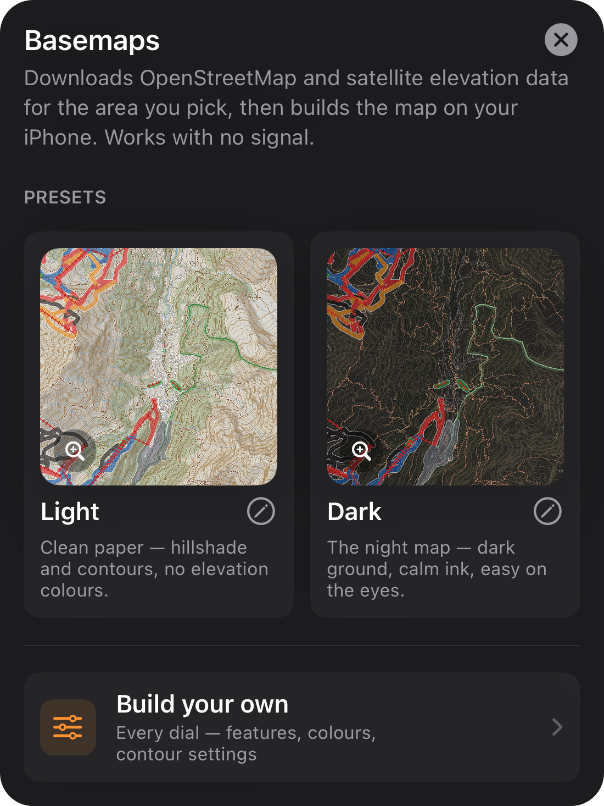
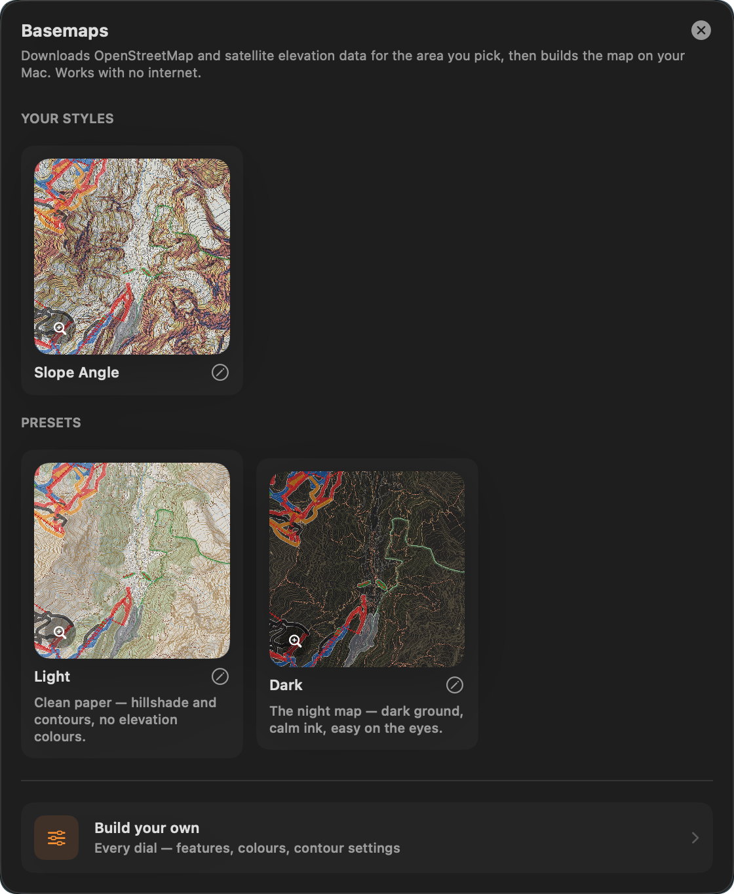
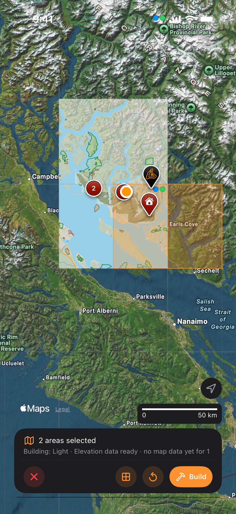
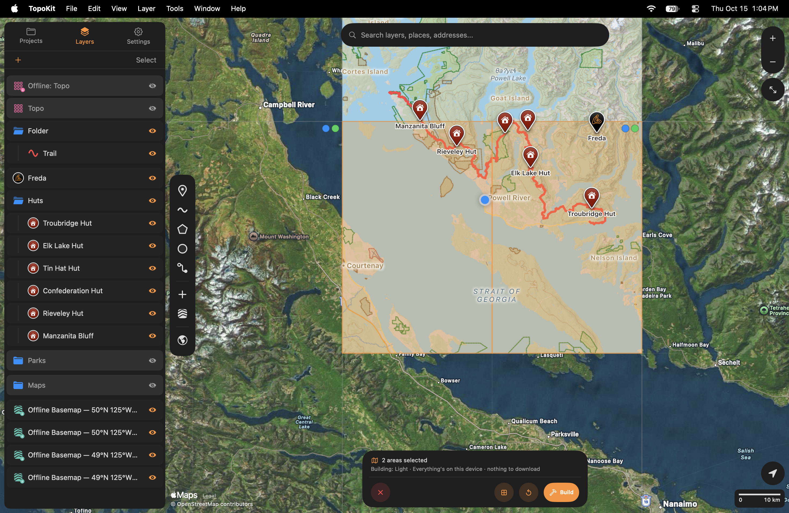
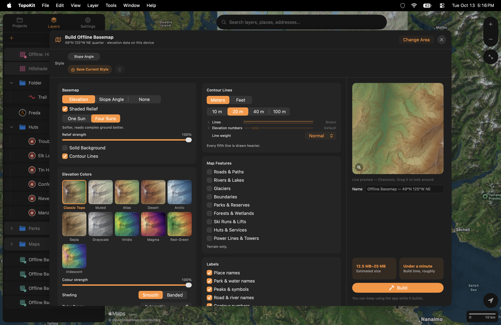
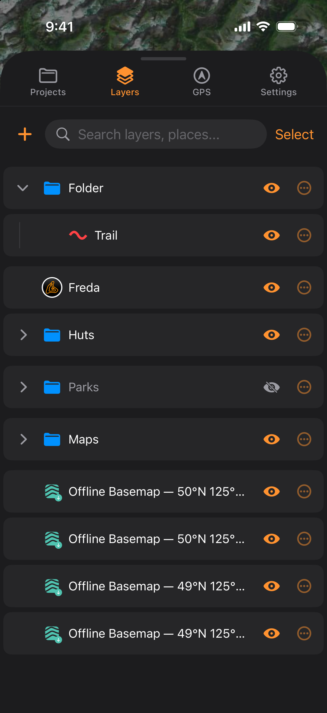
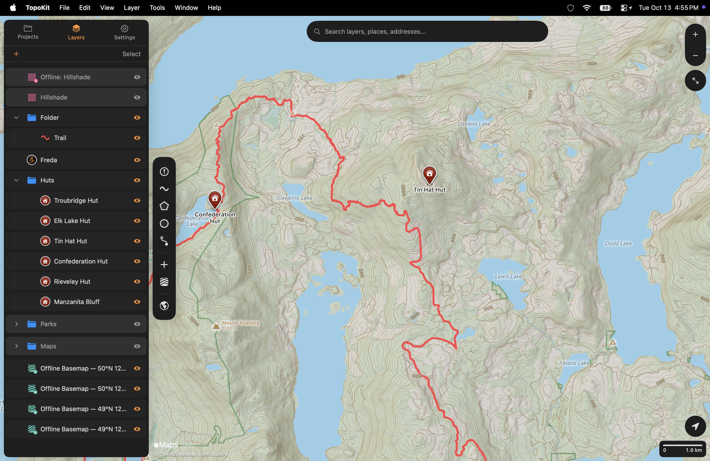
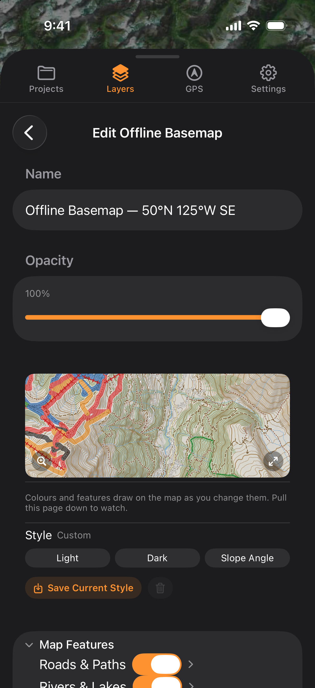

## The Apple Maps switch

To choose which Apple map appears under your layers, tap or click the last button in the tool sidebar. Each tap or click changes the map in this order: :ui[Standard]{icon=map-standard} → :ui[Hybrid]{icon=map-hybrid} → :ui[Satellite]{icon=map-satellite} → :ui[Off]. :mac[On Mac, you can also choose **View → Apple Maps** in the [menu bar](/manual/interface/#the-menu-bar) to select one of these options.]

::::platforms
:::ios
<video src="/media/basemaps-apple-maps-switch-iphone.mp4" autoplay loop muted playsinline aria-label="The Apple Maps button at the foot of the tool sidebar on iPhone tapped four times, with the trail and three huts drawn over Apple's map: Hybrid to Satellite, then Off with the map a plain dark background, then Standard, then back to Hybrid, the button's glyph changing with each"></video>
:::

:::mac
<video src="/media/basemaps-apple-maps-switch.mp4" autoplay loop muted playsinline aria-label="Clicking the Apple Maps button at the foot of the tool sidebar four times, with a label beside it naming each state: the map under a built basemap changes from Hybrid to Satellite, then Off, then Standard, then back to Hybrid"></video>
:::
::::

Hybrid is the default, and your choice is saved on this device rather than in the project. Every project opens with this choice, which does not sync. When you choose **Off**, Apple's map stops loading and your layers appear over a plain background.

## What a basemap is

A basemap is a topographic map that TopoKit builds on your device for an area you choose, using downloaded satellite elevation data and map data. Once built, the basemap appears in your project as a [tile layer](/manual/tile-layers/), and you can view, tap and search it without a connection.

## Building a basemap

1. With a project open, tap :ui[Basemaps] in the tool sidebar. :mac[On Mac, you can also choose **Layer → Build Basemap…**.]
2. In the **Basemaps** chooser, tap **Light**, **Dark**, or a style you saved to choose the look.
3. Tap the map to select each area, or tap a selected area again to deselect it.
4. Tap **Build** on the tool card.

::::platforms
:::ios

:::

:::mac

:::
::::

Each area is built with the look you chose, without opening a setup page. To change the settings before building, tap the pencil beside a look or tap **Build your own**. The button on the tool card changes to **Next**, which opens [the setup page](#the-setup-page).

**Light** and **Dark** show shaded relief and contours over a solid pale or dark ground, without elevation colours. Both turn on all nine map features, so either look downloads the area's map data. Their contour interval follows **Settings → Units & Coordinates → Units**: 20 m for Metric and 80 ft for Imperial.

### Picking the area

Tap the map to select a quarter of a 1° square, or use the quartered-square button on the tool card to switch to whole squares. Selecting a whole square clears any selected quarters within it, and selecting a quarter clears the whole-square selection. To clear every selected area, tap ↺ on the tool card.

Each selected area becomes a separate basemap with its own row. The areas are built square by square, north to south, then west to east.

::::platforms
:::ios

:::

:::mac

:::
::::

The marks in a square's top-right corner show which data is already on this device: a green dot indicates elevation data, a blue dot indicates map data, and a blue ring indicates map data for only some quarters. Building a quarter still downloads the whole square's elevation tile, 25–40 MB, which the other quarters and the [elevation tools](/manual/elevation/#elevation-data-source) reuse.

## The setup page

:ios[On iPhone, **Build Offline Basemap** opens as a page in the Layers tab.] :mac[On Mac, **Build Offline Basemap** opens over the map; `Esc` closes it, and `Return` does not start a build.]

::::platforms
:::ios

:::

:::mac

:::
::::

To return to the map and keep every setting and the name, choose **Change Area**. Closing the setup page any other way discards them. **Name** applies only when you select one area; when you select several, each basemap is named for its own square.

The build button becomes available when you turn on relief, a coloured ground or contours, and stays grey until then.

### Ground and relief

Use the first control on the **Basemap** card to choose the coloured layer under the relief.

- **Solid Background**: When this is on, the basemap covers Apple Maps wherever it draws, using the ground colour set by **Background**. When it is off, the relief shades Apple's map, elevation or slope colours cover Apple's map unless you lower their strength, and Apple's names remain on top, as described in [draw order](/manual/layer-tree/#draw-order).
- **Elevation Colors**: Set **Color Range** to **Automatic** to match a basemap built nearby so neighbouring basemaps share one scale. With this setting, the basemap keeps the range it was built with when you edit it. With **This area only**, the colour can change at the shared edge.
- **Slope Angle**: Slopes are pale under 27°, yellow at 27–29°, orange at 30–34°, red at 35–45°, violet at 46–50°, and blue at 51° and steeper.

To remove a layer, switch it off, as the strength sliders stop at 15%.

### Contour lines

The initial choice of **Meters** or **Feet** follows **Units** and is saved with the basemap. If you change **Units** later, the basemap's contour labels and peak heights keep their original unit. Use **Elevation numbers** to set the colour of contour heights and the names and heights of peaks, huts and places.

### Map features

Use the nine switches to choose which map features appear, as listed in [Reading the map](#reading-the-map). Turning on any one downloads a few megabytes of map data for all nine in that area, so you can turn on the others later without a connection.

A colour set to **Default** uses TopoKit's colour for that feature and can change with an app update. To keep the colour you choose, select a swatch or a custom colour.

Set a weight to **Off** to remove that kind of line. For roads, trails and tracks, this also removes the names of that kind of line, but river names remain. **Road weight** also applies to railways, ferry routes, runways and taxiways, and **Run weight** applies to lifts. Trails follow **Road weight** until you choose a **Trail weight**, and tracks follow **Trail weight** until you choose a **Track weight**.

With **Run colours** set to **Automatic**, a basemap centred between 170° W and 30° W uses North American difficulty colours, and a basemap centred anywhere else uses European colours.

### Labels

Use the switches on the **Labels** card to change which labels appear; each change redraws the map at once without a rebuild. The last column of [Marks and names](#marks-and-names) shows which labels each switch controls. To show **Road & river names**, you also need to turn on the map feature that draws the line.

### Estimates and saved styles

**Build time, roughly** uses the median seconds per tile from this device's recent builds and reads **A minute or two** until one has finished. **Estimated size** always shows a range, using the median size per tile from the same recent builds, up to the last eight. Before the first build, it uses a built-in 18 KB per tile, so a size appears from the start.

To save the look, map features, colours and contour settings for use in the chooser, choose **Save Current Style** on the setup page or in the editor. Saving with a name already in use replaces that style, regardless of capitalisation. Saved styles are stored on this device and do not sync.

To delete a saved style, select its chip and tap the trash, or press and hold its card in the chooser (right-click on Mac) and choose **Delete Style**. Deleting a style leaves basemaps built with it unchanged.

## While it builds

TopoKit builds one area at a time and queues the rest, but quitting TopoKit clears the queue. If a build finishes after you open another project, it does not add a layer. Run the same build in the original project to add the layer without building it again.

If a download stalls, the bar reads **Waiting for connection…**, and the download resumes when data returns.

To stop a build, tap ✕ on the bar. When other areas are queued, **Stop Building?** lets you choose **Stop This Area** or **Stop All**. A stopped build adds no layer and loses nothing, so building the same area again creates only what is missing. Deleting a basemap's row while its area is building stops that build and removes any repeats of it from the queue.

:::ios
On iPhone, a build continues after you leave TopoKit for as long as iOS allows, with a system progress item titled **Building offline basemap**. If iOS stops the build, or you stop it from that item, it starts again when you return unless TopoKit was closed in between. Only ✕ on the progress bar stops the build permanently.

Downloads over cellular data follow **Settings → Storage & iCloud → Large Downloads**, and the bar reads **Waiting for Wi-Fi…** while a download waits for Wi-Fi, as described in [downloads over cellular data](/manual/tile-layers/#downloads-over-cellular-data).
:::

## The basemap in the Layers tab

A basemap's row is named for its square, such as **Offline Basemap — 49°N 126°W**, followed by **NE**, **NW**, **SE** or **SW** for a quarter. A download arrow badge means the basemap is built on this device. If the icon is dimmed and has an orange hammer, use [Build on This Device](#other-projects-and-other-devices) to build it here.

::::platforms
:::ios

:::

:::mac

:::
::::

A new basemap is added at the bottom of the tree, where it draws under everything else, unless it overlaps a top-level basemap. In that case, it is added directly above the overlapping basemap. Building the same area again updates its row instead of adding another one.

To use a basemap in another project, build the area there to reuse what this device has already built; basemaps cannot be [copied or duplicated](/manual/layer-tree/#copying-pasting-and-duplicating).

## Editing a basemap

:ios[On iPhone, tap the basemap's row to open **Edit Offline Basemap**. The page has no **Save** button, and leaving it keeps every change, including the name.] :mac[On Mac, click the row or choose **Layer → Edit Layer…** (`Cmd-I`) to open **Edit Offline Basemap**. Closing the popover keeps every change.]

::::platforms
:::ios

:::

:::mac

:::
::::

Your changes are saved as you make them, and the map continues to show the previous version of each layer until the new one is ready. When the change appears depends on what you edit:

- Changes to colours, weights, the Labels switches and map features whose data is on the device appear at once, without building anything.
- Changes to **Solid Background** and its colour, the strengths, or a look that recombines ground already built appear at once and are finished when you close the editor.
- Changes to the contour interval, elevation colours or relief lighting are built from the elevation data on the device when you close the editor.
- When you add a map feature to a basemap built without any, the map data downloads when you close the editor.

Until a change has been built, its section shows ⏱ before the summary.

To add contours, switch on **Contour Lines** under **Terrain**.

Editing a basemap keeps all ground already built. While a change is waiting, you can choose **Undo Changes** in the footer to return the basemap to how it was when you opened the editor, except for its name and **Opacity**. Basemap edits are not included in the app's undo history.

To check for a newer release of the map data, open the editor with a connection; **About This Basemap** then offers **Refresh Map Data**. Map data does not update automatically.

## Other projects and other devices

Each device stores a basemap's ground (its shading, colours, contours and map data) once per 1° square and shares it among all basemaps covering that square. Each project keeps its own look, so two projects can show the same square as Light and Dark without a second download.

A basemap's settings [sync with the project](/manual/projects-and-files/#icloud-sync), while its built files remain on the device that built them and are excluded from device backups.

When you open a project, TopoKit automatically builds anything its basemaps need that can be made from the elevation data already on this device. If a basemap needs data the device does not have, TopoKit asks **Build Basemaps on This Device?** once per project until TopoKit quits.

To build one basemap with the same area, settings and name, choose **Build on This Device** in the row's menu or in the editor :mac[or, on Mac, in the **Layer** menu]. This option is available only while the basemap has nothing on this device.

## Storage

To delete every basemap's built files and map data on this device, choose **Delete Offline Basemaps** in **Settings → Storage & iCloud → Offline Basemaps**. The rows remain in their projects with the hammer badge until you rebuild the basemaps. Deleting an individual basemap's row removes only ground that no other basemap uses and keeps the area's map data.

**Clear Elevation Data** keeps built basemaps, but a later change that needs new ground downloads the elevation tile again. **Clear Downloaded Map Tiles** also deletes basemaps' map tiles, which are rebuilt from the elevation data the next time you open the project, as described in [Storage & iCloud](/manual/settings/#storage--icloud).

## Credit and licences

The map shows **© OpenStreetMap contributors** under Apple's Legal link at the bottom left while a basemap with map features is visible in the Layers tab and its area is in view. Tap the credit to open the map data's copyright page.

You can find credits for the elevation data and map data in **Settings → About TopoKit → Licenses** :mac[and, on Mac, in **Help → Licenses**].

## Reading the map

To show the features in these tables, turn on at least one map feature so the basemap has map data; only contours do not need it. The colours shown here are those of the Light look, and change when you use Dark or adjust the colour rows.

A mark without a name appears at two-thirds size, except for springs, hot springs, geysers, drinking water, toilets and information. When labels overlap, settlements take priority, followed by area names and named huts, hospitals, ranger stations and lookouts, then named peaks with a height, and finally other named marks.

You can tap anywhere along trails, tracks, ski runs and lifts, and along footpaths, cycleways, steps, sidewalks and crossings when zoomed in close. Roads, rivers and ferry routes respond only when you tap where their name is printed.

### Marks and names

| Card says | On the map | Shown by |
|---|---|---|
| Peak, Volcano | A triangle, or a cone for a volcano, appears with the name and height in the contour unit. Ranges are not marked. | Peaks & symbols |
| Point of interest | An unnamed summit appears as a small dot with its height, and is not shown if it has no height. | Peaks & symbols |
| Pass, Cliff, Rock, Cave, Waterfall | The mark appears when you zoom in close, and its name appears a step closer. | Peaks & symbols |
| Spring, Hot spring, Geyser, Reef | These marks use water blue. | Peaks & symbols |
| Campsite | A tent marks the campsite, and commercial campgrounds also need Huts & Services turned on. | Peaks & symbols |
| Hut | These marks show lodges, cabins and hostels. | Huts & Services, Peaks & symbols |
| Hospital, Ranger station, Pharmacy, Grocery, Fuel | Hospitals and ranger stations are named from the start, and the other marks appear when you zoom in close. Hotels, restaurants and police are not shown. | Huts & Services, Peaks & symbols |
| Lookout tower | The tower is named, and shows a peak's height when it is within 200 m of that peak. | Peaks & symbols |
| Radio tower | Cell masts are not marked. | Power Lines & Towers, Peaks & symbols |
| Viewpoint, Picnic site, Drinking water, Toilet, Information | These marks appear when you zoom in close. Drinking water uses the land colour, so blue indicates a natural source. | Peaks & symbols |
| Gate, Barrier | These marks are never named. | Peaks & symbols |
| Airport, Seaplane base, Heliport, Ferry terminal | Runways are drawn as lines. | Peaks & symbols |
| Railway station, Border crossing | These marks appear only when named. | Peaks & symbols |
| City, Town, Village, Hamlet, Locality, Neighbourhood | The name serves as the mark and is ranked by prominence rather than the word on the card. A dot appears only at the widest views. | Place names |
| Bay | Only the name is shown. | Place names |
| Park, Indigenous land, Forest, Military area, Glacier, Island, Water, Sea | Each area has one name in its colour, with only a few names per screen except for islands. Water, sea and island names disappear when you zoom in close. | Park & water names |
| Cape, Dam | Only the name is shown, and a dam also needs Rivers & Lakes turned on. | Park & water names |

### Lines, edges and tints

| Feature | On the map | Switch |
|---|---|---|
| Highway, Primary road, Secondary road | These are the widest lines, in amber, yellow and pale yellow respectively, with a dark edge. | Roads & Paths |
| Tertiary road, Minor road, Residential street, Service road | These lines are white with a dark edge. Unpaved roads keep their colour and have a dashed edge. | Roads & Paths |
| Track | Tracks use long brown dashes with a pale halo. | Roads & Paths |
| Trail, Bridleway | Trails and bridleways use short brick-red dashes with a pale halo. A named footpath or cycleway is drawn as a trail. | Roads & Paths |
| Footpath, Cycleway, Steps, Sidewalk, Crossing | Footpaths, cycleways and steps use short grey dashes, while sidewalks and crossings use thin, solid pale-grey lines. | Roads & Paths |
| Railway, Ferry route, Runway, Taxiway | Railways use thin dark-grey dashes, ferry routes use thin blue dashes, and runways and taxiways use solid grey lines. | Roads & Paths |
| River, Stream, Canal; lakes, reservoirs, sea | These lines are blue, with rivers the heaviest and seasonal streams dashed. Water bodies use one flat blue. | Rivers & Lakes |
| Dam, weir | These features use a grey area or bar, with a dashed line for a weir. | Rivers & Lakes |
| Glacier | Glaciers are translucent white-blue with a thin dashed blue edge. | Glaciers |
| Borders | Borders are plum and appear only on land. Country borders use dash-dot-dot lines, province or state borders use dash-dot lines, and county or district borders use short dashes when you zoom in close. | Boundaries |
| Park and reserve edges | A dashed edge has a soft inner band, in green for parks, brown for indigenous land, dark green for forest reserves and muted red for military areas. | Parks & Reserves |
| Forest, wetland, scrub, grass, moss, cropland, snow | Tints are mixed into the relief and fade when you zoom in close. | Forests & Wetlands |
| Ski run | A translucent band uses green for easy runs and blue for intermediate runs with North American colours, or blue for easy runs and red for intermediate runs with European colours. The other colours are black for advanced, green for novice, orange for freeride and grey for unrated runs. | Ski Runs & Lifts |
| Gondola, Chairlift, Cable car, Surface lift | These lifts use red lines with crossbar ticks. | Ski Runs & Lifts |
| Power line | A fine slate line shows pylons as small squares when you zoom in close. Distribution lines are not drawn. | Power Lines & Towers |
| Contour | Contours are brown, and every fifth line is heavier and labelled with its height. | Contour Lines; Contour numbers |

## FAQ

**Why does the shading go soft when I zoom in close?**
Relief, colours and slope are built at one level of detail from 30 m elevation samples and enlarged when you zoom in beyond that level. Two levels beyond it, they fade toward the **Background** colour, but there is no colour to fade toward when **Solid Background** is off. Contours, features and names are drawn as lines, so they stay sharp.

**Can I get a deleted basemap back?**
[Deleting](/manual/layer-tree/#deleting) a basemap does not add a step to the [Undo](/manual/interface/#undo-and-redo) history. To get the basemap back, build the same area again to reuse any ground still stored on this device.

**Why are there no country names or sea depths?**
Country names and sea depths are not drawn: borders are never named, and Rivers & Lakes shows the sea as one flat blue.
