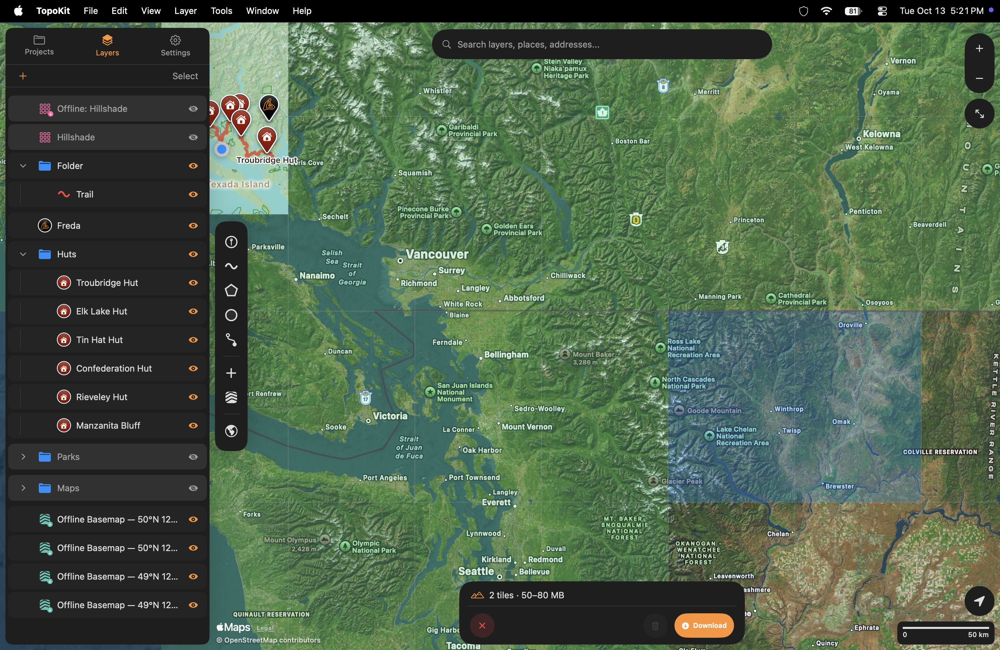

You can read ground heights and view elevation profiles without a connection after downloading elevation tiles. TopoKit uses one elevation model and stores each tile on your device.

## Elevation data source

TopoKit uses [Copernicus GLO-30](https://spacedata.copernicus.eu/collections/copernicus-digital-elevation-model), which is distributed as 1° × 1° tiles. Each value covers about 30 metres of ground.

- Terrain features narrower than about 30 metres, such as a gully or a levee bank, are not included in the model.
- Heights are measured above sea level rather than above the ellipsoid, and the two differ by tens of metres in most places.
- The model includes trees and buildings, so heights in a forest are partway up the trees, and heights in a town are at roof level.
- The surface was surveyed between 2011 and 2015, so the model does not reflect changes to the ground since then.

## Downloading tiles

You can download elevation tiles from the places described below or by [building a basemap](/manual/basemaps/#building-a-basemap) over an area whose tile is not on your device. A tile downloads only when you ask for it.

Whichever method you use, TopoKit stores the tile in its own data area rather than a cache, and keeps it until you remove it. Tiles are stored for the device rather than a project and never sync through iCloud, so you need to download them on each device.

:ios[On iPhone, **Settings → Storage & iCloud → Large Downloads** controls elevation downloads over cellular data, as described in [Downloads over cellular data](/manual/tile-layers/#downloads-over-cellular-data).]

### When a tile is missing

When an elevation tile is missing, each place that reads heights asks you before downloading it:

- In a profile, the message "This line needs N elevation tiles that are not on this device." appears with **Download N tiles** and an estimated size. The estimate uses 41.9 MB a tile, so the download is usually smaller. When there is no connection, the profile tells you and offers no download. It checks the connection when it opens, so reopen it after you are back online. Closing the profile cancels the download.
- In a point's editor, **Get Elevation** appears with "(25–40 MB download)" beside it, and the download starts as soon as you tap it.
- On a spot's card, the message "Terrain for this spot is not downloaded." appears with a **Download** button that shows the size for that one tile.

### The elevation grid

1. With a project open, choose **Download Elevation…** from the :ui[Add Data]{icon=plus} menu on the tool sidebar or the :ui[plus]{icon=plus} menu in the [Layers tab](/manual/layer-tree/). :mac[On Mac, you can also choose it from the **Layer** menu.]
2. Tap or click squares to select them.
3. Choose **Download**.

::::platforms
:::ios

:::

:::mac

:::
::::

:ios[On iPhone, opening the grid ends any tool in progress and discards an unfinished drawing.]

The colour of each square shows the tile's state:

- **Green** means the tile is on the device.
- **Blue** means the tile is selected for download.
- **Red** means the tile is on the device and selected for deletion.
- **Grey** means the last download found no tile there, and you can tap the square to select it and try again.
- **No square** means the dataset publishes no tile there.

If you cancel a download, tiles that have finished downloading stay on the device. If a connection drops, a timeout occurs or the server returns an error, TopoKit allows up to three attempts in total to download the tile. However, if an attempt does not finish within 15 minutes, including time spent waiting for a connection, it fails and TopoKit makes no further attempts. A tile that still fails is not stored, and you can select its square to try again.

To remove tiles, select their squares, then choose the trash button on the tool card and confirm. The button turns red when a red square is selected, and removes only the tiles selected in red.

### Removing tiles

You can also remove tiles in [**Settings → Storage & iCloud → Elevation Data**](/manual/settings/#storage--icloud), where **Manage Tiles** deletes one tile at a time and **Clear Elevation Data** deletes them all.

Each tile is named by its south-west corner, so N49° W123° covers 49° to 50° north and 123° to 122° west.

## Coverage gaps

The dataset covers Antarctica, but publishes no tiles over open ocean or north of 84°N. The release TopoKit uses also excludes Armenia and Azerbaijan, along with every 1° square that touches either country. These squares include neighbouring ground in Georgia, Turkey, Iran and Russia, with Tbilisi and Tabriz among the excluded places. In all these excluded areas, there is no square to select and no height is returned.

Where terrain data is missing, the profile shows a hole with a dashed line joining the heights on either side and no fill beneath it. The dashed stretch does not represent data.

The line above the chart shows the length with no terrain data in orange, for example, "850 m with no terrain data". This includes areas where the dataset publishes no tile and areas where a tile on the device has no value under the line.

## Disk space

Allow 25–40 MB for each tile, which covers about 111 km from north to south. Tiles become narrower from east to west farther from the equator.

## Elevation at a point

TopoKit calculates a point's height by finding the tile that covers it and interpolating between the four surrounding values. If any of the four is missing a value, the result is empty rather than zero.

When the tile is on the device, the **Elevation** section in a point's editor fills in automatically; there is no field for typing a height. The height is saved with the point and appears on its card, as described in [Editing a feature](/manual/points-lines-polygons/#editing-a-feature). Over open sea, or where the tile has no value, the section reads "Not available" and nothing is saved.

### Height, slope and aspect at a spot

You can read the ground height anywhere without creating a point by [opening a spot's card](/manual/search-and-identify/#holding-a-spot-and-the-place-card).

When the spot's tile is on the device, the card shows **Elevation**, **Slope** and **Aspect** first.

- **Slope** and **Aspect** are calculated from four heights 45 m north, south, east and west of the spot, so they describe a patch about 90 m across rather than the spot itself.
- **Aspect** shows the downhill compass direction and appears only where the slope is 1° or more.
- If one of the four neighbouring heights has no value, such as just across the edge of a tile that is not on the device, the card shows only **Elevation**.

## The elevation profile

You can view an elevation profile along any drawn or imported line, a recorded track, a saved route, or a trail, road or other line on a basemap you built. The profile charts the ground along the line; polygons and circles have no profile.

To open a profile, choose **Elevation profile** on a line's [card](/manual/search-and-identify/#the-card), or **Elevation Profile** in the line's menu in the [Layers tab](/manual/layer-tree/) or in its editor. :mac[On Mac, you can also choose **Elevation Profile** from the right-click menu on a line or the **Layer** menu.]

:::mac
<video src="/media/elevation-profile-hover.mp4" autoplay loop muted playsinline aria-label="The elevation profile of the saved line Trail, which follows the Sunshine Coast Trail, open under the map on a Mac: the pointer moves along the chart and a marker follows along the trail on the map, then a drag across the chart selects a stretch, which lights on the map while the numbers switch to the stretch's own"></video>
:::

Move the pointer over the chart or drag a finger along it to see the height and distance at that location. A marker on the map moves to the corresponding place on the line.

At the foot of the profile, you can use the card's [**Zoom to** and **Share** buttons](/manual/search-and-identify/#the-cards-buttons). **Share** is not available when you open the profile from the Layers tab, the line's editor or the **Layer** menu.

For a named trail or road on a basemap, the profile covers its whole length rather than just the stretch you tapped. For an unnamed trail or road, it covers the stretch outlined on the map.

Opening a profile from the Layers tab, the line's editor or the **Layer** menu ends any tool in progress and discards an unfinished drawing.

The profile samples the ground about every 30 m to match the model's spacing, and also samples every vertex. This means a GPS track with fixes a few metres apart is sampled at every fix.

The height scale adjusts to fit the heights in view, with a minimum of 20 m (66 ft) from top to bottom. As a result, a gentle grade can look steep, and two profiles are rarely on the same scale.

You can read the following numbers under the chart:

- **Distance** is the length charted by the profile, including any gap between its parts. It excludes side pieces left out of the profile and the second side of a line drawn twice.
- **Gain** and **Loss** show the total climb and descent, counting a rise or fall as soon as it reaches 4 m (13 ft) from the last counted height. This threshold is the terrain model's own error from one point to the next. Any smaller change remaining at the end of the line or a selected stretch, or at the edge of a hole in the data or a gap between two parts of a line, counts too. This remaining change is why, without a hole or gap, gain minus loss equals the change in height from start to end. A step across a hole or gap is not counted.
- **Min**, **Max** and **Avg** are calculated from the samples, so **Max** does not include a summit between two samples. **Avg** gives every sample equal weight, so on a GPS track, stretches where the fixes are closest together have more influence on the average.

All six use **Settings → Units & Coordinates → Units** rather than the units the measuring tools start with, as described in [Units & Coordinates](/manual/settings/#units--coordinates). Tap or click a number to copy it.

### Selecting and zooming

Select a stretch to see its climb and descent. :mac[On Mac, drag across the chart.] :ios[On iPhone, hold a finger on the chart for a moment, then drag; dragging without holding first only moves the marker.] The selected stretch is highlighted on the map and has a handle at each end on both the map and the chart. To move either end, drag its handle on the chart. A selection under 50 m is discarded.

::::platforms
:::ios
<video src="/media/elevation-profile-select-iphone.mp4" autoplay loop muted playsinline aria-label="The elevation profile of the Sunshine Coast Trail on iPhone: a finger runs along the chart and the marker follows along the trail on the map, a hold and a drag select a stretch whose Selection, Gain, Loss, Min, Max and Avg replace the line's figures, a pinch zooms the chart to part of the line and the map to the same stretch, and a double tap on the bar along its foot shows the whole line again on both"></video>
:::

:::mac

:::
::::

Pinch the chart to zoom into part of the line; the smallest stretch you can view is 200 m or 2% of the line, whichever is longer. To show the whole line again, double-click or double-tap the bar along the foot of the zoomed chart.

### The line above the chart

When the chart has notes, the line above it shows only the first, which may describe a length with no terrain data, gaps between the line's parts or side pieces left out of the profile. Tap or click the note, or the line when it is at rest, to open a short explanation of where the heights come from and how **Gain** and **Loss** are counted, along with every chart note in full.

Until you first select a stretch on each device, the line at rest explains how to select one instead, and tapping or clicking it opens nothing.

### Recorded tracks and lines in several parts

A recorded track is charted in the order it was travelled, whether it was recorded in TopoKit or imported from another app with times recorded for its points. The profile uses heights from the terrain model rather than the [recorded altitudes](/manual/gps-and-track-recording/#trip-statistics), so its **Gain** and **Loss** can differ from the track's own figures.

On a line with several parts, a jump of 100 m or less between parts is charted as ground. A longer jump is included in **Distance** but shown as a gap, with a dashed line like a hole in the data.

### A profile while you draw

To view a profile while drawing, choose **Elevation profile** on the :ui[Add Line]{icon=add-line} or :ui[Add Route] tool card. You can continue editing the drawing with the profile open, and the chart redraws after each point you add, move or delete. Each update clears any selected stretch or zoom window.

A route is charted along the roads its legs follow.

## FAQ

**Can TopoKit read heights from my own DEM or lidar?**
TopoKit reads all ground heights from the Copernicus model. If you import a DEM as a [raster](/manual/raster-overlays/), it appears as an image and is never used to read heights.

**Why does no grid appear when I choose Download Elevation…?**
Zoom in until the squares appear; the grid is drawn only when a 1° square is large enough on screen.
