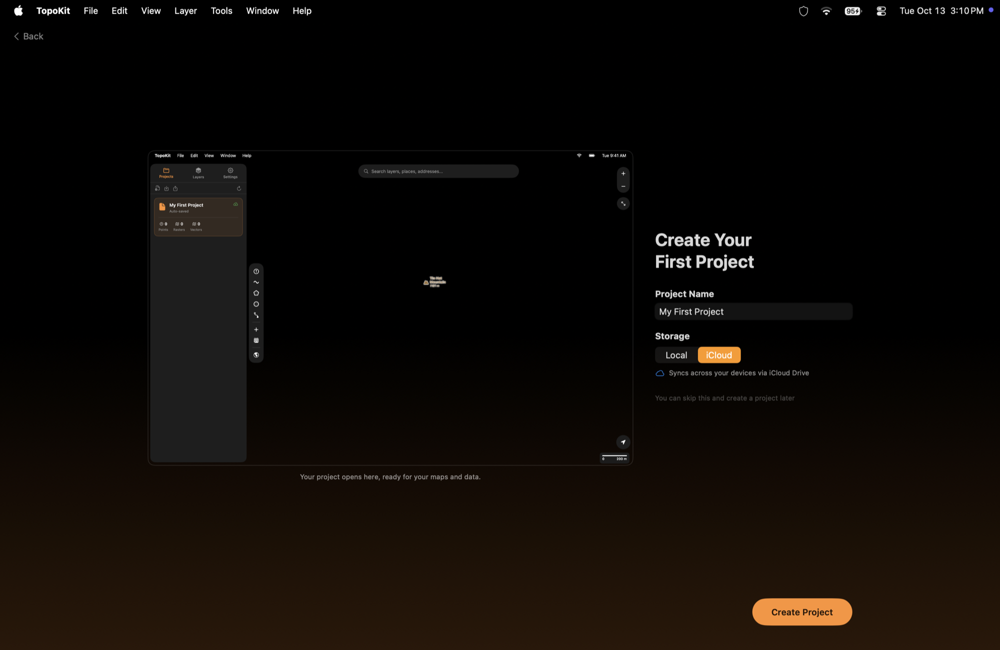
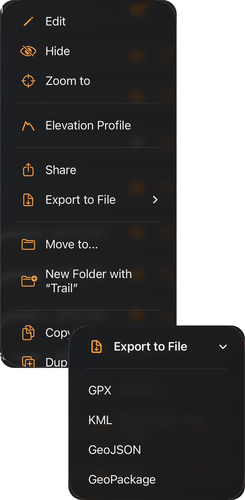
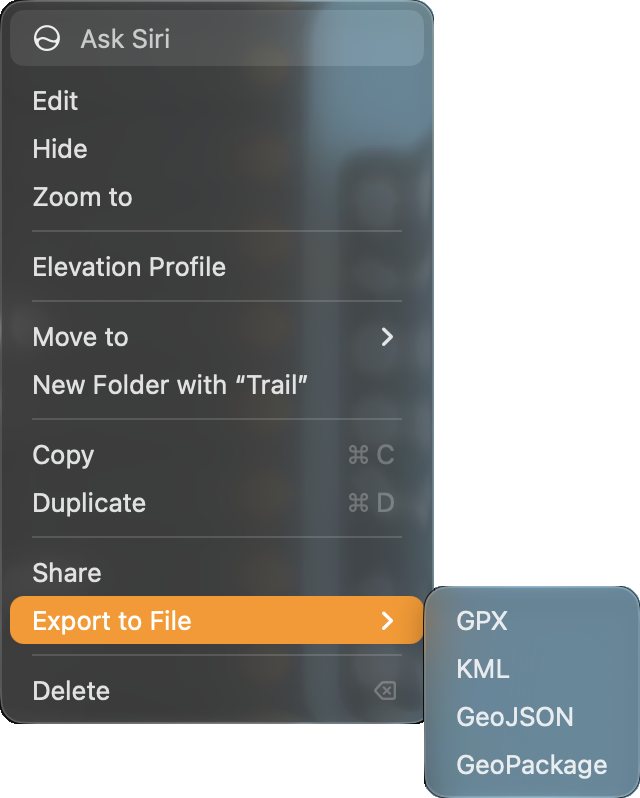

## The first launch

A new install opens with an introduction where you choose your appearance and units and create your first project before you use the map. The introduction has eight pages on iPhone and seven on Mac, where there is no permissions page.

**Customize Your Look** and **Units & Coordinates** set the same options as **Settings → Appearance** and **Settings → Units & Coordinates**, where you can change your choices later. :ios[On iPhone, you can choose which side the tool sidebar appears on in **Settings → Toolbar & Haptics → Position**.] :mac[On Mac, you can choose the panel side in **Settings → Appearance → Panel Position**.]

:ios[On iPhone, **TopoKit Needs Your Permission** asks for Location, Camera and Photo Library access up front. If you skip Location permission, TopoKit asks for it when you open the **GPS** tab, and if you skip Camera permission, it asks when you tap **Take Photo**. If you deny a permission, you can turn it on later in the iPhone's Settings app under TopoKit, not in TopoKit's Settings; GPS tracking and **Take Photo** do not work until you do. You can choose a photo from the library without granting permission.] :mac[On Mac, TopoKit asks for each permission when a feature first needs it.]

On **Create Your First Project**, the project name starts as **My First Project**, and **Storage** appears only when iCloud is available, with **iCloud** selected. The project you create here is open when the introduction ends.

:::mac

:::

:::ios
On iPhone, tap **Skip** at the top right to go from any of the first three pages to the permissions page. On the project page, tap **Skip** to open the story without creating a project, or tap it on the story to open the plans.
:::

:::mac
On Mac, click **Skip** at the top right to go from any of the first three pages to the project page, or from the story to the plans. You can also press `Esc` to end the introduction at once; no project is created unless you have already pressed **Create Project**. Pressing `Return` activates the page's main button, including **Create Project**.
:::

To run the introduction again from its first page, choose **Settings → Help & Feedback → Replay Introduction**. If you choose **Create Project** during the replay, TopoKit creates another project and opens it in place of the current one. :mac[On Mac, you can also replay the introduction with **Help → Replay Introduction**.] :ios[On iPhone, tap **Skip** on the project page to keep your current project.]

When the introduction ends, TopoKit shows the safety notice **Before you head out**, which appears once on each device and is described in [Your TopoKit](/manual/your-topokit/#the-safety-notice).

## Create a project

A project contains everything for one job: points, lines, polygons, rasters and photos. If you skipped creating a project in the introduction, create one here before using the tools, because every button in the tool sidebar except the Apple Maps switch is dimmed when no project is open. When you create another project, TopoKit saves the open project and opens the new one in its place.

:::ios
1. In the **Projects** tab, tap the new-project button at the top left.
2. Name the project, then tap **Create in iCloud** or **Create Locally**. When iCloud is unavailable, the only button is **Create**.
:::

:::mac
1. Click the new-project button at the top of the **Projects** tab, or choose **File → New Project…** (`Cmd-N`).
2. Name the project, choose **Local** or **iCloud** when the switch is shown, then click **Create**.
:::

You can [move a project between iCloud and this device](/manual/projects-and-files/#renaming-moving-and-deleting) later.

## Choose a map

Use the **Apple Maps** button at the bottom of the tool sidebar to cycle through :ui[Standard]{icon=map-standard}, :ui[Hybrid]{icon=map-hybrid}, :ui[Satellite]{icon=map-satellite} and :ui[Off]. Standard, Hybrid and Satellite load from Apple over the network, as described in [Basemaps](/manual/basemaps/#the-apple-maps-switch).

To use a map without a connection, build a basemap:

1. Tap **Basemaps** in the tool sidebar, directly above the Apple Maps button.
2. Tap **Light** or **Dark**.
3. Tap the map to choose the area, adding a quarter of a 1° square with each tap.
4. Tap **Build** to close the picker and build the areas one after another.

::::platforms
:::ios

:::

:::mac

:::
::::

TopoKit downloads elevation and map data for the area once, then builds the basemap on the device so you can use it offline. To build larger areas or choose your own look, follow the instructions in [Building a basemap](/manual/basemaps/#building-a-basemap).

## Mark a point

1. Tap :ui[Add Point]{icon=add-point}.
2. Tap the map where you want the point, or tap the orange :ui[location]{icon=location} button on the tool card to place it at your current location. The button appears only when TopoKit has location access.
3. Name the point, choose its style and add a photo if needed, then tap **Create**. The **Create** button stays dimmed until you enter a name.

::::platforms
:::ios

:::

:::mac

:::
::::

For all the other ways to add a point, follow the instructions in [Adding a point](/manual/points-lines-polygons/#adding-a-point).

## Draw and measure

1. Tap :ui[Add Polygon]{icon=add-polygon}, then tap the corners of the area. As you draw, the tool card shows the area, perimeter and point count. You can drag a corner to move it or pull out the faint dot between two corners to add another corner.
2. Tap a figure to copy it.
3. Once the shape has three corners, tap **Save**, name it in the editor that opens, then tap **Create**. To discard the shape instead, tap ✕ on the tool card.

::::platforms
:::ios
<video src="/media/getting-started-draw-and-measure-iphone.mp4" autoplay loop muted playsinline aria-label="Drawing a polygon round Inland Lake on iPhone: each tap on the shoreline adds a corner, a length appears along each side, and the card's Area, Perimeter and Points update as the shape grows, then a tap on Area copies the figure and Copied shows in its place"></video>
:::

:::mac
<video src="/media/getting-started-draw-and-measure.mp4" autoplay loop muted playsinline aria-label="Drawing a polygon round Inland Lake on a Mac: each click adds a corner and a length appears along each side while the tool card updates Area, Perimeter and Points, then a corner is dragged, and Save opens the New Polygon sheet"></video>
:::
::::

A ring marks the corner you last placed or touched, and the next corner is added after it. To reverse the newest change, tap **Undo** on the card, as described in [Adding lines, polygons and circles](/manual/points-lines-polygons/#adding-lines-polygons-and-circles).

You use the same tools to draw and measure; saving is the only difference. :ui[Add Line]{icon=add-line} shows distance and bearing in the same way. The figures are not stored with the shape, but you can tap a saved polygon to see its area and perimeter again. For details about the units and earth model used for each figure, read [Units](/manual/measurement/#units) and [Calculation methods](/manual/measurement/#calculation-methods).

## Prepare for offline

Before you go offline, save three kinds of map data on the device. To download map tiles and elevation, open the :ui[Add Data]{icon=plus} menu in the tool sidebar:

- Choose **Download Map Tiles…** to save an area of a tile layer you added with **Add Tile Layer…** in the same menu.
- Choose **Download Elevation…** to save the terrain data used for heights and elevation profiles.

Downloaded tiles, downloaded elevation and a basemap's map data are stored on the device, not in the project, so you need to save them on each device you use.

::::platforms
:::ios

:::

:::mac

:::
::::

A local project is always on the device, while an iCloud project downloads when you open it. To keep a copy that iCloud cannot remove to free space, choose **Save Offline** from the :ui[Project options]{icon=ellipsis} menu on the project's row in the Projects tab. :mac[On Mac, you can also choose **File → Save Offline** for the open project.]

Use the checklist in [Before you go offline](/manual/offline/) to prepare your data, and follow [Offline pinning](/manual/projects-and-files/#offline-pinning) to keep projects on the device.

:::ios
## Record a track

1. Open the **GPS** tab and tap **Record Track**. You need an open project to record a track.
2. When you finish, tap **Stop Recording**, then **Save Recording**. Stopping pauses the track, so you can tap **Cancel** in the alert to resume recording.
3. Name the track and tap **Save**. If you leave the name blank, TopoKit uses Track followed by its start date and time, and if the recording has no points, nothing is saved.

TopoKit continues recording when the screen is off or another app is open, and saves the track as a line with its distance, time and elevation statistics. You can read about profiles and auto-pause in [Recording profiles](/manual/gps-and-track-recording/#recording-profiles) and [Auto-pause](/manual/gps-and-track-recording/#auto-pause).
:::

## Export your data

:ios[On iPhone, tap :ui[Layer options]{icon=ellipsis} on a feature's or folder's row in the **Layers** tab and choose **Export to File**.] :mac[On Mac, right-click the row and choose **Export to File**, or select it and choose **Layer → Export to File…** (`Cmd-E`).] Choose GPX, KML, GeoJSON or GeoPackage, then choose where to save the file, which is named after the row.

::::platforms
:::ios

:::

:::mac

:::
::::

To export the shape from [Draw and measure](#draw-and-measure), choose KML, GeoJSON or GeoPackage, because [GPX](/manual/import-and-export/#gpx) does not include polygons. Only vector features can be exported; you can read about the formats and sharing options in [Exporting and sharing](/manual/import-and-export/#exporting-and-sharing).

## FAQ

**Do I need to save my work?**
TopoKit [saves the open project](/manual/projects-and-files/#saving) two seconds after your last change, so you don't need to save it yourself. :mac[On Mac, you can save at once with **File → Save** (`Cmd-S`).]

**How do I bring in the GPX, KML or GeoTIFF files I already have?**
To [import a file](/manual/import-and-export/#importing-a-file), tap :ui[Add Data]{icon=plus} in the tool sidebar and choose **Add Vector Layer…** or **Add Raster Layer…**. :mac[On Mac, you can also drag the files onto the open project's map.] Each vector file becomes a folder of features, while each GeoTIFF or GeoPDF becomes one [raster overlay](/manual/raster-overlays/).

**Can I record a track on my Mac?**
You can record tracks only on iPhone, but recording into an iCloud project makes the track appear on your Mac with the rest of the project.
