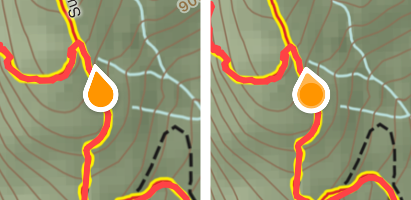
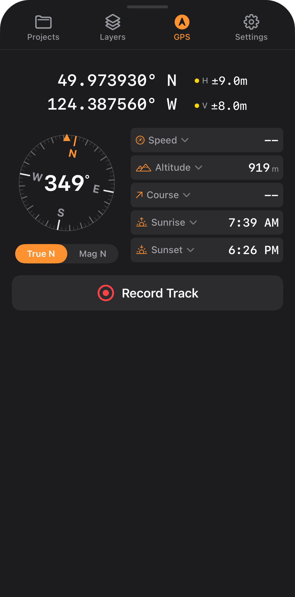
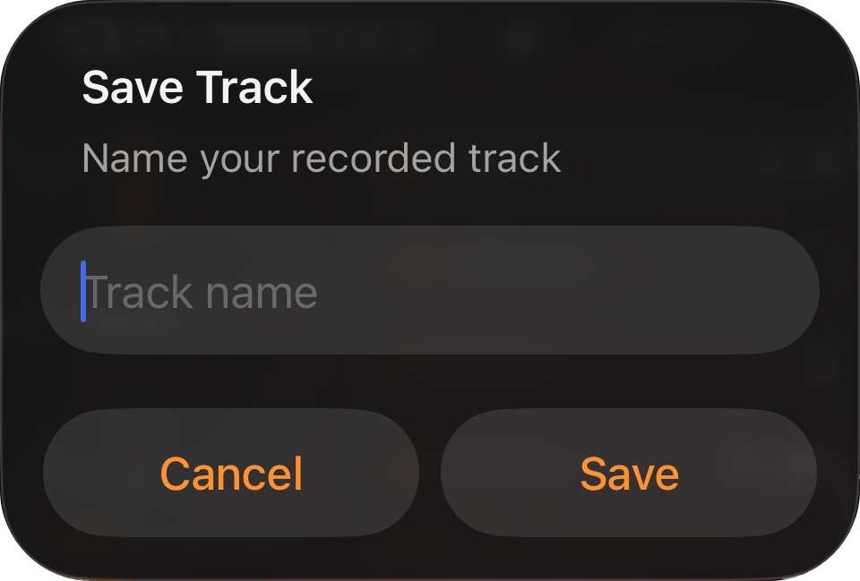
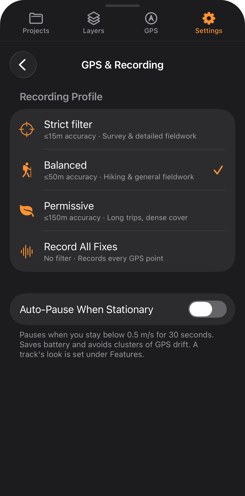

:mac[On Mac, TopoKit shows your position on the map and the tracks that [sync](/manual/projects-and-files/#icloud-sync) from iPhone, but does not record tracks.]

## Location permissions

:::ios
On iPhone, TopoKit asks for access to your location while the app is in use, on the introduction's permissions page during [the first launch](/manual/getting-started/#the-first-launch). If you skip that page, TopoKit asks the first time it needs your position.

When iOS's **Precise Location** switch is off, iOS provides only approximate positions, and every profile except **Record All Fixes** rejects nearly every fix. During a recording in this state, a **Precise Location Off** banner appears with a **Settings** button that opens TopoKit's page in iOS Settings.

If you deny location access, the GPS tab shows **Location Access Required** with an **Open Settings** button. If access is revoked during a recording, the tab shows a **Location Access Revoked** banner with a **Settings** button that opens TopoKit's page in iOS Settings. This does not end the recording, so you can still pause it, stop and save it, or delete it.
:::

:::mac
On Mac, you are asked for location permission only when you use the map's location button or choose **View → Show My Location** (`Cmd-L`). Until you grant permission, the map does not centre on you when it opens, and the Add Point card has no :ui[location]{icon=location} button.
:::

## The location dot

:::ios
On iPhone, an orange dot marks your position on the map, and a pointer on the dot shows the direction your phone faces. The pointer is sharp when the compass is accurate to 10° or better, becoming rounder and fainter as accuracy drops and reaching its faintest at 45° or worse. The dot has no pointer when there is no usable compass reading or Precise Location is off. When the fix's horizontal accuracy is worse than 5 m, a circle around the dot shows that accuracy.

:::

:::mac
On Mac, the map marks your position with the system's blue location dot. The dot has no pointer and there is no heading, because TopoKit does not read a compass on Mac.
:::

:::ios
## The GPS tab

Your coordinates appear at the top of the tab as latitude and longitude or a single UTM line, in the format set under [Settings → Units & Coordinates](/manual/settings/#units--coordinates). **H** and **V** show horizontal and vertical accuracy, each after a dot that is green up to 5 m, yellow up to 15 m, orange up to 50 m and red beyond. A grey dot and `--` mean iOS is not reporting that figure, most often vertical accuracy.

### The compass

The dial uses your iPhone's compass to show where the phone points. Your direction of travel appears in **Course**, which shows `--` when iOS is not reporting a direction, such as when you stand still.

**True N** and **Mag N** below the dial share the **Settings → Units & Coordinates → Bearing** setting, so tapping **Mag N** here also changes which north the [measuring tools](/manual/measurement/#bearing) start with.

### The stat slots

Tap a slot's label to choose from nine readings, including the following:

- **Dist. Traveled** counts distance from when you open the tab, whether or not you are recording. It starts at zero each time you return to the tab, so it does not match the Speed card's **Distance**. It ignores fixes of 50 m or worse and any step of 500 m or more.
- **Mag Declination** shows the declination that **Mag N** subtracts from a true bearing. The value comes from the phone's compass and appears in degrees with **E** or **W**.
- **Sunrise** and **Sunset** are calculated on the phone from your position and the date. They appear in the phone's time zone rather than the local time zone at your position, or as "N/A" during polar day or night.

You can copy a coordinate, an accuracy figure, the compass heading or a stat's value by tapping it. Coordinates are copied in the format shown, stats include their units, and the compass heading uses whichever north is set.

## Recording a track

Tracks are recorded into the open project, so if none is open, **Record Track** asks you to open or create one from the [Projects tab](/manual/projects-and-files/#creating-a-project).

1. Open the **GPS** tab.
2. Tap **Record Track**.
3. Tap the pause button for a rest break, and again to resume.
4. Tap **Stop Recording** when the track is finished.

During a recording, including while it is paused, the GPS tab is red and the line below the buttons shows the profile in use. The line adds "· Paused" when you pause the recording or auto-pause pauses it.

If 60 seconds pass without an accepted fix, a **No recent GPS fixes** banner appears and the recording continues. You can dismiss this banner or **Precise Location Off** to hide it for the rest of that recording only, but **Location Access Revoked** cannot be dismissed.

Each time recording resumes, a new segment starts in the saved track, so the map draws no line across the part you did not record. A gap longer than 60 seconds between accepted fixes also starts a new segment.

## Saving a track

Tap **Stop Recording** to pause the recording and open the **Recording Paused** alert, where you can tap **Cancel** to resume. To delete a recording, tap **Delete Recording** or the trash button beside the pause button. Both ask for confirmation, and a deleted recording cannot be recovered.

Tap **Save Recording** to open the **Save Track** prompt, where **Cancel** also resumes the recording. If you leave **Track name** blank, the track is named after the moment you tapped **Record Track**, such as "Track 2026-10-08 14:30". No track is saved if the recording has no accepted fixes.

The track is saved to whichever project is open when you save, rather than the one open when you tapped **Record Track**. If the project was closed during the recording, saving creates a project named "Recorded Track" followed by the start date, such as "Recorded Track 2026-10-08".

The saved track appears at the top of the [Layers tab](/manual/layer-tree/) as a line feature, using the style in [**Settings → Features → Tracks → Default Style**](/manual/settings/#features). If **Randomize Colour** is on, its colour is picked at random from twelve colours for each track, while its width, pattern and opacity still come from **Default Style**. This style is copied onto the track when you save it, so later changes to the default style do not change saved tracks.

## Background recording and recovery

A recording continues when your phone is locked or you are using another app, and the system's location indicator stays lit.

To keep the screen on during a recording, set [**Settings → Map → Keep Screen On**](/manual/settings/#map) to **While Recording**. The screen stays on from when you tap **Record Track** until the track is saved or deleted, including while the recording is paused.

TopoKit saves a snapshot of the track every 30 seconds or 100 metres, whichever comes first, and whenever you pause or leave the app. If iOS ends TopoKit, you force-quit it, it crashes or the battery dies, a **Recover Track?** alert appears the next time you open TopoKit, once your last project has opened.

Tap **Recover** to add the track to the open project or to a new project with a name such as "Recovered Track 2026-10-08". You can also tap **Discard** to delete it, or **Not Now** to leave it for the next launch. TopoKit offers one recording per launch, starting with the newest.

No alert appears for a track already saved into the open project before TopoKit ended, a recording whose last snapshot is more than 30 days old, or a recovery file TopoKit cannot read.

A recovered track has a name such as "Track 2026-10-08 14:30 (Recovered)" and has `track_recovered` set to `true`. TopoKit recalculates its statistics from the points, so its speeds and moving time can differ from what the cards showed.

## Recording profiles

To choose a recording profile, use [**Settings → GPS & Recording → Recording Profile**](/manual/settings/#gps--recording). TopoKit reads this setting when you tap **Record Track**, so changing it takes effect on the next recording.

| Profile | Distance filter | Accuracy threshold | Jump threshold | Max velocity | Desired accuracy |
| --- | --- | --- | --- | --- | --- |
| Strict filter | 3 m | ≤15 m | 200 m | 15 m/s | Best available |
| Balanced (default) | 8 m | ≤50 m | 500 m | 40 m/s | Best available |
| Permissive | 20 m | ≤150 m | 1000 m | 150 m/s | Nearest 10 m |
| Record All Fixes | 0 m | none | none | none | Best available |

Permissive uses **Nearest 10 m**, which lets iOS use lower-power positioning and reduces power use.

## Auto-pause

To pause recording automatically when you stop, turn on **Settings → GPS & Recording → Auto-Pause When Stationary**. The recording pauses once the reported speed stays below 0.5 m/s for 30 seconds and resumes when you move at 1.0 m/s or more.

Auto-pause uses the speed reported by each fix rather than the change in position. It checks that speed before a fix is dropped for being too close to the last point, so those fixes still count toward a pause.

## How fixes are filtered

TopoKit applies four checks to each fix:

1. **Accuracy**: Horizontal accuracy must be 0 or more and no worse than the profile's threshold. Record All Fixes skips the threshold but still rejects fixes iOS marks invalid.
2. **Age**: Fixes older than 10 seconds are rejected on every profile, so a recording is never back-filled with cached positions after a signal gap.
3. **Distance**: A fix closer to the last point than half the profile's distance filter is dropped without counting as a rejection.
4. **Impossible jumps**: A fix is rejected only when its distance from the last point exceeds the jump threshold and its implied speed exceeds max velocity.

The Time card's **Rejected** row counts rejections from checks 1, 2 and 4, and appears once a fix has been rejected.

## Trip statistics

When you start a recording, three cards and a chart appear and remain visible through pauses, until you save or delete the track. The statistics are kept in the [saved track's properties](#what-a-saved-track-carries), and its card uses them to show **Time**, **Moving**, **Gain**, **Loss** and **Avg speed**.

- **Speed** shows average speed as distance divided by moving time, so rest breaks do not lower it.
- **Time** counts moving time above 0.3 m/s, a lower threshold than auto-pause's 0.5 m/s, and excludes all paused time from the total.
- **Elevation** uses GPS altitude for every figure and counts a change toward gain or loss only once it reaches 2 m, so smaller receiver jitter does not add climb to a flat walk.
:::

## What a saved track carries

A saved track includes the trip statistics in its properties, both on iPhone and on any Mac it syncs to. These values use SI units so a desktop GIS can read them without conversion:

- `track_distance`, `track_duration`, `track_moving_time` and `track_stopped_time` store distance in metres and time in seconds, with `track_duration` excluding paused time.
- `track_elevation_gain`, `track_elevation_loss`, `track_min_altitude` and `track_max_altitude` store elevation and altitude in metres.
- `track_max_speed` and `track_avg_speed` store speed in metres per second, with the average calculated over moving time.
- `track_point_count` and `track_segment_count` store the point and segment counts, and `track_avg_accuracy` stores average accuracy in metres.
- `track_recorded` and `track_end_time` store the time **Record Track** was tapped and the time of the last fix, in ISO 8601.
- `track_profile` stores the profile's internal identifier: `highPrecision` (Strict filter), `standard` (Balanced), `batterySaver` (Permissive) or `recordAll`.

Each point also keeps its own altitude, time and horizontal accuracy, as described in [Format by format](/manual/import-and-export/#format-by-format). A track with one segment is saved as a LineString, and a track with several segments is saved as a MultiLineString.

On a saved track's [card](/manual/search-and-identify/#the-card), [**Elevation profile**](/manual/elevation/#the-elevation-profile) charts the terrain under the track rather than the recorded altitudes, so its gain and loss can differ from those shown on the card.

## FAQ

:::ios
**Why did my recording pause while I was still moving?**
iOS can report a speed of zero when you start slowly or move only a few centimetres. If you turn off auto-pause, the change takes effect on the next recording rather than the one in progress.
:::

**Why does my track zigzag on a straight road?**
Every fix within the profile's accuracy threshold is kept, so Balanced still includes a fix reporting 40 m accuracy. Strict filter keeps only fixes of 15 m or better.

**Why is a track's saved distance longer than a line drawn along it?**
During recording, `track_distance` is added up fix by fix, including deviations in the GPS path. When you retrace the same route with Add Line, the line follows the route itself and gives a shorter distance.
