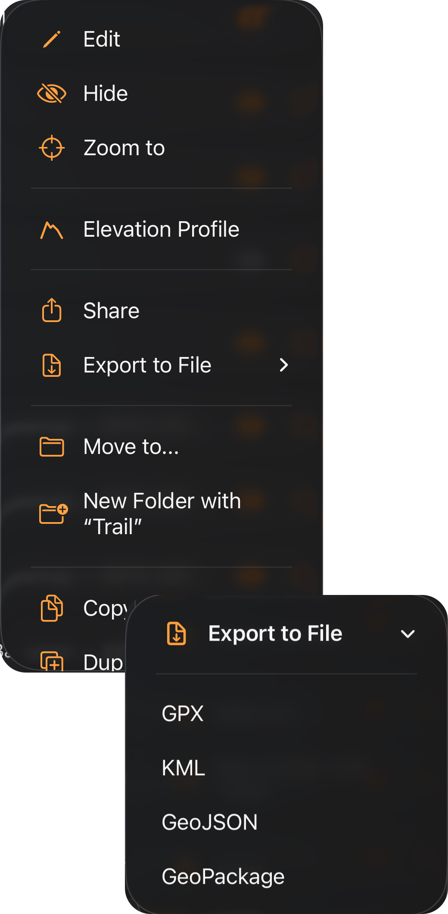
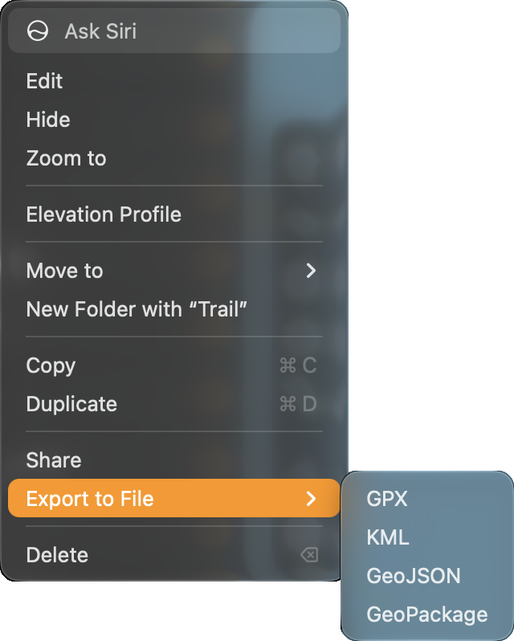

TopoKit stores every feature in a project in WGS84 (EPSG:4326). It converts vector imports to this coordinate system and uses it for every vector export.

## Formats at a glance

| Format | Files | Reads | Writes | Covered in |
|---|---|---|---|---|
| GPX | `.gpx` | Yes | Yes | [GPX](#gpx) |
| KML | `.kml` | Yes | Yes | [KML and KMZ](#kml-and-kmz) |
| KMZ | `.kmz` | Yes | No | [KML and KMZ](#kml-and-kmz) |
| GeoJSON | `.geojson`, `.json` | Yes | Yes, as `.geojson` | [GeoJSON](#geojson) |
| GeoPackage | `.gpkg`, `.geopackage` | Yes | Yes, as `.gpkg` | [GeoPackage](#geopackage) |
| GeoTIFF | `.tif`, `.tiff` | Yes | Shared as the image file, never converted | [Raster overlays](/manual/raster-overlays/#importing-a-raster) |
| GeoPDF | `.pdf` | Yes | Shared as the PDF, never converted | [GeoPDF import](/manual/raster-overlays/#geopdf-import) |
| World file, projection file | `.tfw`, `.wld`, `.tifw`, `.tiffw`, `.prj` | When picked together with the TIFF | No | [Sidecar files](/manual/raster-overlays/#sidecar-files) |
| Basemap | Built on the device | — | Never exported or shared | [Basemaps](/manual/basemaps/#what-a-basemap-is) |
| TopoKit project | `.mapproject` | Yes | Yes | [The project file](/manual/projects-and-files/#the-project-file) |

## Importing a file

:::mac
On Mac, open the :ui[Add Data]{icon=plus} menu in the tool sidebar, the :ui[plus]{icon=plus} menu in the Layers tab, or the **Layer** menu. Choose **Add Vector Layer…**, then select one or more files.

You can also drag files from Finder onto the open project's map or open a file with TopoKit from Finder. When you open a file from Finder, it must have the `.geojson` extension for GeoJSON or `.gpkg` for GeoPackage. A dropped `.mapproject` opens as a project, and a dropped TIFF or PDF is imported as a [raster overlay](/manual/raster-overlays/#importing-a-raster). Files of any other type are ignored.
:::

:::ios
On iPhone, tap :ui[Add Data]{icon=plus} in the tool sidebar or :ui[plus]{icon=plus} in the Layers tab, choose **Add Vector Layer…**, then select one or more files. You can also open a file in TopoKit from the Files app or another app to import it, but `.json` and `.geopackage` files can only be imported through the picker.
:::

If you open a file in TopoKit when no project is open, TopoKit imports it into the next project you open. It chooses how to read a file by its extension, so a GPX or KML file saved as `.xml` is refused as an unsupported format. When you select several files in the picker, TopoKit imports them one after another and continues even if a file fails. The alert gives the reason for the first failure only.

## What happens on import

TopoKit adds each file as one folder at the top of the Layers tab, using the file's name. Every feature appears as a row directly inside that folder, without subfolders for KML's nested folders, GPX's waypoints, routes and tracks, or a GeoPackage's feature tables. To view the imported data, choose **Zoom to** on the folder; the map does not move to it automatically.

Imported features use the styles in [Settings → Features](/manual/settings/#features), rather than styling from the file. Lines and polygons use **Imported Files**, and points use **Default Style** under **Points**. TopoKit copies the style onto each feature when you import it, so changing these settings later does not affect earlier imports.

To remove an import's folder and every feature in it, use [Undo](/manual/interface/#undo-and-redo) once.

A GPX or KML file still adds an empty folder when it contains no features TopoKit can read, as does a GeoPackage with no readable features in its feature tables. When an import skips or changes something, an alert titled **Imported, With Gaps** or **Imported, With Notes** shows the number of features imported, the number skipped, and the first three reasons.

Vector files have no fixed size limit in any format. :mac[On Mac, TopoKit reads files of any size without a size check.] :ios[On iPhone, TopoKit checks the available memory before reading a file. For KMZ, it checks the archive first, then the KML inside it before unzipping.]

:ios[After reading the file, TopoKit checks the available memory again before adding anything to the project, because saving needs more memory than reading. If any check fails, nothing is added, and an alert shows the file's name, roughly how much memory is needed and how much is free.]

When a file takes more than a moment to read, a progress row appears at the bottom of the map with the file's name, a percentage and ✕. Use the row's ✕ to stop the import immediately without a confirmation, and nothing from the file is added.

For GPX, KML and KMZ, the percentage is based on the number of lines read. When all the text is on one line, it stays at the same percentage until reading finishes. For a KML or KMZ file with a few very long lines or areas, the percentage also stays the same until reading finishes, however many line breaks the file contains. With thousands of shorter lines, the percentage moves normally. For GeoPackage, the percentage stays at 0% until reading finishes; for GeoJSON, it stays at 0% until the whole file has been read, then continues from 50%.

If you open another project or close the project you were importing into while a file is being read, the file is not added to any project. The progress row disappears as soon as the project changes. Once reading has stopped, an alert titled **Import Stopped** names the file. If the row was not moving when the project changed, TopoKit reads the file to the end first, so the alert can appear some time later.

If you open the same file again while it is being read, an alert titled **Already Importing** appears, and the file is imported only once.

When you import lines and areas, TopoKit leaves out a point if it has the same position, height and accuracy as the point before it, unless removing it would leave a line part with fewer than two points or an area ring with fewer than four. The import alert shows how many repeated points were left out. Point features are unaffected, and TopoKit keeps repeated points in a line or area that has a time on any point.

## Exporting and sharing

When you export several rows together, TopoKit always saves them in one file.

:::mac
On Mac, right-click a row or a selection of rows and choose **Export to File**, or select the rows and choose **Layer → Export to File…** (`Cmd-E`). To export rows from different places in the tree, click **Select** in the Layers tab, check the rows, then click **Export** in the action bar.
:::

:::ios
On iPhone, tap a row's :ui[Layer options]{icon=ellipsis} button and choose **Export to File**. You can also tap **Select**, check the rows, then tap **Export** in the action bar.

:::

::::platforms
:::ios

:::

:::mac

:::
::::

To share a file, choose **Share** from the same menus or action bar, or from the Mac **Layer** menu. For vector features, choose a format, then TopoKit opens the share sheet with the file instead of asking where to save it. When you share a folder, its raster overlay image files are shared along with the vector file.

To share one feature from the map, use the [**Share** button on its card](/manual/search-and-identify/#the-cards-buttons).

## What an export contains

An export includes the vector features in the rows you choose, including hidden rows and all vector features in a folder's subfolders. Raster overlays and tile layers in a folder or selection are left out, and **Export** in the action bar becomes available only when the selection includes a vector feature.

To export a whole project to these formats, select your top-level rows in Select mode and export them together. Exporting the project itself writes a [project file](/manual/projects-and-files/#the-project-file) in `.mapproject` format instead.

All four formats include attributes, but styling is not exported.

When you export, share or copy a feature with photos from the Layers tab, every format includes a `photo_paths` attribute. It lists each photo's path inside the project folder, such as `Photos/<id>.jpg`, separated by `|`. The photo files are not exported, and importing the file again does not reattach them.

## Format by format

### GPX

You can import [GPX 1.1](https://www.topografix.com/GPX/1/1/) files as points and lines. Waypoints become points, routes and tracks become lines, and a track with several segments becomes one line in several parts.

When a line has a timestamp on any point, TopoKit keeps its parts exactly as recorded. For a line without timestamps, it leaves out parts with fewer than two points or under 5 m long, unless that would leave no parts. It then joins the remaining parts end to end by proximity, reversing a part when needed. This applies to lines in several parts in any format, and the import alert shows how many lines were changed.

TopoKit reads per-point elevation and time from any GPX, and reads horizontal accuracy only from the `<topokit:hAccuracy>` element it writes in a point's `<extensions>`. A `<time>` without a time zone is read as UTC, so times logged by a device in local time without a zone are shifted by the device's UTC offset.

The feature's name comes from `<name>`, and its description comes from `<desc>` and `<cmt>`. TopoKit reads other attributes only from its own extensions, leaving out extensions written by other apps, track colours and icons.

When you export to GPX, points are written as `<wpt>` and every line as `<trk>`, never as `<rte>`. A multi-point feature is written as one `<wpt>` per point, each with the feature's name and description, so importing it again creates separate points. TopoKit writes each attribute except name and description as its own element in `<extensions>`, such as `<topokit:Site_Name key="Site Name">`. The element's name uses the attribute's name with accents removed and every character other than a letter, digit, `_`, `-` or `.` replaced by an underscore. If the resulting name does not start with a letter or `_`, or starts with `xml`, TopoKit adds `_` in front. The `key` attribute preserves the name exactly as you typed it for TopoKit to read back on import. In a desktop GIS that reads GPX through [GDAL](https://gdal.org/en/stable/drivers/vector/gpx.html), each attribute appears as a column named like `topokit_Site_Name`. TopoKit preserves attributes when importing GPX files from earlier versions of the app. It also appends a recorded track's statistics to `<desc>` as readable text, always in metric units and English, regardless of your settings.

A point or vertex on the 180° meridian is exported with longitude −180, which is the same line, because GPX 1.1 allows longitudes from −180 up to but not including 180.

When you export points or lines to GPX, any polygons in the export are left out. An export containing only polygons is refused with an alert.

### KML and KMZ

TopoKit reads points, lines and polygons with holes from KML's `<Placemark>` elements. It reads `<description>` and attributes in either form of `<ExtendedData>`: `<Data>` entries or typed `<SchemaData>` and `<SimpleData>`.

Altitude becomes each vertex's elevation, except that 0 is read as no elevation rather than sea level when the altitude mode is `clampToGround`, KML's default. TopoKit also reads per-point times and accuracy from `<gx:Track>` and `<gx:MultiTrack>`.

Each part of a `<MultiGeometry>` or `<gx:MultiTrack>` becomes a separate feature with the placemark's name and attributes, so a placemark containing three polygons becomes three polygons. In GeoJSON and GeoPackage, a `MultiPoint`, `MultiLineString` or `MultiPolygon` remains one feature in several parts.

When you import a KMZ, TopoKit opens the archive and reads the first `.kml` file inside it, ignoring other KML documents, icons and overlays in the archive.

When you export to [OGC KML 2.2](https://www.ogc.org/standards/kml/), TopoKit writes one `<Document>` with one `<Placemark>` per feature. It uses `<MultiGeometry>` for a feature in several parts and keeps polygon holes. Attributes are written as typed `<SimpleData>` in `<ExtendedData>`, with each declared once in the document's `<Schema>` as `int`, `double`, `bool` or `string`. An attribute is typed as a number only when every exported value is a number, or as a boolean only when every exported value is a boolean, according to the [GeoJSON typing rule](#geojson).

A column of whole numbers is written as `int` only when every value is between −2,147,483,648 and 2,147,483,647, the range GDAL reads as `int`. When a value falls outside this range, as a long ID can, the column is written as `string` so every digit is preserved.

Recorded tracks and any line with a time on any vertex are written as `<gx:Track>` or `<gx:MultiTrack>`, with per-point time, altitude and accuracy. Every placemark uses one of three fixed styles—a yellow pushpin, a red line or a translucent red polygon—so your colours, widths and pins are not included.

### GeoJSON

You can import [RFC 7946](https://datatracker.ietf.org/doc/html/rfc7946) GeoJSON as a `FeatureCollection`, a single `Feature` or a bare geometry. A `GeometryCollection` becomes separate features that share one `properties` block, and a third coordinate value is read as the vertex's elevation.

TopoKit keeps `properties` values as text. Numbers use decimal text, so `1.50` becomes `1.5` while `12.0` keeps its decimal point, and booleans become `true` or `false`. Nested objects and arrays are kept as JSON text, while `null` values are dropped.

A feature's top-level `id` is kept as an attribute named `id` unless `properties` already has one, and a `name`, `title` or `label` key supplies the feature's name. The `coordTimes` and `coordHorizontalAccuracy` values in `properties` are read as a line's per-point times and accuracies rather than attributes.

TopoKit also reads a legacy `"crs"` member. When it names an EPSG code other than 4326, TopoKit reprojects every feature to WGS84 on import and skips any feature still out of range afterwards. If TopoKit cannot read the `"crs"` member, or it names neither CRS84 nor an EPSG code, TopoKit ignores it, reads the coordinates as longitude, latitude, and includes a note in the import alert.

When you export to GeoJSON, TopoKit writes an RFC 7946 `FeatureCollection` with sorted keys so you can compare two exports. Coordinates are written as `[lon, lat]`, or as `[lon, lat, elevation]` when any vertex of the feature has a height, with `0` for a vertex without one. Exterior polygon rings are written counterclockwise and holes clockwise, so rings drawn or imported in the other direction have their vertices reversed on export.

TopoKit assigns types to values on export. Text becomes a number only when converting that number back to text produces exactly the original text, and `true` and `false` become booleans regardless of capitalization. Everything else remains text, so a `site_id` of `007` or a reading of `1.50` exports unchanged as text.

Each feature is written with all the file's attributes and `null` for any missing values, so a desktop GIS gets all columns even when it determines them from the first feature.

A `name` attribute is written in place of the feature's own name, so a feature you rename in TopoKit exports under the `name` it was imported with. A line's per-point times and accuracies are written as `coordTimes` and `coordHorizontalAccuracy`. The time and accuracy imported with a point, such as a GPX waypoint's `<time>`, are not written.

### GeoPackage

When you import a GeoPackage, each column becomes a text attribute, except the geometry and the table's integer primary key, usually `fid`. BOOLEAN columns are read as `true` or `false`, while `NULL` and BLOB values are left out. A `name` or `title` column sets the feature's name regardless of capitalization and remains an attribute as well.

TopoKit reads Z as each vertex's elevation and M as a per-point time when it can be read as Unix time in seconds or milliseconds. Other M values are dropped, so a measure such as a milepost is not mistaken for a date. Layers in a coordinate system other than WGS84 are reprojected on import; if a transform fails, TopoKit keeps the raw coordinates and reports this in the import alert. Raster tile tables, attribute-only tables and styling are not read.

When you export to [OGC GeoPackage](https://www.geopackage.org/spec/), TopoKit separates features into `points`, `lines` and `polygons` tables, all tagged SRS 4326, and omits any tables that would be empty.

Each attribute gets its own column. Column names use only the letters A to Z, the digits 0 to 9 and the underscore, keeping each attribute's capitalization. TopoKit removes accents, replaces each run of other characters with one underscore and drops underscores at either end. A name that starts with a digit gets `f_` in front, and a name with nothing left becomes `field`. For example, `site id` becomes `site_id`, `Höhe` becomes `Hohe` and `2024 count` becomes `f_2024_count`. Using the [GeoJSON typing rule](#geojson), a column is INTEGER when every value is a whole number, REAL when every value is a number, BOOLEAN when every value is `true` or `false`, and TEXT otherwise.

If a column name is already used by another attribute or by the table's own `fid`, `geom` or `name` columns in any capitalization, TopoKit adds a numbered suffix. For example, `site-id` becomes `site_id_2` when exported alongside `site id`. An attribute called `name` is not written again when it only repeats the feature's name, as one imported from a `name` column does. If it differs on any feature, as it can after you rename an imported feature, it is written as `name_2`.

Each feature is written with only the dimensions it has. Z is included when any vertex has a height, with 0 for a vertex without one, and M is included only for a line with a time on every vertex, as milliseconds since 1970. A line's per-vertex horizontal accuracy is written in a related table using the [OGC Related Tables Extension](https://docs.ogc.org/is/18-000/18-000.html), while a point's horizontal accuracy is not written as a vertex value.

## Coordinate validation

Coordinates must be between −90 and 90 latitude and −180 and 180 longitude. TopoKit handles coordinates outside this range according to the format:

- GPX and KML: TopoKit drops the vertex without a note and keeps the rest of the line, connecting the vertex before it straight to the one after it. An out-of-range GPX waypoint is skipped with a note in the import alert, while a KML point is dropped without a note. KML longitude is brought into range first, so a KML vertex is dropped only for its latitude.
- GeoJSON: TopoKit skips the whole feature if any coordinate is out of range and includes a note in the import alert. If no features remain, the file fails to import and an alert gives the reasons. This means that a single `Feature` or a bare geometry with one bad coordinate fails the whole import. Within a `GeometryCollection`, only the bad part is dropped, without a note.
- GeoPackage: TopoKit keeps out-of-range coordinates and reports how many there are in the import alert.

## FAQ

**Why are my imported features in the wrong place?**
TopoKit uses the axis order specified by each format rather than guessing. If features appear in the wrong hemisphere or mirrored, the file's coordinates were written in the wrong order; correct them in your desktop GIS and import the file again. Another cause is a coordinate system TopoKit cannot use, as described under [GeoJSON](#geojson) and [GeoPackage](#geopackage). For rasters, check the supported [coordinate systems](/manual/raster-overlays/#coordinate-systems).

**What changes when my data goes to my desktop GIS and comes back?**

- Column types: TopoKit keeps every attribute as text and [assigns column types again on export](#geopackage), so a DATE column returns as TEXT and a whole number in a REAL column gains a decimal: `10` returns as `10.0`.
- Attribute names: When you export to GeoPackage, column names keep only letters, digits and underscores, so an attribute named `Site Name` returns as `Site_Name`.
- Identity: Each import assigns new identifiers, so use a stable attribute of your own, named anything but `name`, `fid` or `geom`.
- Layer structure: Exports do not include folders, and imports place every feature directly in one folder, so features from separate folders are combined when you import them again. To keep them separate, export each folder to its own file.

**Can TopoKit open a shapefile or a CSV of coordinates?**
TopoKit cannot open a shapefile or a CSV of coordinates. To import a shapefile or a table of coordinates, first convert it to GeoPackage or GeoJSON in your desktop GIS.
