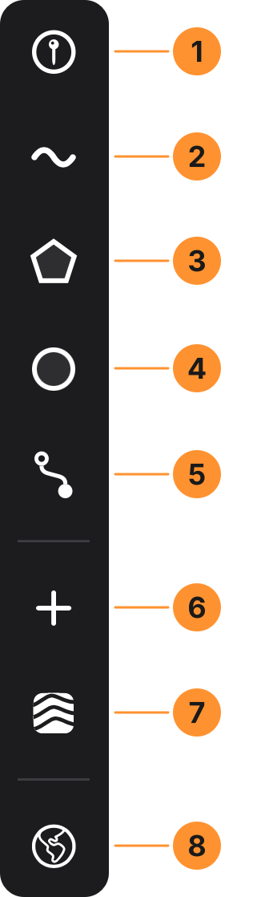
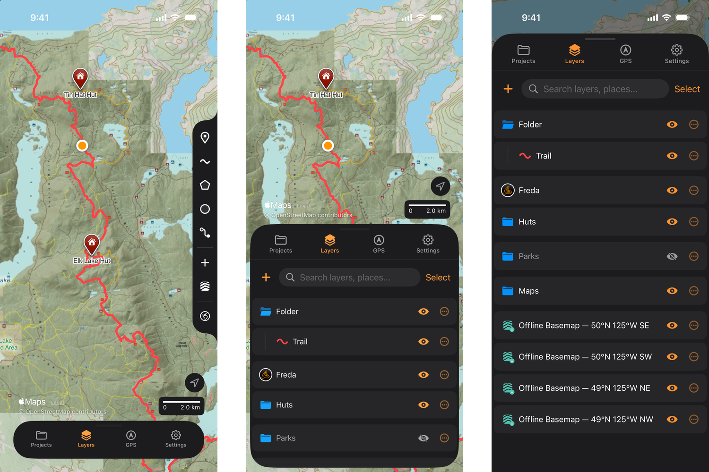
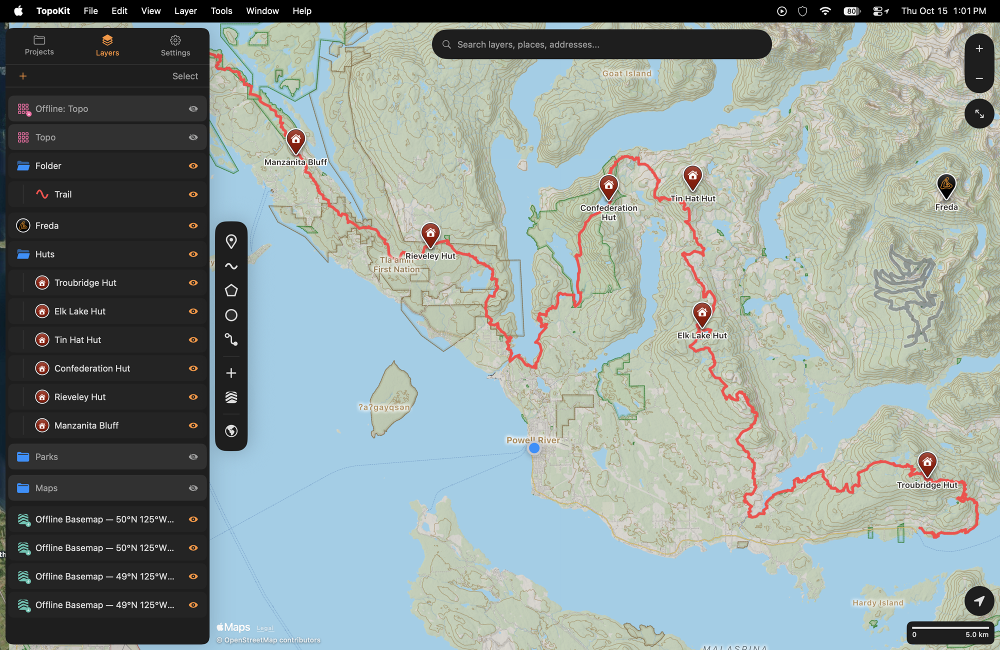
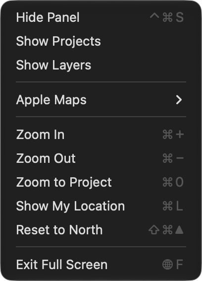
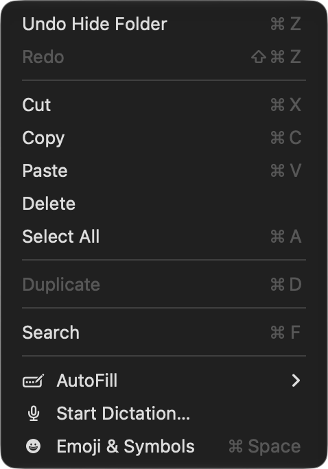

The map fills the TopoKit screen, with the tool sidebar along one edge. :ios[On iPhone, you use a sheet with four tabs to access your projects, layers, GPS and settings.] :mac[On Mac, you use one floating panel with three tabs to access your projects, layers and settings, and the menu bar for the main commands.]

## The map

Everything you add appears over Apple Maps. To change the map underneath, use the [**Apple Maps** button](/manual/basemaps/#the-apple-maps-switch) at the bottom of the tool sidebar to switch between :ui[Standard]{icon=map-standard}, :ui[Hybrid]{icon=map-hybrid}, :ui[Satellite]{icon=map-satellite} and :ui[Off]. You can also use these controls and readouts over the map:

- **Compass**: The compass appears when the map is rotated. Tap or click it to turn the map back to north while keeping any tilt, or use [**Settings → Map**](/manual/settings/#map) to keep the compass on screen or lock north up.
- **Zoom**: :ios[On iPhone, there is no zoom button.] :mac[On Mac, the + and − buttons are at the top right. Below them, **Zoom to Project Extent** frames every visible feature and raster in the project, excluding tile layers and basemaps.]
- **Location button**: :ios[On iPhone, tap once to follow your location, a second time to also turn the map to your heading, and a third time to stop following. An [orange dot](/manual/gps-and-track-recording/#the-location-dot) marks your position on the map.] :mac[On Mac, each click centres the map on your location once. The Mac map never follows you.]
- **Scale bar**: The scale bar appears under the location button and uses the units set in **Settings → Units & Coordinates → Units**.
- **Search bar**: Use the search bar to [find your layers, basemap names, places and typed coordinates](/manual/search-and-identify/#search). :ios[On iPhone, it is at the top of the **Layers** tab.] :mac[On Mac, it is in the bar above the map, and you can press `Cmd-F` to put the cursor in it.]
- **Tool card**: While you use a tool, its card appears at the bottom with live figures, a ✕ on the left to cancel and **Save** on the right. The line, polygon and circle cards also have **Undo** between these controls, with **Redo** beside it once you undo a step. The Add Point card has only the ✕ and, once you grant location access, the :ui[location]{icon=location} button, because placing a point opens its editor at once. You can tap a figure to copy it or tap a unit to [choose from a menu of units](/manual/measurement/#units).
- **Map credits**: Apple's logo and **Legal** appear at the bottom left. When you view a basemap you built with map features, a [credit line](/manual/basemaps/#credit-and-licences) appears underneath; tap or click it to open the map data's copyright page.

When you open a project, the map frames its visible features and rasters, replacing your previous view. Choosing **Reload** on [**Updated on another device**](/manual/projects-and-files/#icloud-sync) does the same. If there is nothing to frame, the map centres on your first location fix once per launch.

You can follow each tile download, elevation download and basemap build in a progress row at the bottom of the map, whichever tab is open. Use the row's ✕ to stop it; for tile and elevation downloads, TopoKit asks before stopping.

## The tool sidebar

The tool sidebar has the same eight buttons on iPhone and Mac.

:::::platforms

::::legend
1. :ui[Add Point]{icon=add-point} marks one location where you tap or click, or where you stand, and opens the [point's editor](/manual/points-lines-polygons/#adding-a-point).
2. :ui[Add Line]{icon=add-line} lets you [draw a line](/manual/points-lines-polygons/#adding-lines-polygons-and-circles) while showing its live length and bearing.
3. :ui[Add Polygon]{icon=add-polygon} lets you [draw an area](/manual/points-lines-polygons/#polygons) while showing its live area and perimeter.
4. :ui[Add Circle]{icon=add-circle} lets you [draw a circle](/manual/points-lines-polygons/#circles) from a centre and an edge point, with a lock to keep the radius fixed.
5. :ui[Add Route] draws a driving, walking or cycling [route](/manual/routes/) through the stops you place, following the roads from Apple Maps, and saves it as a line.
6. :ui[Add Data]{icon=plus} opens a menu with [**Add Vector Layer…**](/manual/import-and-export/#importing-a-file), [**Add Raster Layer…**](/manual/raster-overlays/#importing-a-raster), [**Add Tile Layer…**](/manual/tile-layers/#adding-a-tile-layer), [**Download Map Tiles…**](/manual/tile-layers/#offline-downloads) and [**Download Elevation…**](/manual/elevation/#downloading-tiles). :ios[On iPhone, choosing an item opens the Layers tab, where you complete the task, except **Download Elevation…**, which opens its grid on the map.]
7. :ui[Basemaps] [builds an offline map with contours](/manual/basemaps/#building-a-basemap) for an area you choose and adds it to the project.
8. **Apple Maps** switches Apple Maps to the next state with each tap or click. The button's label shows the current state, such as **Apple Maps (Hybrid)**.
::::
:::::

:ios[On iPhone, touch and hold a button to see its name.]

:::ios
## iPhone layout

TopoKit on iPhone runs in portrait only, with the map filling the screen. The sheet has three heights: a strip showing only the tab bar, half the screen, or nearly full. To raise the strip to half height, tap another tab; tapping the selected tab raises the sheet to nearly full, and tapping it again lowers the sheet to half height.

Choosing a search result or **Zoom to** on a row lowers the sheet to the strip so you can see the place on the map. You can also pull the sheet down to the strip without closing what is open in it, so an editor in the Layers tab keeps its unsaved changes.

As the sheet approaches full height, the location button, scale bar, compass and credit line fade out. The tool sidebar begins to fade once the sheet passes a fifth of the screen and is gone at 40%, so it appears only beside the strip.

While you use a tool or have a card open, the sheet and tool sidebar are hidden. This also applies to the area pickers for **Download Map Tiles…**, **Download Elevation…** and **Basemaps**, to **Edit Vertices on Map**, and to an open elevation profile. When you finish the tool or close the card, the sheet returns as the strip regardless of its previous height, unless the tool continues in a page of the Layers tab.

You can switch between four tabs in the sheet:

- :ui[Projects]{icon=folder} shows your [projects and their sync state](/manual/projects-and-files/).
- :ui[Layers]{icon=layers} shows the [open project's layers](/manual/layer-tree/), the search bar and the Undo pill.
- :ui[GPS] shows your [position, accuracy, compass, readouts and track recording](/manual/gps-and-track-recording/#the-gps-tab), and turns red while a track is recording or paused.
- :ui[Settings]{icon=settings} gives you access to [all ten Settings pages](/manual/settings/).

The tool sidebar is on the right edge by default, and you can move it to the left in [**Settings → Toolbar & Haptics → Position**](/manual/settings/#toolbar--haptics).

### Gestures

You can pan, pinch and use a two-finger twist on the map, or drag up or down with two fingers to tilt it. You can also use these gestures:

- Tap a feature to [open its card](/manual/search-and-identify/#what-a-tap-finds).
- Touch and hold a spot for half a second to [open a card for the ground there](/manual/search-and-identify/#holding-a-spot-and-the-place-card). This gesture does nothing while a tool is running.
- Slide a finger up or down the sidebar to see each button's name as your finger passes it, then lift your finger to press the button under it.
- Swipe toward the screen edge from the map just beside the sidebar to hide it, then tap the [chevron tab](/manual/settings/#toolbar--haptics) left at the edge to show it again.

<video src="/media/interface-sidebar-hide-and-show.mp4" autoplay loop muted playsinline aria-label="The tool sidebar on iPhone: a finger swipes from the map beside it toward the screen edge and the sidebar slides off, leaving a small chevron tab at the right edge, and a tap on the tab brings it back"></video>
:::

:::mac
## Mac layout

The window displays the map, the tool sidebar and one floating panel with three tabs. In the panel, :ui[Projects]{icon=folder} shows [your projects](/manual/projects-and-files/), :ui[Layers]{icon=layers} shows [the open project's layers](/manual/layer-tree/), and :ui[Settings]{icon=settings} shows [the Settings pages as a list](/manual/settings/).

Each time you open TopoKit, the panel opens unfolded on the Projects tab at its narrowest width. Drag its edge to make it wider; TopoKit does not keep the width, fold or selected tab between launches.

To fold the panel to a pull tab, move the pointer over the tab bar and click the chevron that appears on the panel's outer edge, or press `Cmd-Ctrl-S`. Click the pull tab or press the same shortcut to show the panel again. You can place the panel on the left, where it appears by default, or on the right in [**Settings → Appearance → Panel Position**](/manual/settings/#appearance).

<video src="/media/interface-panel-hide-and-show.mp4" autoplay loop muted playsinline aria-label="The panel on a Mac folded away with its chevron, leaving a small pull tab at the left edge of the map, then unfolded again with a click on the tab"></video>

The tool sidebar is always on the left of the map and moves up above the elevation profile while a profile is open. The bar above the map displays the search bar and, when the map is rotated, the compass.

### Mouse and keyboard

- Click a feature to [open its card in a popover](/manual/search-and-identify/#what-a-tap-finds).
- Right-click or Control-click the map to [open a menu of actions at that spot](/manual/search-and-identify/#right-clicking-the-map).
- Right-click a row in the Layers tab to [open its menu](/manual/layer-tree/).
- Press `Esc` to cancel the running tool, including **Edit Vertices on Map** and the area pickers for **Download Map Tiles…**, **Download Elevation…** and **Basemaps**. If you have already placed or moved points, an **Unsaved Work** alert asks first: press `Return` to keep your work, or click **Discard**. **Tools → Cancel Tool** and the card's ✕ discard without asking, while starting another tool with points placed asks the same question as `Esc`.

### The menu bar

Most commands are greyed out while the Settings window is in front, or while a dialog, the introduction or the basemap setup panel is open over the map. **Reset to North** is also greyed out while you type in a field, where `Cmd-Shift-Up` selects text instead.

| Menu | Commands and keys |
|---|---|
| **TopoKit** | **Settings…** `Cmd-,` opens [a separate window](/manual/settings/#the-mac-settings-window); [**Unlock TopoKit…** and **Restore Purchases**](/manual/your-topokit/); **Quit TopoKit** `Cmd-Q`. |
| **File** | **New Project…** `Cmd-N`, **Open Project…** `Cmd-O`, **Open Recent**, **Close Project** `Cmd-W`, **Save** `Cmd-S`, and the open project's commands ([Projects, saving and iCloud](/manual/projects-and-files/)). |
| **Edit** | **Undo** `Cmd-Z` and **Redo** `Cmd-Shift-Z` include the step's name; **Copy**, **Paste** and **Duplicate** `Cmd-D` act on layers while the Layers list has keyboard focus; **Search** `Cmd-F`. |
| **View** | **Hide Panel** or **Show Panel** `Cmd-Ctrl-S`, **Show Projects**, **Show Layers**, **Apple Maps**, **Zoom In** `Cmd-+`, **Zoom Out** `Cmd-−`, **Zoom to Project** `Cmd-0`, **Show My Location** `Cmd-L`, **Reset to North** `Cmd-Shift-Up`. |
| **Layer** | The **Add Data** rows, **Build Basemap…**, **New Folder** `Cmd-Shift-N`, **New Folder with Selection** `Cmd-Ctrl-N`, **Edit Layer…** `Cmd-I` and **Export to File…** `Cmd-E`. The menu also includes a row's other right-click commands except **New Subfolder**, **Copy**, **Paste**, **Duplicate**, **Download for This Device** and **Delete**. These commands act on the rows selected in the Layers tab. |
| **Tools** | **Add Point** `Cmd-1`, **Add Line** `Cmd-2`, **Add Polygon** `Cmd-3`, **Add Circle** `Cmd-4`, **Add Route** `Cmd-5`, **Cancel Tool**. |
| **Help** | **TopoKit Help** `Cmd-?` opens this manual, and **Getting Started** opens its first chapter; [**Replay Introduction**](/manual/getting-started/#the-first-launch) and **What's New**; followed by the feedback, rating and legal items. |

- Press `Cmd-W` to save and close the project while leaving the window open. If the save fails, the project stays open.
- Close the map window or press `Cmd-Q` to quit TopoKit. Both save the open project first, but if the save has not finished after 10 seconds, TopoKit quits anyway.
:::

## Undo and redo

TopoKit keeps one undo history for the open project, with a name for each step. VoiceOver reads that name on the Undo control, such as **Undo Delete Camp** or **Undo Hide 3 Layers**.

You can undo adding any row, including one saved from a basemap's card, and adding any raster or tile layer. The history also includes deleting, hiding, showing and moving rows, grouping rows into a new folder, renaming a folder, and applying a folder's style to the features in it.

Changes made in an editor are not included, such as changes to a feature's name, description, coordinates, style or photos, or to a raster's or tile layer's settings and name. The exceptions are moving the feature to another folder, making a folder with **Create New Folder** and deleting the feature, which you can undo. Building a basemap does not add a step to the history, and [deleting a basemap](/manual/layer-tree/#deleting) deletes its built files, so Undo cannot restore it.

The history has no length limit and is kept when you save. It starts empty whenever a project is created, opened, closed or reloaded; a reload happens after another device changes the project, after a merge and after **Restore from Backup**.

:::ios
On iPhone, the pill at the bottom right of the **Layers** list is the only place to undo project changes, including changes made on the map. The pill appears while there is a step to undo or redo, with Redo beside Undo once you undo a step. Undo dims when there is nothing left to undo, and an editor opened from the list covers the pill. The pill steps aside while rows are checked in **Select**.

:::

:::mac
On Mac, use **Edit → Undo** (`Cmd-Z`) and **Edit → Redo** (`Cmd-Shift-Z`), which include the step's name. These commands act on your typing while you are in a field and wait while you hold a point.

:::

### While a tool is open

As you draw a shape, each change becomes a step you can undo. This includes adding a vertex by tapping or pulling it out of the faint dot in the middle of a segment, deleting a vertex, and dragging a vertex, which is recorded when you let go.

Use the card's **Undo** and **Redo** to undo and redo only the drawing's own steps; these controls wait while you hold a point. The ✕ discards both the shape and its steps, while **Save** replaces them with one step named **Create** followed by the feature's name, so one Undo afterwards removes the whole feature. :mac[On Mac, `Cmd-Z` undoes the drawing's steps first and then continues through the project's earlier steps, while the card's Undo stops at the drawing's steps.]

In **Edit Vertices on Map**, each change adds a step to the project's history as you make it, named **Move Point**, **Add Point** or **Delete Point**. While the card is open, Undo and Redo act only on that editing session's steps, whether you use the card or the Edit menu. For details about which changes **Done** and ✕ keep, see [Reshaping a saved line or polygon](/manual/points-lines-polygons/#reshaping-a-saved-line-or-polygon).

## Accessibility

When a card opens, VoiceOver moves to its name and reads the whole card at once: the name, its kind, its folder if it is your own feature, then its facts, with units spoken as words, such as "1,819 metres". Activate the name to copy it, or activate the coordinate, address or description to copy that information. VoiceOver announces "Copied." each time.

When you tap a spot shared by two or more of your own points, the card opens as a list headed "3 points here". The heading is "3 things here" when the list includes anything other than your own points.

A cluster of pins is read as "5 grouped points". Activating it zooms in on the points, or lists them when they share one spot. When you tap a basemap tile that is still loading, VoiceOver says "Map still loading here." Once the tile loads, VoiceOver reads the card or says "Nothing here."

:ios[On iPhone, a greyed sidebar button adds "Not available without a project" to its announcement. While a tool or card is open, the sheet is hidden and unavailable to VoiceOver.]

While you draw or reshape a line or area, activate a faint dot to add its point. A point that can be removed offers the **Delete Point** action, and each addition or deletion is announced with the running count, such as "Point added. 4 points." :ios[On iPhone, VoiceOver also announces each sidebar tool as it starts.]

Basemap builds, elevation downloads and track recording announce their milestones, such as "Offline basemap ready" with the basemap's name, and the number of points in a stopped track. As an elevation profile loads, it announces its gain and loss and how much of the line has no terrain data.

When you turn on the system **Reduce Motion** setting, sheets, panels, cards and folds change in one step instead of sliding or fading.

## FAQ

**My tool sidebar disappeared. Where did it go?**
:ios[On iPhone, the sidebar is hidden while a tool or card is open, as described in [iPhone layout](#iphone-layout). It also fades out when the sheet rises above about a fifth of the screen and is gone at 40%. If you swiped the sidebar off the screen, tap the chevron tab at the edge to show it again, or check **Settings → Toolbar & Haptics → Show Toolbar**.] :mac[On Mac, the sidebar is always visible.]

**Why are the tool buttons greyed out?**
Open or create a project to use the tool buttons. Everything they make is saved into a project, so every button except **Apple Maps** is greyed out when no project is open. :ios[On iPhone, tapping a greyed button tells you that you need to open a project.]

**Why can I see the map through the panel?**
You can choose how the panel looks in [**Settings → Appearance → Panel Style**](/manual/settings/#appearance). **Solid** is opaque, while **Blur** and **Glass** let the map show through unless **Solid Panel Background** is on.
