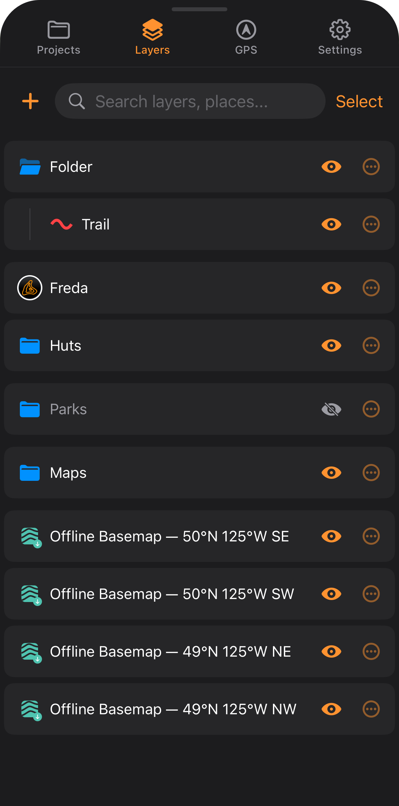
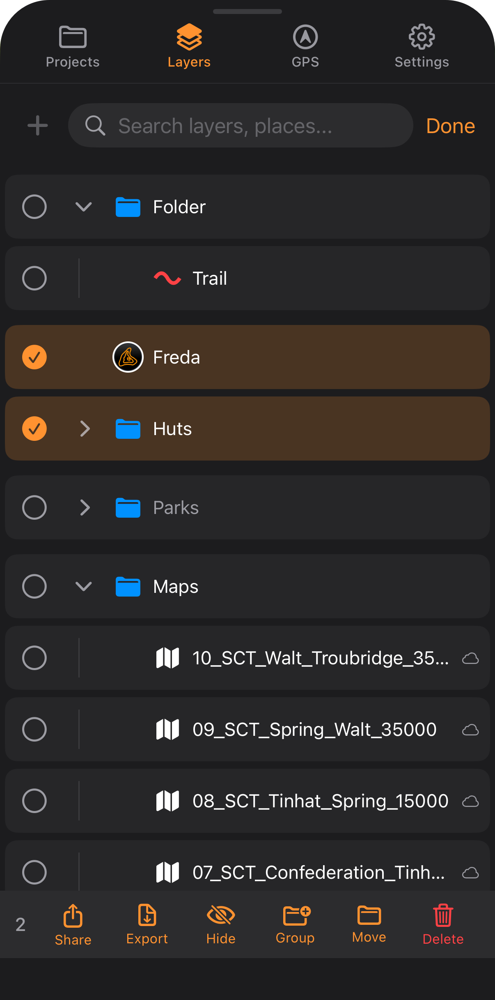
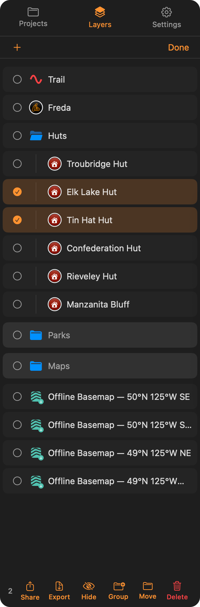
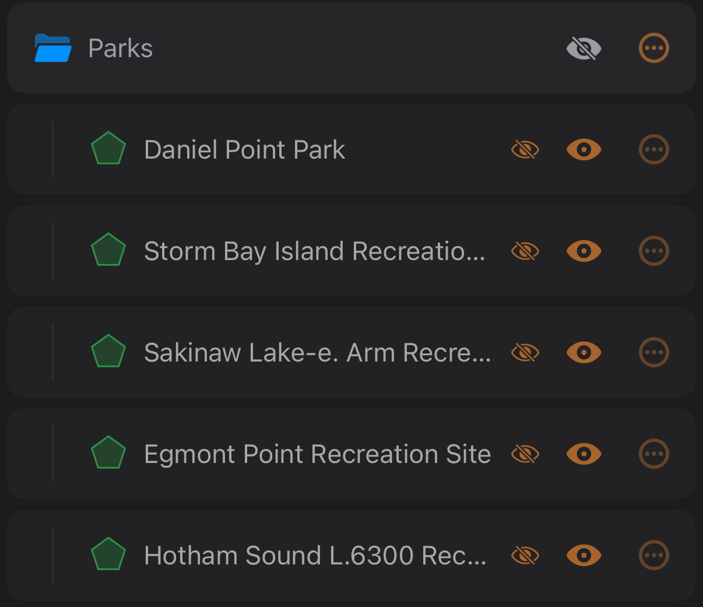
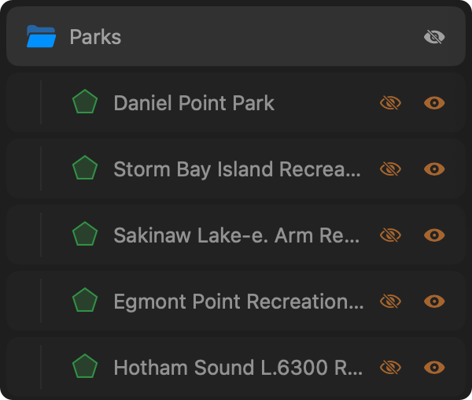
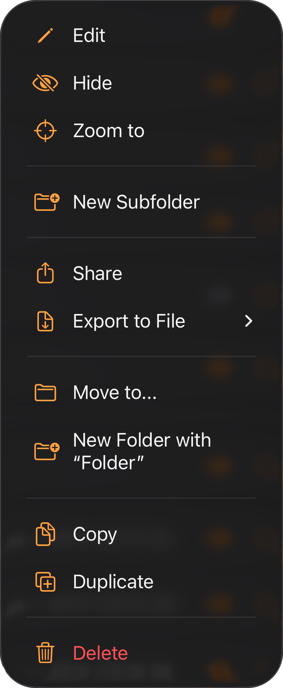
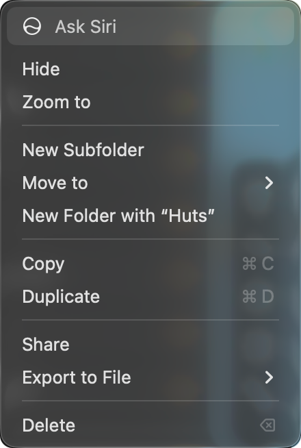

The Layers tab lists everything in the open project in the order it draws on the map. :ios[On iPhone, you can use the search bar at the top of the tab to find rows by name as well as places.] For details about what you can find, see [Search](/manual/search-and-identify/#search).

## What is in the tree

Each row is a feature, raster overlay, tile layer or folder. Features are points, lines and polygons that you draw or import, and raster overlays are imported GeoTIFF or GeoPDF maps. Tile layers are streamed from a server or are basemaps you built. You can organise any of these in folders, with folders nested to any depth.

::::platforms
:::ios

:::

:::mac

:::
::::

The icon of an **Offline: {name}** row shows a small download arrow when its [tiles are on this device](/manual/tile-layers/#using-offline-tiles). If the project arrived by sync without the tiles, the icon is dimmed and shows an orange iCloud arrow. A [basemap you built](/manual/basemaps/#the-basemap-in-the-layers-tab) shows the same download arrow when it is built on this device.

## Draw order

Rows higher in the tree draw on top of rows below them.

::::platforms
:::ios
<video src="/media/layer-tree-draw-order-iphone.mp4" autoplay loop muted playsinline aria-label="The Maps folder held until it lifts and dragged to the top of the Layers tab on iPhone: the hut pins and the trail under its rasters vanish from the map; dragged back below Parks, they return"></video>
:::

:::mac
<video src="/media/layer-tree-draw-order.mp4" autoplay loop muted playsinline aria-label="The Maps folder dragged up the Layers tab on a Mac to above the folder holding the trail: the hut pins and the trail inside the rasters' footprints vanish from the map, and when the folder is dragged back below Parks they return"></video>
:::
::::

A layer can be switched on and still be hidden by a row above it in the tree. A tile layer covers the whole map, hiding anything below it except through the transparent parts of its tiles. A raster hides rows below it only inside its own footprint, so the same layer can be hidden in one part of the map and visible in another.

An offline tile layer covers only the regions you downloaded, and a basemap you built covers only the area it was built for. A layer faded below 5% opacity does not cover anything.

Points always draw above lines and polygons, regardless of their order in the tree. A point below a raster or tile layer is removed wherever that layer covers it, even if the layer is partly transparent. For a raster, this means anywhere inside its bounding box. Lines and polygons below a raster or tile layer stay drawn and show through according to that layer's opacity.

The place and road names on Apple Maps draw over your lines and polygons until a raster or tile layer in the project is showing. When one is showing, every row from the lowest such layer upwards draws over those names, while rows below it stay under them. A basemap you built counts as such a layer only when [**Solid Background**](/manual/basemaps/#the-setup-page) is on.

When you add a folder, drawn feature, import, raster or tile layer, it goes to the top of the tree or its folder, so a new tile layer covers everything already there. A new basemap goes to the bottom instead, or directly above a top-level basemap it overlaps.

## Folders

To create a folder, choose **New Folder** from the :ui[plus]{icon=plus} menu at the top of the Layers tab. :mac[On Mac, you can also choose **Layer → New Folder** (`Cmd-Shift-N`).] To create a folder inside an existing folder, choose **New Subfolder** from that folder's :ui[Layer options]{icon=ellipsis} menu, or its right-click menu on Mac.

To put existing rows into a new folder, choose **Group** in the **Select** bar, or **New Folder with “{name}”** in a row's menu. Both commands create a folder called **New Group** in place of the topmost chosen row, add the rows inside it in their order, and open its editor.

Use a folder's icon to open or close it in the list. Closing a folder shortens the list, and its contents continue to draw on the map.

## Styling a folder

To style the features in a folder, tap its name on iPhone or click it on Mac to open **Edit Folder**. The editor has a style row for each kind of feature directly inside the folder, starting from the style of the first feature of that kind. A folder has no style of its own, and style rows appear only for the kinds present, so you cannot style an empty folder in advance.

When you choose **Done**, the style replaces the individual styles of every feature of that kind directly inside the folder. Features in subfolders keep their own styles, and you can reverse the change with a single Undo.

When you draw a feature afterwards, it starts from the **Default Style** in [**Settings → Features**](/manual/settings/#features). For details about the controls in the style sheets, see [Styling a feature](/manual/points-lines-polygons/#styling-a-feature).

## Selecting several rows

Choose **Select** to turn the tree into a checklist, then check the rows you want to **Hide**, **Delete**, **Share** or **Export** using the bar. **Delete**, **Group** and **Move** end **Select**, while **Hide** keeps the rows checked so you can take another action.

:::mac
On Mac, you can also turn on **Select** with Cmd-click or Shift-click. When you select a range with Shift-click, rows inside closed folders are skipped.

Right-click a selected row to act on every row in the selection. Every row inside a selected folder goes with its folder when you move, copy, share or export the selection.
:::

::::platforms
:::ios

:::

:::mac

:::
::::

## Moving rows

Drag a row and drop it on a folder to put it inside, or between two rows to change its position in the draw order. When you move a folder, everything inside it moves with it.

Rows you drop on or move into a folder are added at the bottom of that folder. If you move a row to **Root Level**, it goes to the bottom of the tree.

:::ios
On iPhone, you can drag one row at a time or choose **Move to...** from its :ui[Layer options]{icon=ellipsis} menu. The menu lists folders alphabetically, without nesting, and includes **Root Level** to move the row out of all folders. To move several rows, check them under **Select** and tap **Move** in the bar.
:::

:::mac
On Mac, drag any selected row to move the whole selection, keeping the rows in their order. To scroll the list while dragging, hold the row at the top or bottom edge, but a row dropped at either edge returns to its original position.

To move rows without dragging, right-click a row and choose **Move to**, or choose **Layer → Move To** for the selected rows. Folders are greyed out when you cannot move the rows into them.
:::

## Showing and hiding

::::platforms
:::ios

:::

:::mac

:::
::::

Hiding a folder hides every row inside it, regardless of each row's own eye setting. When a folder above a row is hiding it, the row dims and shows an orange :ui[crossed-out eye]{icon=eye-hidden}. If a layer is switched on but does not appear on the map, it is most often inside a hidden folder.

For a selection, **Hide** changes to **Show** only when every selected row is already hidden.

Choose **Zoom to** in a folder's menu to frame all the features and rasters inside it, including those in subfolders. It ignores tile layers and leaves the map where it is if the folder contains no features or rasters. For a tile layer, **Zoom to** frames the downloaded area, or zooms out to a world view if nothing was downloaded. :mac[On Mac, with several rows selected, **Zoom to** or **Layer → Zoom to N Layers** frames them as if they were inside a folder.]

## Renaming

:::ios
On iPhone, tap a row to open its editor and change the **Name**. For points, lines, polygons and rasters, the editor keeps the new name when you leave, as does **Edit Offline Basemap** for a basemap you built. For a folder or tile layer, choose **Save** to keep the new name; if you go back without saving, the old name is kept.
:::

:::mac
On Mac, click a row to open its editor, then type the new name and click outside to apply it.
:::

If you clear a folder's name or enter only spaces, the name is not applied. Renaming a folder adds a step to the [undo history](/manual/interface/#undo-and-redo), but a new name given to a point, line, polygon, raster or tile layer in its editor does not.

## Copying, pasting and duplicating

Use **Copy** to copy rows to the clipboard with their style, description and attributes, including everything inside a folder. **Paste** adds the copies as new rows in any project, so you can copy features from one project to another. Features are also copied as GeoJSON text, which you can paste into another app.

In a folder's menu, **Paste** reads **Paste into “{name}”** and adds the copies at the bottom of that folder. On any other row, **Paste** adds them directly below that row. **Duplicate** adds a copy directly below the original, with "copy" added to the end of its name.

Photos and a tile layer's downloaded tiles are not copied, and you cannot copy raster overlays or basemaps you built. When you copy a folder or selection that contains raster overlays or basemaps you built, the copies do not include them.

:::ios
On iPhone, choose **Copy**, **Paste** or **Duplicate** from a row's :ui[Layer options]{icon=ellipsis} menu to act on that row alone.
:::

:::mac
On Mac, **Copy**, **Paste** and **Duplicate** are in the right-click menu. To paste, right-click a single row, as **Paste** is not offered when several rows are selected. Under **Select**, `Cmd-V` pastes at the row you clicked last. Pasted and duplicated rows become the selection, so a second `Cmd-D` duplicates the copies rather than the originals.
:::

::::platforms
:::ios

:::

:::mac

:::
::::

## Deleting

TopoKit always asks you to confirm before deleting rows, and deleting a folder deletes everything inside it.

:mac[On Mac, under **Select**, press the `Delete` key to get the same confirmation for the checked rows.]

You can [undo the deletion](/manual/interface/#undo-and-redo) to restore rows to their original positions, including their contents.

When you delete a basemap you built, its built files are also deleted from this device, except for files another basemap still uses. Undo restores everything deleted with the basemap, including the rest of a folder that contained it, but the basemap itself must be built again.

:::mac
## The Layer menu

On Mac, the **Layer** menu in the menu bar acts on the rows selected in the Layers tab, but only while that tab is showing. A plain click on a row selects it, so outside **Select**, the menu acts on the row you clicked last.

Choose **Edit Layer…** (`Cmd-I`) to open the editor of the one selected row, opening any closed folder above it. The **Layer** menu does not include **Copy**, **Paste**, **Duplicate** or **Delete**.

:::

## FAQ

**I deleted a folder by accident. Can I get it back?**
You can use Undo to restore the folder until the project is closed, reopened or reloaded with another device's changes. Each of these clears the project's undo history, after which you can try [restoring an earlier version](/manual/projects-and-files/#restoring-an-earlier-version).
