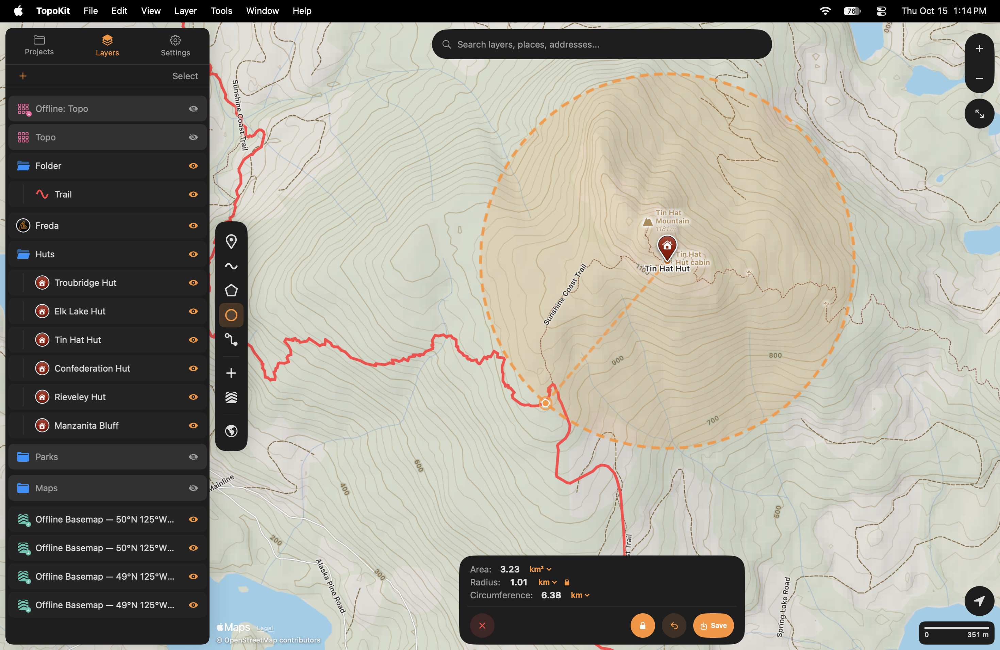
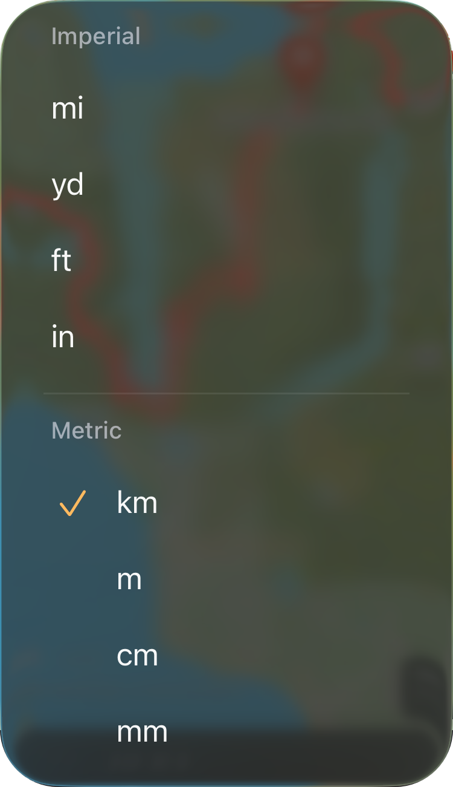
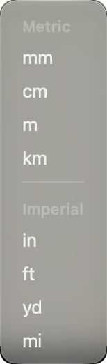
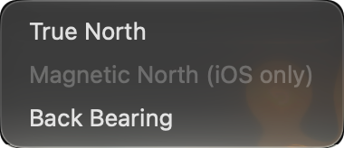

You can measure as you draw with :ui[Add Line]{icon=add-line}, :ui[Add Polygon]{icon=add-polygon}, :ui[Add Circle]{icon=add-circle} and :ui[Add Route]. Each tool shows measurements on its tool card, and you can cancel instead of saving to close it without adding anything to the project. To adjust the shape as you measure, you can [place and move vertices](/manual/points-lines-polygons/#moving-adding-and-deleting-vertices).

You need an open project to use the line, polygon and circle tools, even when you only want to measure. You can start a [route](/manual/routes/) without an open project by choosing **Route here** (**Route to Here** on Mac) on a card.

## Live measurements

Measurements appear once you have added enough points to the shape. A line or route needs two points, a polygon needs three, and a circle needs a centre and an edge point.

::::platforms
:::ios
<video src="/media/getting-started-draw-and-measure-iphone.mp4" autoplay loop muted playsinline aria-label="Drawing a polygon round Inland Lake on iPhone: each tap adds a corner and a length appears along each side; the tool card counts the points it still needs until the third corner, then updates Area, Perimeter and Points with each corner; a tap on Area makes the card read Copied"></video>
:::

:::mac
<video src="/media/getting-started-draw-and-measure.mp4" autoplay loop muted playsinline aria-label="Drawing a polygon round Inland Lake on a Mac: each click adds a corner and a length appears along each side; the card counts the points it still needs until the third corner, then its Area, Perimeter and Points update as the shape grows; a corner is dragged, and Save opens the New Polygon sheet"></video>
:::
::::

To copy a measurement, tap its figure on the tool card. The number is copied as shown, rounded and with your device's thousands separator and decimal mark (`1,234.5`), but without its unit. A bearing is copied as three digits with its degree sign (`045°`). A route's figures have no unit menu and cannot be copied.

When you save a line, polygon or circle, its tool card measurements are not saved with it. Tapping the saved feature opens its [card](/manual/search-and-identify/#the-card), where the measurements are calculated again and copied values include the unit. A saved circle is a polygon, so its card shows **Area** and **Perimeter** without **Radius**. A [saved route](/manual/routes/#saving-a-route) keeps its distance and travel time as properties.

## Circles and the radius lock

Until you lock a circle, you can [resize it](/manual/points-lines-polygons/#circles) with a tap or by dragging its edge point. While the circle is unlocked, dragging its centre moves only the centre, which also changes the radius.

::::platforms
:::ios

:::

:::mac

:::
::::

To keep the radius while moving the circle, turn on the lock, which becomes active once the circle has a radius. You can then tap elsewhere or drag the centre to move the whole circle, and the edge point keeps its bearing from the centre. Dragging the edge point moves it round the rim.

Both the measurement and the ring use the radius captured when you locked the circle, so the figure stays the same however far you move it, and unlocking leaves the circle as it was.

Locking and unlocking each have their own [undo step](/manual/interface/#while-a-tool-is-open), **Lock Size** and **Unlock Size**. If you use Undo straight after locking, the circle unlocks at the same size, and if you undo a move made while locked, the lock stays on.

## Units

To choose the starting units for line, polygon and circle cards, use the **Distance** and **Area** pickers in [**Settings → Units & Coordinates → Measuring Tools Start With**](/manual/settings/#units--coordinates). **Distance** also sets the starting units for perimeter, radius and circumference. Both pickers offer only units from the system selected in **Units**, and switching **Units** between **Metric** and **Imperial** resets them to km and km², or mi and mi², respectively.

To change units while measuring, open the menu using the unit after a figure. This menu offers both metric and imperial units regardless of the **Units** setting, and choosing a unit converts every figure of that kind on the card without changing your defaults. Feet, miles, square feet and acres use the international foot of exactly 0.3048 m.

::::platforms
:::ios

:::

:::mac

:::
::::

The **Units** picker alone sets the units for a route's distance on its tool card and the figure on the **Edit Vertices on Map** card. It also sets the units for distances on the elevation profile, a saved feature's **Length**, **Area** and **Perimeter** on its card, and segment lengths on the map. These measurements choose their scale by size: m below 1,000 m, then km; ft below 1,000 ft, then mi; m², ha and km², or ft², acres and mi².

## Bearing

A line's card shows the bearing of its last segment to the whole degree, from 0–360° clockwise from north. This segment joins the final pair of points in the line's order, rather than the pair you placed most recently if you added points after an earlier one. To choose a bearing mode, open the menu using the tag after the figure (**TN**, **MN** or **BB**):

- **True North** shows the initial great-circle bearing from true north, calculated on a sphere rather than the ellipsoid.
- **Magnetic North** shows the true bearing minus the magnetic declination at your position. TopoKit calculates declination from the difference between the true and magnetic headings reported by the compass and recalculates it with every compass reading. A line drawn far away still uses the declination where you stand.
- **Back Bearing** shows the true bearing plus 180°, giving you the direction back the way you came.

:::mac

:::

A line opens in True North unless you choose another default in **Settings → Units & Coordinates → Bearing**, and switching **Units** leaves the bearing mode unchanged. :ios[On iPhone, the **True N** / **Mag N** switch under the [GPS tab's compass](/manual/gps-and-track-recording/#the-compass) sets the same default.]

:ios[On iPhone, Magnetic North needs location access. The menu shows **Magnetic North (needs your location)** and greys it until the first compass reading after a location fix.] :mac[On Mac, the menu shows **Magnetic North (iOS only)** and greys it because the Mac has no compass, and Settings does not offer this mode.] When Magnetic North is the default, the card shows the true bearing under the **MN** tag until a declination is available.

## Segment lengths

You can see segment lengths on the map while drawing a line or polygon, or editing a saved one with **Edit Vertices on Map**. These include a polygon's closing side, and each label appears only when its text fits inside the segment on screen. Zoom in to see more labels; where two would overlap, only the longer segment's label appears. The circle and route tools do not show segment lengths, as a route's labels would measure the straight line between two stops rather than the road.

Turn off **Settings → Units & Coordinates → Show Segment Lengths** to hide the labels; the faint dots between points remain visible.

## Calculation methods

### Distance

TopoKit measures distances on your own data along the Earth's ellipsoid, including distances on tracks and elevation profiles. A circle's circumference is the exception, calculated as 2πr from its radius. A line's length is the sum of its segment distances, measured point to point. Altitude is not included in any distance, so a line up a steep slope shows its map distance, which is shorter than the distance walked.

Distances are calculated using Apple's Core Location function, [`CLLocation.distance(from:)`](https://developer.apple.com/documentation/corelocation/cllocation/distance%28from:%29). Apple publishes neither its algorithm nor an error bound.

A route's distance is calculated by summing distances along the road line returned by Apple Maps, using the same method as a line. TopoKit uses this calculation rather than Apple's own distance figure, so the distance matches the route's profile. When Apple finds no road for a leg, that leg counts as the straight distance between its two stops. Travel time uses Apple's estimate for the road legs only, so a straight leg adds distance but no time.

### Area and perimeter

TopoKit measures area on the WGS84 ellipsoid using a Lambert azimuthal equal-area projection centred on the polygon. It projects the polygon onto a plane, then applies the [Shoelace formula](https://en.wikipedia.org/wiki/Shoelace_formula). The equal-area projection adds no error that grows with the polygon's size or latitude. A 1° by 1° cell between 45° and 46° N, with its sides densified to follow the parallels and meridians, measures within two parts in 100,000 of its exact ellipsoidal area.

The only approximation comes from treating each side as a straight line between its two vertices on the projected plane rather than a geodesic. The difference grows with the side's length, so to make a long side follow a particular line, such as a parallel, add points along it.

Perimeter uses the same distance function as a line, summed segment by segment. It follows the Earth's curve along each side, while the area calculation treats each side as a straight line on the equal-area plane.

### Circles

TopoKit measures the radius from the centre to the edge point using the same distance function as lines. It then calculates area and circumference from that radius using the flat-plane formulas πr² and 2πr. On the curved Earth, a circle of that radius is slightly smaller than these formulas give, so both figures read a little high, with the difference increasing as the radius grows.

When you draw or save a circle, TopoKit creates a ring of 64 vertices at equal bearings round the centre, starting due north. Vincenty's direct formula places each vertex on the WGS84 ellipsoid at the radius shown on the card. The ring represents a true circle on the ground, so it looks stretched on the map near the poles or at very large radii.

The ring's straight sides lie just inside the true circle between vertices. The ring passes through your edge point only when that point lies on one of the 64 bearings.

## FAQ

**Why doesn't my distance match my handheld GPS?**
If your handheld shows the distance of a recorded track, that distance includes the [wander of every fix](/manual/gps-and-track-recording/#faq). When both devices measure the same points, the remaining difference comes from the earth model and altitude: TopoKit measures along the [ellipsoid](#distance) without including altitude.
