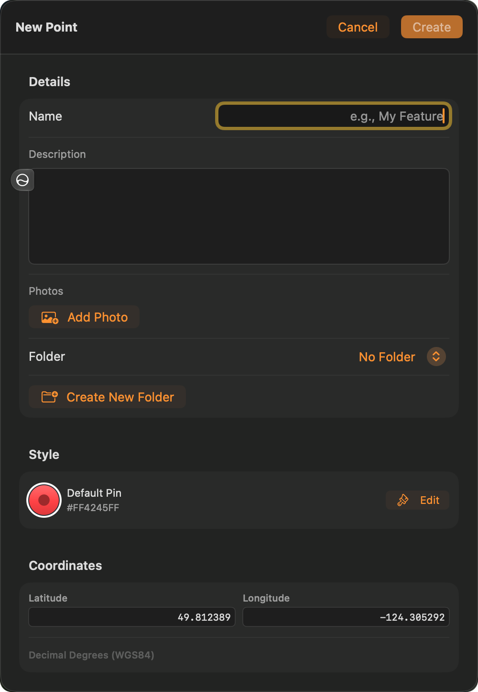
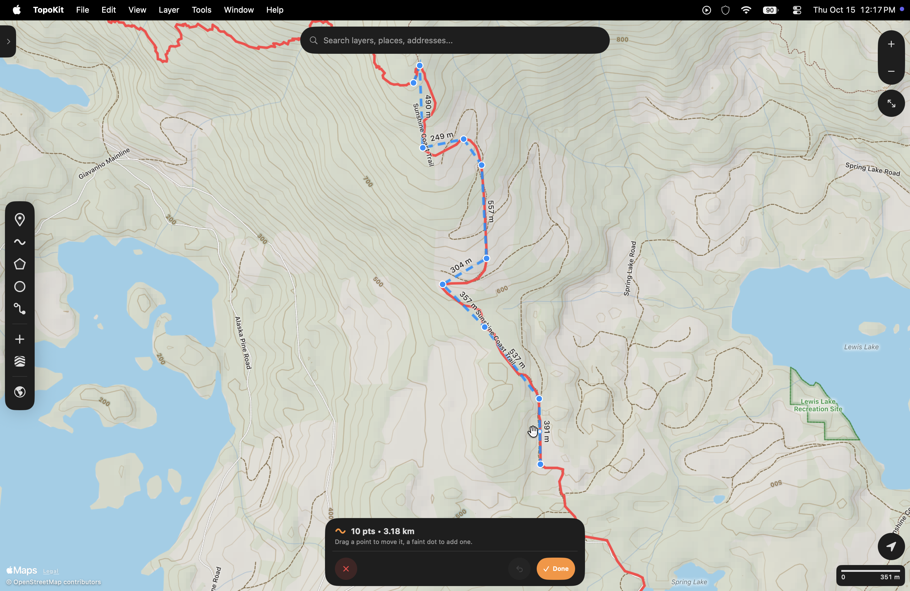
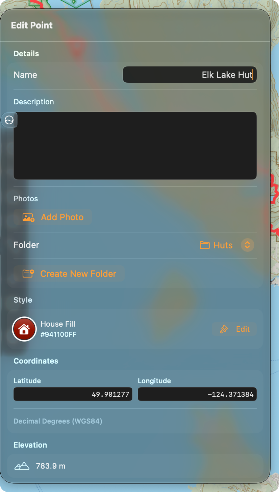
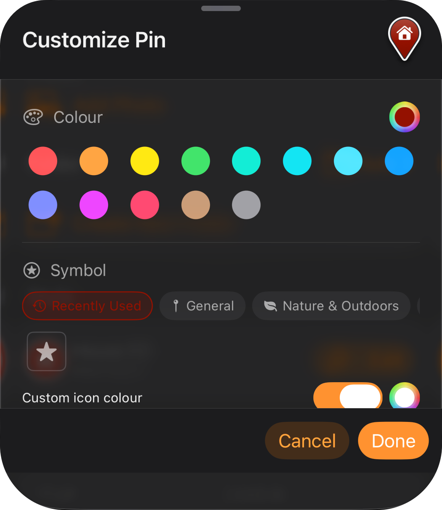
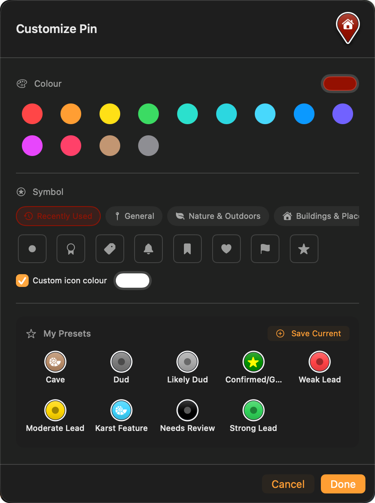

A TopoKit project stores three geometry types: points, lines and polygons.

## Adding a point

Choose a location for the point in one of these ways to open the editor for that spot.

- Tap :ui[Add Point]{icon=add-point}, then tap where you want the point on the map.
- To place the point at your GPS fix, tap the :ui[location]{icon=location} button on the Add Point tool card. The button appears once TopoKit has location access; the line, polygon and circle tool cards have no location button.
- Choose **Add Point** on the card of a search result, a typed coordinate, a [held spot](/manual/search-and-identify/#holding-a-spot-and-the-place-card), or a peak, hut or other mark on a basemap you built.
- :mac[On Mac, right-click an empty spot on the map and choose **Add Point Here**, or right-click a basemap mark and choose **Add Point**.]

::::platforms
:::ios

:::

:::mac

:::
::::

Once you place the point, the tool closes and you can adjust the coordinate in the editor. Enter a name to make **Create** available, then tap it to save the point.

:ios[On iPhone, a point placed from your location also stores the GPS reading in its **Attributes**. This includes accuracy, timestamp and original lat/lon, along with altitude, speed and course when the fix includes them. If you move the saved point, it keeps the original lat/lon and adds **Gps Location Edited** to its Attributes; moving it back to the recorded location removes **Gps Location Edited**.]

## Adding lines, polygons and circles

To draw a shape, choose :ui[Add Line]{icon=add-line}, :ui[Add Polygon]{icon=add-polygon} or :ui[Add Circle]{icon=add-circle} in the tool sidebar. These tools are greyed out until you open a project. :mac[On Mac, you can also start each tool from the **Tools** menu using the keyboard shortcuts listed in [The menu bar](/manual/interface/#the-menu-bar).] As you draw, the [tool card](/manual/interface/#the-map) shows the shape's [live figures](/manual/measurement/).

::::platforms
:::ios
<video src="/media/points-lines-polygons-line-tool-iphone.mp4" autoplay loop muted playsinline aria-label="The line tool on iPhone tracing the Sunshine Coast Trail: each tap adds a vertex on the trail and a length appears along the segment, the card's Distance, Bearing and Points grow, a tap back on an earlier vertex rings it so the next tap inserts the trail's hairpin after it, a faint dot is dragged onto a bend the trace cut, and Save opens the Line Editor"></video>
:::

:::mac
<video src="/media/points-lines-polygons-line-tool.mp4" autoplay loop muted playsinline aria-label="The line tool on a Mac tracing the Sunshine Coast Trail south of Tin Hat Hut: each click adds a vertex on the trail and a length appears along the segment, a click back on an earlier vertex rings it so the next click inserts the trail's hairpin after it, a faint dot is dragged onto a bend the trace cut, and Save opens the New Line sheet"></video>
:::
::::

Tap the map to add a vertex, shown as a dot using **Settings → Features → [Vertex Style](/manual/settings/#features)**. A ring marks the active vertex, which is the one you touched last. New vertices are inserted after it, so you can tap an earlier vertex and add to the middle of a line without starting over.

Every change to the shape is a [step](/manual/interface/#while-a-tool-is-open), and you can tap **Undo** on the tool card to undo the most recent change. To view [a profile while you draw](/manual/elevation/#a-profile-while-you-draw), tap **Elevation profile** on the line's tool card.

Tap ✕ on the tool card to discard the shape and its steps without confirmation. :mac[On Mac, starting another tool from the tool sidebar or the **Tools** menu also discards the shape and its steps, or restores a line or polygon open in [Edit Vertices on Map](#reshaping-a-saved-line-or-polygon) to its previous shape. An **Unsaved Work** alert asks for confirmation first when vertices have been placed or moved.]

### Polygons

A polygon needs 3 vertices and appears as an open outline until you add them. TopoKit closes the ring for you, so you don't need to tap the first corner again. The tool card shows [area and perimeter](/manual/measurement/#area-and-perimeter) instead of length.

### Circles

Tap once to place the centre, then tap again to set the edge. Each tap after that resizes the circle, and you can use the [lock button on the tool card](/manual/measurement/#circles-and-the-radius-lock) to keep the radius. Circles have no faint dots, **Delete Point** or segment lengths.

When you save a circle, TopoKit stores it as a polygon feature with a 64-vertex ring on the WGS84 ellipsoid, using the radius shown on the tool card. Tapping **Save** opens the polygon editor, and from then on the feature is a polygon in every respect, including when you export it.

## Moving, adding and deleting vertices

You can move, add and delete vertices while drawing a line or polygon, or while using [Edit Vertices on Map](#reshaping-a-saved-line-or-polygon).

::::platforms
:::ios

:::

:::mac

:::
::::

- To move a vertex, drag it to a new location. Releasing it records the drag as one step.
- To add a vertex along a segment, drag the faint dot halfway along it; tapping the dot does not add a vertex. The dot appears only when the segment is long enough on screen for you to grab it without touching either end. No more than 100 faint dots appear at once, and a long line viewed from far out has none until you zoom in. :mac[On Mac, a segment's faint dot appears only while the pointer is near it.]
- To delete a vertex, :ios[tap it on iPhone to mark it with a ring, then tap it again and choose **Delete Point**. The vertex you placed or touched last is already ringed, so you only need to tap it once.] :mac[right-click or Control-click it on Mac; the vertex is deleted without opening a menu.] You can restore a deleted vertex with **Undo**.

In Edit Vertices on Map, you can delete vertices down to two for a line and three for a polygon; **Delete Point** is not offered if it would leave fewer. While drawing, you can delete any number of vertices, but **Save** becomes available only when the shape has enough vertices again.

## Finishing a shape

To finish drawing, tap **Save** on the tool card to open the editor. **Save** becomes available at two vertices for a line or circle and three for a polygon, and you need to enter a name in the editor before you can tap **Create**.

The editor's **Vertices** section lists one row per vertex, where you can edit its coordinate in place. The section is collapsed when the shape has 20 or more vertices; once you expand it, you can use **Show more** to view 20 rows at a time. :ios[On iPhone, tap **Edit** in the list's header to reorder or delete rows, down to 2 vertices for a line and 3 for a polygon.]

If you cancel the editor, you return to the drawing with every vertex in place. The Vertices list is available only when creating a shape; you reshape a saved shape on the map.

## Reshaping a saved line or polygon

To reshape a saved line or polygon, tap **Edit Vertices on Map** in its editor. :mac[On Mac, you can also choose **Layer → Edit Vertices on Map** for the line or polygon selected in the Layers tab.] The editor saves its changes and closes, and the vertices appear as dots that you can [move, add and delete](#moving-adding-and-deleting-vertices).

::::platforms
:::ios
<video src="/media/points-lines-polygons-edit-vertices-iphone.mp4" autoplay loop muted playsinline aria-label="Edit Vertices on Map on iPhone on a line traced along the trail: a vertex that slipped beside the trail is dragged onto it, a tap rings a vertex and a second tap shows Delete Point, which deletes it, the card's Undo brings it back, a faint dot is dragged from a segment that cuts a bend onto the bend, and Done"></video>
:::

:::mac
<video src="/media/points-lines-polygons-edit-vertices.mp4" autoplay loop muted playsinline aria-label="Edit Vertices on Map on a line traced along the Sunshine Coast Trail on a Mac: a vertex that slipped beside the trail is dragged onto it, a right-click deletes a vertex with no menu, the card's Undo brings it back, a faint dot is dragged from a segment that cuts a bend onto the bend, and Done"></video>
:::
::::

Each change is saved to the feature as you make it and recorded as a separate undo step. Tap **Done** to keep all the changes; you can still undo them one at a time afterwards. To restore the line or polygon to its shape when you opened Edit Vertices on Map, tap ✕, which also removes those undo steps. While the tool card is open, you can use its **Undo** :mac[or **Edit → Undo**] to undo only changes from this editing session, as described in [While a tool is open](/manual/interface/#while-a-tool-is-open).

Vertices you leave in place keep their height, time and accuracy, so a recorded track keeps its timings. Vertices you move or add have none of these values.

## Editing a feature

To edit a saved feature, open its row in the Layers tab or tap **Edit** on its map card.

:::mac
On Mac, a saved feature opens in an editor popover that saves when you click outside it and has no Cancel control. When you create a feature, the editor opens as a sheet.
:::

:::ios
On iPhone, the editor saves whenever you leave it, whether you tap **Done**, swipe the sheet down or go back to the Layers tab.
:::

::::platforms
:::ios

:::

:::mac

:::
::::

Some changes are saved before you close the editor: a style when you tap **Done** in its sheet, a photo when you add or delete it, and a height when **Get Elevation** returns. A point's **Elevation** section fills in automatically when the elevation tile for that spot is on the device. Otherwise, you can tap **Get Elevation** to download that one tile, 25–40 MB, as described in [Elevation at a point](/manual/elevation/#elevation-at-a-point).

Changes made in an editor are not [undo steps](/manual/interface/#undo-and-redo). Moving the feature to another folder, creating a folder with **Create New Folder** and deleting the feature are recorded as undo steps.

### Coordinate entry formats

Coordinate fields use the format you choose in **Settings → Units & Coordinates → [Coordinate Format](/manual/settings/#units--coordinates)**, and TopoKit stores the coordinates as decimal degrees whichever format you choose. When entering decimal degrees, use negative numbers for south and west, as there is no hemisphere menu.

You can use a comma as the decimal mark in decimal degrees, DMS seconds and DDM minutes, so `49,5` is read as 49.5. UTM easting and northing fields do not accept a comma because it may be a thousands separator. If an entry cannot be read or is out of range, the field shows the reason in red and keeps the coordinate's last valid value.

### Attributes are read-only

The **Attributes** list shows values recorded by TopoKit, such as a recorded track's statistics, and every attribute included with an imported feature. Attribute names appear in title case with the words separated, so `track_distance` appears as **Track Distance**. The list is sorted alphabetically rather than in the file's order, omits empty values and opens collapsed when it has more than five attributes. You can [search](/manual/search-and-identify/#search) imported values, and they are included when you [export](/manual/import-and-export/#what-an-export-contains).

A feature you draw has a name and a description, with no custom fields. TopoKit has no attribute editor, so to capture structured attributes, collect the geometry in TopoKit, export it to GeoPackage, then add attributes in your desktop GIS.

## Photos

To add photos to a feature, tap **Add Photo** or the **+** tile after the last thumbnail in the editor's Details section. You can select up to 10 images from the photo library at a time, and a feature can have more. :ios[On iPhone, **Take Photo** adds one photo each time you use it and saves it only in the project, not in your Photos library.] :mac[On Mac, **Import from Files** lets you add any number of images at once.]

TopoKit limits each image's longest edge to the size set in **Settings → Storage & iCloud → [Photo Size](/manual/settings/#storage--icloud)**, saves it upright as JPEG, and stores it with a thumbnail in a `Photos/` folder [beside the project file](/manual/projects-and-files/#file-locations). When you create a feature, its photos are attached when you tap **Create**.

Tap a thumbnail in the editor or on the feature's card to open the viewer, where you can page through all the feature's photos. :mac[On Mac, use the Left and Right arrow keys to page through them.] To delete a photo, choose **Delete** in the viewer's :ui[More]{icon=ellipsis} menu and confirm, or choose **Delete** in the thumbnail's menu in the editor to delete it without confirmation. Deleting a photo removes its file from the project, and you cannot restore it with Undo.

If a photo's file is missing, an exclamation mark replaces its thumbnail and the viewer shows **Photo unavailable**. This can happen if you move a project by hand without its `Photos/` folder; put the folder back beside the project file and open the feature again. If you open a feature over iCloud Drive before its photos arrive, they appear unavailable until you reopen it. Photos are not included when you [paste or duplicate a feature](/manual/layer-tree/#copying-pasting-and-duplicating).

## Styling a feature

To change a feature's style, tap **Edit** in the editor's **Style** row to open **Customize Pin**, **Customize Line** or **Customize Polygon**. A feature you draw uses a copy of the **Default Style** for its kind in **Settings → Features**. The style is copied when you create the feature, so changing the default later leaves existing features as they are.

::::platforms
:::ios

:::

:::mac

:::
::::

- For pins, choose the small dot at the start of the **General** symbol category to use no symbol. A pin with no symbol shows a disc in a shade of its own colour, and **Custom icon colour** appears only when you set a symbol. The symbol picker opens on **Recently Used**, which shows your last eight symbols, or on **General** until you have used a symbol.
- For polygons, choose the first stroke swatch, marked with a link, to copy the current fill colour to the stroke. This copies the colour once, so changing the fill afterwards leaves the stroke as it was. Both stroke and fill opacity can be set to 0%, letting you show only the outline or only the fill, while a line's minimum opacity is 10%. Until you change the defaults, fill opacity starts at 15% for polygons you draw and 25% for imported polygons.
- To save a style in **My Presets**, choose **Save Current**; the list is empty until you save one. Tap a preset to load it into the sheet, then tap **Done** to apply it. You can choose **Delete** from a preset's context menu, but you cannot rename a preset. Presets are stored on this device and do not sync, and each feature's style is saved in the project so it looks the same when opened elsewhere.

To restyle every feature of a kind in a folder at once, [style the folder](/manual/layer-tree/#styling-a-folder).

## Points on the map

You can choose when point names appear under their pins in **Settings → Features → [Pin Names](/manual/settings/#features)**. With the default, **Always**, names appear unless they would overlap another pin, a cluster bubble or another name, so more names appear as you zoom in. Up to 150 names appear at once, and when more than 600 single pins are on screen, excluding pins inside bubbles, only the picked pin's name appears.

::::platforms
:::ios

:::

:::mac

:::
::::

A name appears on at most two lines and is cut off with an ellipsis, while a point with no name or named Untitled Point shows no name. A [picked pin](/manual/search-and-identify/#the-card) appears at one and a half times its size, and its name is bold and visible even when it overlaps other items. :ios[On iPhone, names follow the system text size, up to 22 pt.]

With **Point Clustering** on, as it is by default, overlapping pins merge into a round bubble showing the number of points. Tap a bubble to zoom in and spread the points apart; when they share one spot or the map is at its closest zoom, the card lists them.

## Moving features between folders

To create a folder for a feature, tap **Create New Folder** in its editor. The new folder is created immediately at the top level of the tree and selected as the feature's folder, so cancelling the editor leaves the new folder empty. A feature you are creating is saved into the new folder, and a feature you are editing moves into it when the editor closes.

The folder picker lists only folders that directly contain a feature of the same type, so a new or empty folder, or one containing only subfolders, does not appear. You can also [move rows in the Layers tab](/manual/layer-tree/#moving-rows).

## FAQ

**Why can I reshape only part of a multi-part line or polygon?**
When you use Edit Vertices on Map, you edit the first part of a line or the outer ring of a polygon's first part, and the other parts and any holes stay as they are. An imported multi-point opens in the point editor at its first point, so changing the coordinate moves only that point. To change the rest, [export](/manual/import-and-export/#exporting-and-sharing) the feature, edit it in your desktop GIS, then import it again.

**How precise are the stored coordinates?**
TopoKit stores coordinates at full double precision, while the fields show decimal degrees to 6 decimal places (about 11 cm), DMS seconds to 2 decimals (about 31 cm), DDM minutes to 3 decimals (about 1.85 m) and UTM in whole metres. When you change any field, both latitude and longitude are stored as shown in the fields, so an edit in DDM can move a point by up to about 1 m.

**Can I make a feature use the default style again?**
To apply a default style again, open the **Default Style** you want in **Settings → Features**, save it with **Save Current** under **My Presets**, then apply that preset in the feature's own sheet. The style sheets have no reset, so you cannot do this with one tap.
