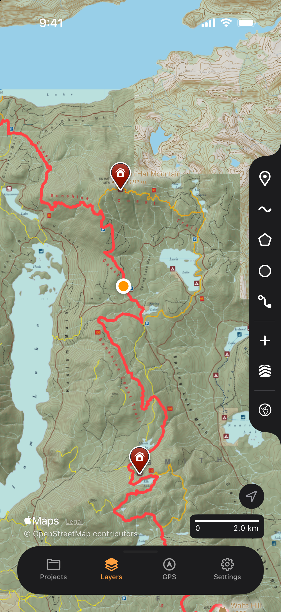
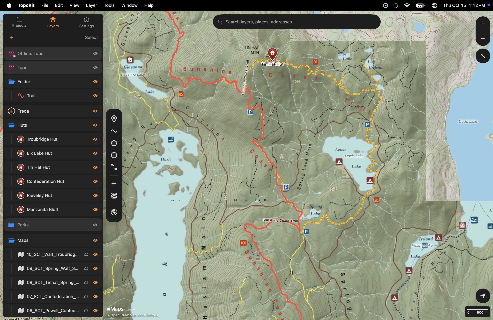
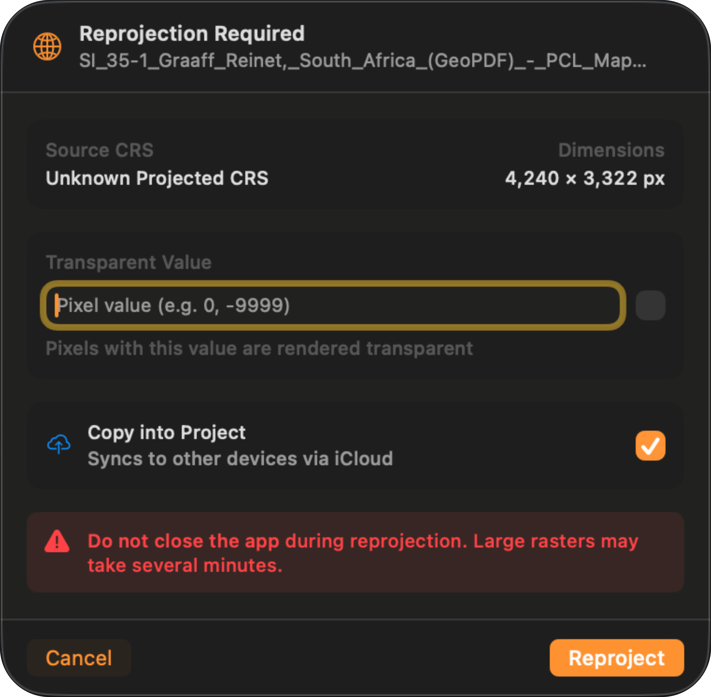
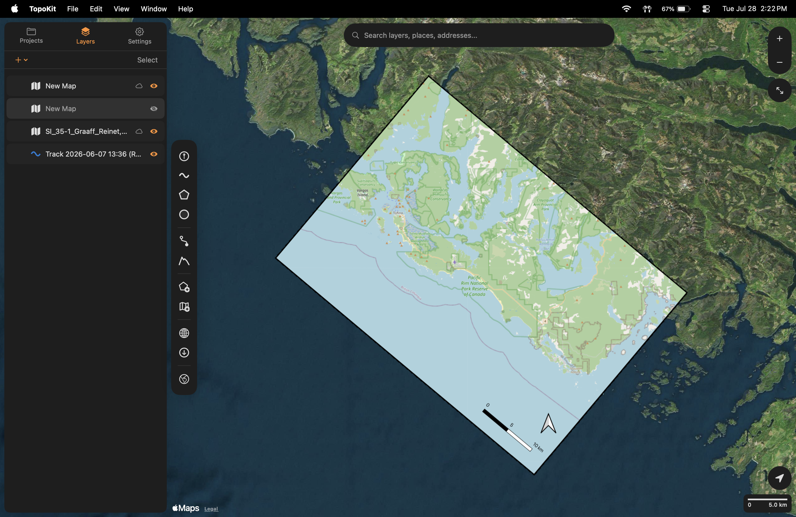

A raster overlay is a map image, such as an aerial photo, a scanned survey sheet or a hillshade, with its real-world position stored in the file. You can import images in two formats, **GeoTIFF** (`.tif`, `.tiff`, including BigTIFF) and **GeoPDF** (`.pdf`), then arrange their rows in the Layers tab to draw them above or below your points, lines and polygons.

The [Maps](/maps/) page lists where to download GeoPDF and GeoTIFF maps by country, province and state.

## Importing a raster

:::mac
On Mac, choose **Add Raster Layer…** from :ui[Add Data]{icon=plus} on the [tool sidebar](/manual/interface/#the-tool-sidebar), from the :ui[plus]{icon=plus} menu in the Layers tab, or from the **Layer** menu.

You can also drag a GeoTIFF or GeoPDF onto an open project's map, open a file with TopoKit from Finder, or drop it on TopoKit's Dock icon. These methods import the file in the same way, and if no project is open, TopoKit waits until you open one.
:::

:::ios
On iPhone, tap :ui[Add Data]{icon=plus} on the [tool sidebar](/manual/interface/#the-tool-sidebar) or :ui[plus]{icon=plus} in the Layers tab, choose **Add Raster Layer…**, and select one or more files. You can also open a GeoTIFF or GeoPDF in TopoKit from Files, Mail or Messages to import it in the same way. If no project is open, TopoKit waits until you open one.
:::

TopoKit copies each raster into its own storage on the device, so moving, renaming or deleting the original afterwards does not affect the layer.

::::platforms
:::ios

:::

:::mac

:::
::::

A raster appears at once when it needs no reprojection, followed by the [**Raster Storage** question](#rasters-and-icloud) if the project is in iCloud. When a raster needs reprojection, TopoKit opens the **Reprojection Required** sheet.

## The reprojection sheet

In the sheet, **Source CRS** reads "Unknown Projected CRS" when TopoKit did not detect an EPSG code. You can adjust the following settings before reprojection:

- **Transparent Value** sets the pixel value to make transparent when you turn on [NoData](#nodata).
- **Copy into Project** copies the raster into the project's folder so it [syncs through iCloud](#rasters-and-icloud). This setting starts on and appears only in an iCloud project when the raster has not already been copied into it.

To reproject several waiting rasters with the same settings, choose **All (N)**. TopoKit reprojects them in turn using the sheet's settings, so you only need to answer the sheet once.

If you choose **Cancel**, TopoKit switches the raster off. :mac[On Mac, you can open the sheet again by right-clicking the raster's row and choosing **Show**.] :ios[On iPhone, you can open the sheet again by tapping **Select** in the Layers tab, selecting the raster, and tapping **Show**.]

## Coordinate systems

A raster's coordinate system is read-only everywhere it appears.

For a GeoTIFF, TopoKit reads the EPSG code from the file's GeoTIFF keys or from a `.prj` selected with the image. UTM zones marked as "user-defined" in the keys still resolve, but TopoKit does not read the GeoTIFF's embedded WKT text.

When a GeoTIFF has a position but no declared projection, TopoKit places it as Web Mercator only if its coordinates fall within Web Mercator's range but beyond 1,000,000 east or west and 500,000 north or south of the origin, and it spans more than 1,000 metres in both width and height. The diagnostics in Edit Raster identify this as a guess. A State Plane sheet in feet can match the same numbers, so if such an image appears in the wrong place, import it again with its `.prj`.

For a GeoPDF, TopoKit first uses the projection parameters stored in the file. If those cannot be used, it reads the file's coordinate-system description, which can contain an `EPSG:` prefix, an `AUTHORITY["EPSG","XXXX"]` clause, or a recognized name such as a UTM zone, a State Plane zone or a national grid.

A raster is imported switched off, with no badge on its row, when TopoKit cannot resolve its coordinate system or convert its coordinates. The alert is titled **No Georeference Found**, **Coordinate Conversion Failed** or **Unsupported Coordinate System**, or **Raster Import Warnings** when several rasters fail at once.

If the alert asks for a `.prj` or world file, import the image again and select that file at the same time. Otherwise, correct the source file; for a GeoTIFF, you can use [`gdal_translate -a_srs EPSG:XXXX in.tif out.tif`](https://gdal.org/en/stable/programs/gdal_translate.html) to write the code into its keys.

### Sidecar files

To import a world file (`.tfw`, `.wld`, `.tifw`, `.tiffw`) or a `.prj`, select it together with the GeoTIFF in the file picker. TopoKit matches sidecars to images by name, ignoring case, so `quad.tif` uses `quad.tfw` and `quad.prj`.

A world file replaces the image's position in the TIFF but does not specify a coordinate system. TopoKit reads a `.prj` in the same way as a GeoPDF's coordinate-system description, and only when the GeoTIFF keys have no code.

Sidecars are ignored for GeoPDFs. :mac[On Mac, rasters dragged onto the map or opened from Finder are imported without sidecars.] :ios[On iPhone, rasters opened in TopoKit from another app are imported without sidecars.]

## GeoPDF import

TopoKit uses the main map to position a sheet that has a locator inset. For a multi-page PDF, split the file and import each page, because TopoKit takes the georeference from the first page that has one but always draws page 1.

Control points pair positions on the page with positions on the Earth. The number of control points determines how TopoKit places the sheet:

| Control points | How the sheet is placed |
|---|---|
| Exactly four | The sheet is reprojected, which straightens the edges of a wide sheet and may trim two diagonal corners. |
| Five or more | The sheet is reprojected with the edges of a wide sheet still bowed and nothing trimmed. |

### Edge clipping

TopoKit clips a sheet placed by four or more control points to the outline formed by those points. When the points are at the neatline corners, this removes the collar outside the neatline, which contains the title block, legend and scale bar and has no position on the ground. The following two causes clip more of the sheet:

- If control points are registered at the tick marks rather than the outermost corners, clipping removes tick labels or a sliver of terrain. To avoid this, register the source at the outermost corners.
- When a sheet has exactly four control points, TopoKit clips it to the largest rectangle inside its reprojected trapezoid, which can trim two diagonal corners. You cannot turn this clipping off.

## How reprojection works

TopoKit draws everything in Web Mercator (EPSG:3857), using [PROJ](https://proj.org) for projection calculations so that almost any coordinate system with an EPSG code works. Rasters already in Web Mercator or plain latitude/longitude (EPSG:4326, 4269 or 4258) are drawn straight from their files, except for GeoPDFs with four or more control points. All other rasters are reprojected, and TopoKit caches the results.

When a GeoTIFF's transform or world file includes rotation or skew, TopoKit draws it in its true orientation as a tilted quadrilateral, whether or not it is reprojected. Imagery above about 85° latitude is clipped at the Mercator limit.

### Datum accuracy

For survey-grade alignment, transform a raster in NAD83 or ETRS89 latitude/longitude (EPSG:4269 or 4258) in your desktop GIS first. TopoKit draws these rasters straight from their files as if they were WGS84, but [NAD83 and WGS84 have drifted](https://www.ngs.noaa.gov/CORS/Articles/WGS84NAD83.pdf) one to two metres apart in North America.

### Reprojection quality

To set the resolution of reprojected rasters, choose **Settings → Map → Map Image Quality** in [Map settings](/manual/settings/#map). The number in the setting's label caps the longest side of each reprojected copy, and the default is **High (8192px)**. A larger source is averaged down and remains soft however far you zoom in, while a lower setting reprojects faster and uses less disk space.

Choose **Original** to keep every pixel of an 8-bit greyscale, RGB or RGBA GeoTIFF stored uncompressed or with DEFLATE. A GeoPDF is capped near 8,000 px even at **Original**, so crop it to the area you need before importing.

A reprojected copy keeps the quality it was made at, unless it is a GeoPDF placed by four or more control points. When you raise the setting, TopoKit reprojects those GeoPDFs again the next time they load.

To remake rasters at a new setting, choose **Clear Map Image Cache** in **Settings → Storage & iCloud → Map Image Cache**, under [Storage & iCloud settings](/manual/settings/#storage--icloud). Each raster is reprojected again the next time it loads, without showing the sheet.

### Reprojection time

A large raster can take several minutes to reproject, and its row shows a progress bar captioned "Keep TopoKit open" while you wait. When you use **All (N)**, a "Reprojecting rasters…" banner above the tree also shows how many rasters are done out of the total.

Once reprojection begins, there is no cancel button. If it is interrupted, TopoKit discards all of the work and starts again the next time the project opens, without showing the sheet.

If reprojection fails, the raster returns to the Reprojection Required sheet without an alert, and you can choose **Reproject** to try again. When you use **All (N)**, TopoKit skips a failed raster and continues with the rest.

:::ios
On iPhone, keep TopoKit on screen while it reprojects. If you switch to another app, iOS lets reprojection continue only briefly before suspending TopoKit, and reprojection starts over if iOS then closes it.
:::

### Caching

Each device reprojects its own copies because the cache does not sync through [iCloud](/manual/projects-and-files/#icloud-sync). TopoKit saves your approval in the project, so reprojection starts on another device without showing the sheet. The cache is capped at 2 GB, and when it is full, TopoKit removes the oldest copies first.

## Editing a raster

:mac[On Mac, click the raster's row to open **Edit Raster**.] :ios[On iPhone, tap the raster's row to open **Edit Raster**.]

::::platforms
:::ios

:::

:::mac

:::
::::

- **Opacity** controls how much of the map below shows through the raster, including Apple Maps' place names.
- **Render Quality** controls how much of the image is decoded, from 2048 px at Fast to the whole image at **Full**, the default. This row appears only for GeoTIFFs and applies only when they are drawn straight from their files. Reprojected rasters are drawn from their cached copies.
- **NoData Transparency** sets the pixel value to make transparent, as described in [NoData](#nodata), and takes effect when you close the editor.
- **Flip Y-Axis** lets you override auto-detection when it guesses the orientation wrong. If the raster appears upside down, choose **Force Flip**, and if it is still upside down, choose **Force No Flip**, because auto-detection had already flipped it. The change takes effect when you close the editor.

When you change NoData Transparency or Flip Y-Axis on a reprojected GeoTIFF, TopoKit reprojects it again at the current Map Image Quality when you close the editor. A raster drawn straight from its file redraws without reprojection.

:::ios
On iPhone, a Full decode runs only when the whole image fits in about 150 MB. Larger images remain at a 4096 px preview, which Balanced and Fast do not improve, so crop or downsample the source before importing.
:::

If a raster appears in the wrong place, first check **CRS** below the controls. It shows an EPSG code, or "Custom WKT" when the raster has no code. The import diagnostics below **Bounds** identify a latitude span over 120° or bounds that appear to have latitude and longitude swapped, either of which means the coordinate system or axis order is wrong. They also flag a GeoTIFF 8,000 px or more on a side, which is slow to reproject.

Changes you make in Edit Raster are not added to the undo history.

To send a raster's source file, choose **Share** from its :ui[Layer options]{icon=ellipsis} menu or from its right-click menu on Mac.

## NoData

NoData is the pixel value a raster uses for "no image here", usually the black or white block around a scanned sheet. To make these areas transparent, set the value and turn on NoData transparency, which is off by default. Neither step works alone. TopoKit fills in the field at import when a GeoTIFF stores its own NoData value; otherwise, the field starts empty.

Enter the display value of the pixels you want to make transparent, usually `0` for black or `255` for white. TopoKit rounds the value to a whole number, and a pixel counts as NoData only when all three RGB channels equal that value. Only values from 0 to 255 match a pixel, so a declared sentinel such as `-9999` makes nothing transparent. Replace it with the display value, or null those pixels out before importing.

You can set the value in **Transparent Value** on the sheet before the first reprojection, or later in Edit Raster. If the raster has already been reprojected, changing the value in Edit Raster requires a second reprojection.

## Rasters and iCloud

| Storage | Where the file is | Syncs to other devices |
|---|---|---|
| Referenced | TopoKit's own copy, in the app's storage on this device | No |
| Embedded | The project's `Rasters/` folder | Yes, in an iCloud project |

When you import rasters into an iCloud project, the **Raster Storage** question appears once for the rasters imported together, and choosing **Cancel** leaves them referenced. In a local project, no question appears, and a raster stays referenced until you choose **Copy to iCloud** in Edit Raster.

If copying a raster from the **Raster Storage** question or with **Copy to iCloud** fails, it stays referenced, and an **Embed Failed** alert names the raster and explains the reason.

While an embedded raster uploads, its row shows a cloud with an up arrow and a spinner. A banner above the tree counts the files until it reads "All N raster(s) uploaded to iCloud". Afterwards, the row shows a plain cloud to mark the raster as embedded, while a referenced raster has no cloud on its row.

To delete the project's copy and use TopoKit's own copy for the layer, choose **Remove from iCloud**. On a device that received the raster through iCloud, there is no such copy, so removing it makes the raster unavailable on that device.

On another device, the project file downloads before the rasters. While a raster downloads, its row shows a cloud with a down arrow and a spinner, and a banner counts the files; the raster is not drawn yet. If iCloud has not started sending a file, the cloud becomes a button you can use to request the file again.

## Deleting a raster

To remove a raster layer, choose **Delete Raster** in Edit Raster or [delete its row](/manual/layer-tree/#deleting). You can restore the layer with [Undo](/manual/interface/#undo-and-redo). TopoKit's own copy of a referenced raster stays on the device, while an embedded copy is deleted from the project's `Rasters/` folder the next time the project opens. Until then, Undo restores the layer with its image.

## Troubleshooting

When a raster fails to draw, a warning triangle appears on its row, including for a GeoTIFF whose file is missing. :mac[On Mac, hover over the triangle to read the reason, such as "Raster file missing" or "Failed to load raster image".]

If TopoKit's copy of a raster is not on the device, a "raster file(s) not found" banner lists each missing file with a **Re-link** button. This can happen when you open an iCloud project on another device and the raster was never embedded. A raster still downloading from iCloud is not missing.

Use **Re-link** to choose the file for the layer. TopoKit uses the file at its current location without copying it into its own storage, so moving that file makes the raster unavailable again.

## FAQ

**Can TopoKit colour a DEM or an NDVI grid?**
To display a DEM or an NDVI grid, first render the single-band product to 8-bit RGB or greyscale in your desktop GIS. TopoKit draws a raster as stored, with no band selector, contrast stretch or colour ramp.
