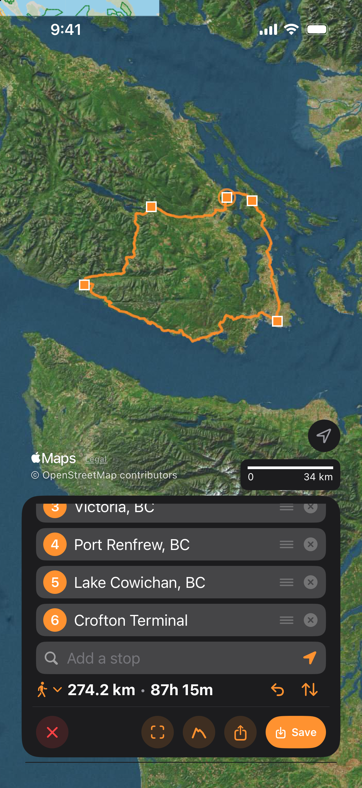
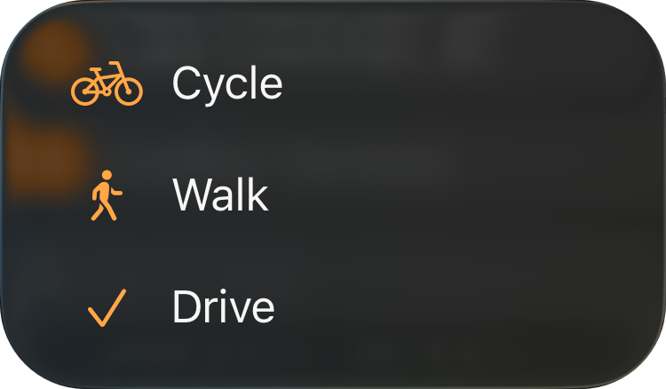
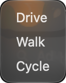

Use Add Route to plan a driving, walking or cycling route through up to 14 stops. TopoKit requests directions from Apple Maps between each pair of neighbouring stops and draws each leg on the map as the directions arrive. You can save the finished route in your project as a line.

## Adding stops

To start a route, choose :ui[Add Route] in the tool sidebar. :mac[On Mac, you can also choose **Tools → Add Route** (`Cmd-5`).] The button is dimmed until a project is open:mac[, and so is the menu item].

The tool card opens with one empty field labelled **Start**. You can add a stop in any of these ways:

- Tap the map to add a stop at the end of the list.
- To use your location, tap :ui[My Location]{icon=location} at the right end of the empty field. This adds a stop named "My Location" at your position when you add it, and the stop stays there as you move. The button appears when the field is empty, the route has fewer than 14 stops, you have granted [location access](/manual/gps-and-track-recording/#location-permissions) and a location fix is available.
- To enter a coordinate, type it into the empty field, then choose its row. You can use [any of the four formats](/manual/search-and-identify/#coordinate-formats), regardless of your coordinate format setting.
- To search, type a name into the empty field, which searches the same sources as the [search bar](/manual/search-and-identify/#what-each-section-finds). Choosing a point, a basemap name, a place or a coordinate adds it as a stop; choosing a line, polygon, folder, raster or tile layer adds nothing.

When you add a stop from search, a typed coordinate or :ui[My Location]{icon=location}, the map moves to frame the stops. Each stop appears as a dot on the map, with a ring around the stop you just added, selected or dragged.

You can add up to 14 stops, including the start and end. At 14, the field reads "14 stops is the most", and tapping the map adds nothing unless a stop is selected, in which case the tap moves that stop.

::::platforms
:::ios
<video src="/media/routes-adding-stops-iphone.mp4" autoplay loop muted playsinline aria-label="Add Route on iPhone, a loop round southern Vancouver Island: each stop typed into the card's field and picked from the results, Crofton Terminal, Ganges, Victoria, Port Renfrew, Lake Cowichan and Crofton Terminal again, each leg drawing as Apple answers with the distance and time on the totals line, then Walk chosen from the travel-mode menu and the legs asked for again"></video>
:::

:::mac
<video src="/media/routes-adding-stops.mp4" autoplay loop muted playsinline aria-label="Add Route on a Mac, a loop round southern Vancouver Island: six stops typed into the card's search field and picked one after another, Crofton Terminal, Ganges, Victoria, Port Renfrew, Lake Cowichan and Crofton Terminal again, each leg drawn as Apple answers, the two ferry crossings included, then Walk and Cycle chosen from the travel-mode menu and the legs asked for again, and Drive once more"></video>
:::
::::

When you tap the map to add a stop, TopoKit uses Apple's place lookup to name it, for example "St Mary's Ln". The field shows the stop's coordinates until the lookup returns a name, or if it finds nothing.

### Starting from a point or a place

- To make a point, place or search result your destination, choose **Route here** (**Route to Here** on Mac) on its [card](/manual/search-and-identify/#the-cards-buttons). That spot becomes the last stop, and if a location fix is available, "My Location" becomes the start and TopoKit requests the route at once. Without a fix, the spot is the only stop until you tap the map, choose a search result or use :ui[My Location]{icon=location} to add the start. You can do this without a project open, but you need one to save the route.
- To route to a point or multipoint from its row in the Layers tab, :ios[open :ui[Layer options]{icon=ellipsis} → **Route to Here** on iPhone.] :mac[right-click the row on Mac, or select it and choose **Layer → Route to Here**.] The point becomes the only stop even when a location fix is available, and the next stop you add becomes the start. For a multipoint row, the route ends at its first point.
- To start from a spot with nothing on it, use the **Start here** menu on the card for a [held spot or a typed coordinate](/manual/search-and-identify/#holding-a-spot-and-the-place-card). :mac[On Mac, the map's [right-click menu](/manual/search-and-identify/#right-clicking-the-map) also offers **Add Route From Here** and **Route to Here**.] You need a project open to start a route this way, but you can use **Route here** (**Route to Here** on Mac) on the same card without one.

## The tool card

Once you have two stops, the totals line below the fields shows the travel-mode menu, distance and travel time, along with a count of straight legs when there are any. It also includes **Undo** and **Reverse**, and **Redo** appears once you have undone a change.

::::platforms
:::ios

:::

:::mac

:::
::::

The distance is measured along the line drawn on the map, so it matches the elevation profile, while the travel time comes from Apple. Distance units are described in [Measuring](/manual/measurement/#units). Choose **Elevation profile** to view the [profile of the route you are drawing](/manual/elevation/#a-profile-while-you-draw), or **Zoom to** to frame the whole route on the map.

::::platforms
:::ios

:::

:::mac
![The elevation profile of the loop open under the map on a Mac, beside the six stop fields and the totals line reading 281.8 km • 6h 1m, with the stops on the map as dots and Crofton Terminal, where the loop starts and ends, ringed beside Ganges at the top: the chart runs the whole 281.8 km with the six stops marked along its foot, the pointer rests on it at 110.3 km and 44 m with its marker on the route near Sooke, and the figures below read Gain 5,854 m, Loss 5,854 m, Min 0 m, Max 395 m and Avg 106 m](../../../assets/manual/routes-elevation-profile-mac.png)
:::
::::

## Travel modes

You can choose a travel mode from the menu on the card, even before you add the first stop. TopoKit starts in **Drive** and remembers your last choice across launches. It requests every leg in the chosen mode, so the roads and totals differ for the same stops. For example, the loop round southern Vancouver Island above is about 280 km and 6 hours in **Drive**, 290 km and 18 hours in **Cycle**, and 275 km and 88 hours in **Walk**. Transit and off-trail routing are not available.

:::ios

:::

::::platforms
:::ios

:::

:::mac

:::
::::

## Changing a route

- To move a stop, drag its dot on the map; TopoKit requests directions again only for the legs that meet it. You can also tap the stop's field or dot to select it, then tap the map or choose a search result to move it instead of adding a stop. To deselect it, tap its field or dot again, or tap the empty field. Using :ui[My Location]{icon=location} adds a new stop even while a stop is selected.
- To remove a stop, tap the ✕ at the end of its field, and a single leg joins the stops on either side. You cannot remove a stop from the map.
- To reorder stops, drag a field up or down the list. To insert a stop between two others, add it, then drag its field into place, as there are no dots between stops that you can drag to create a stop.
- To reverse the route, tap **Reverse**. TopoKit asks Apple only for legs in the new direction it has no answer for, which on a first Reverse is every leg. Reversing back or undoing the Reverse reuses kept directions within the 64-leg limit without another request. If a route already contains a leg and its opposite, such as out and back between the same stops, TopoKit reuses those directions too.
- To change the mode, choose another mode from the menu. TopoKit keeps directions for up to 64 legs in all across every mode, including legs no longer on the route, so switching back normally restores them without another request to Apple. Beyond that limit, it discards some directions for legs no longer on the route in no particular order and requests them again when needed. Closing the tool discards all kept directions.
- To [undo any of these changes](/manual/interface/#while-a-tool-is-open), tap **Undo** on the totals line.
- To start over, tap ✕ on the card to close the tool and discard the stops without confirmation. :mac[On Mac, pressing `Esc` asks "Discard the stops you've placed?" first.]

## The routing engine

Directions come from Apple Maps, and TopoKit sends every request to [Apple's servers](/manual/#what-topokit-sends-and-where), so you need an internet connection to calculate a route. Once saved, a route works offline like any other line, as described in [Before a trip](/manual/offline/#before-a-trip).

Each leg requires a separate request, so a route through five stops makes four requests. While a request is in progress or waiting for you to retry, the leg appears as a dashed straight line. It also appears this way when Apple has no road for it.

To request a waiting leg again, tap **Retry**; TopoKit retries only when you tap it, even after the connection returns. **Elevation profile**, **Share** and **Save** stay dimmed while any leg has a request in progress or is waiting for a retry. A leg with no road counts as answered and adds its length to the distance, but adds nothing to the travel time.

## How the route is drawn

You can set the appearance of stops with **Vertex Style** and legs with **Default Style**, both under **Routes** in [Settings → Features](/manual/settings/#features). If you use a dashed style, road legs look like straight legs, so use the count on the totals line to tell them apart. The route appears above map labels and your saved lines and polygons, with saved points above it.

## Saving a route

To save the route as a line, choose **Save** on the tool card to open the route editor. **Save** stays dimmed until a project is open. The route remains on the map while you use the editor, so you can cancel without losing it, and the tool closes once you save the route.

The editor fills in the name as "Start → End" using the names of the first and last stops. When either end has no name, it uses the travel mode and distance instead. If you leave the description blank, it is saved as "Route via Apple Maps Directions".

The saved line includes every point Apple returned, which can be many hundreds for a detailed city route, and follows a straight line across any straight leg. Stops are not saved as separate points.

The line includes these properties:

- `routeStart` and `routeEnd` contain the names of the ends when they have names.
- `routeDistance`, `routeTravelTime` and `routeTransportType` record the distance, travel time and mode.
- `routeSource` is "Apple Maps Directions".
- `routeViaCount` counts the stops between the ends and is included when the route has more than two stops.
- `routeStraightLegs` counts the straight legs and is included when the route has any.
- The description is included with the route's properties.

`routeDistance` is text in the units set when you saved the route. The line's card shows the description above **Details**, where the other properties are listed except for the two end names.

## Sharing a route

You can share a route without saving it, even when no project is open, by choosing **Share** on the tool card.

For turn-by-turn directions, open the route in Apple Maps or another maps app, as TopoKit keeps the route's shape and figures but not Apple's turn list.

- Choose **Open in Apple Maps** to pass the start, end and travel mode to Apple Maps. Each end uses the name shown in the tool card, and Apple Maps plans its own route between them, leaving out any stops in between.
- Use the row below it to open the route in another maps app with the start, end and first nine stops between them. For a longer route, the caption shows how many stops are included, for example "11 of 13 stops". :ios[On iPhone, this row appears only when the other app is installed.] :mac[On Mac, this row opens the route in the browser.]

To [share the route as a file](/manual/import-and-export/#exporting-and-sharing), choose **GPX**, **KML**, **GeoJSON** or **GeoPackage**. The file includes the route's properties and uses the same name as the save editor. In a GPX file, the route is saved as a track rather than a GPX route.

## FAQ

**Why is part of my route a dashed straight line?**
A dashed straight line means Apple has not yet returned directions for that leg or has no road for it. When there is no road, the card names the mode and the first such leg, for example "No driving route from 2 to 3". You can drag the stop onto a mapped road or path, change the mode, or keep the leg and save it as a straight line. If a request gets no answer, the card shows the cause, such as "Apple is limiting requests" or "Server error", and you can tap **Retry** on that line to request directions again.

**Why does my route take an unusual path?**
TopoKit requests directions for the chosen travel mode without setting other options or asking for alternatives. At each middle stop, it joins Apple's route to that stop with Apple's route onward. To change the path, add a stop on the road you want to use, or drag an existing stop there.
