To see information about something on the map, tap one of your features or a mark, name or trail on a [basemap](/manual/basemaps/#what-a-basemap-is) you built.

## What a tap finds

:mac[On Mac, a click does everything a tap does in this chapter.]

You can tap your own points, lines and polygons, including recorded tracks, saved routes and circles. For a line, tap on or just beside its stroke; for a polygon, tap anywhere inside its outline except in a hole, or just outside its edge.

You can open a card only for what the map is drawing. Hidden layers and points covered by a raster or tile layer above them in the [draw order](/manual/layer-tree/#draw-order) won't open a card.

On a basemap you built, you can identify the following:

- **Marks**: Tap any mark printed on the map to open its card. A mark's **Elevation** uses the basemap's contour unit rather than your **Units** setting.
- **Road and river names**: Tap a printed name to highlight the road or river along its length.
- **Area names**: Tap a printed park, lake, sea, glacier, island or forest name to highlight the whole area.
- **Trails**: Tap anywhere along a trail, track, ski run or lift where the basemap draws its line. You can also tap along footpaths, cycleways, steps, sidewalks and crossings close in.

A tap on empty map closes the card, as does starting a tool. While a drawing tool or **Edit Vertices** is running, taps go to the tool without opening a card.

### Several things under one tap

When a tap finds several things, TopoKit chooses which card to open in this order: your points, basemap marks, your lines, your polygons from smallest to largest, and basemap lines. The rest are listed under **Also here**.

::::platforms
:::ios
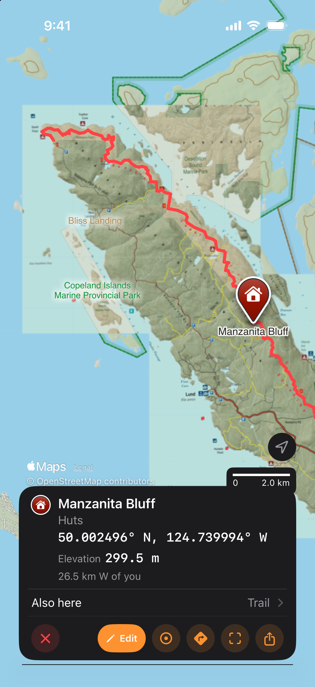
:::

:::mac
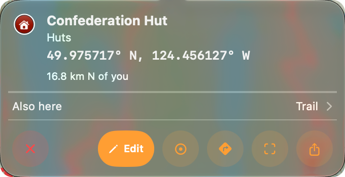
:::
::::

## The card

:ios[On iPhone, the card replaces the bottom sheet at the bottom of the screen. When the card closes, the sheet returns lowered to the strip, even if it was raised before.]
:mac[On Mac, the card opens as a popover on the pin, or at the spot you clicked on a line or an area.]

::::platforms
:::ios
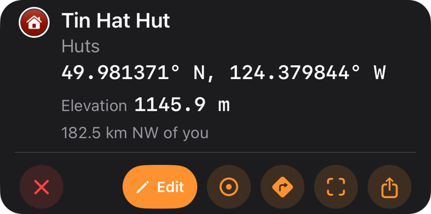
:::

:::mac
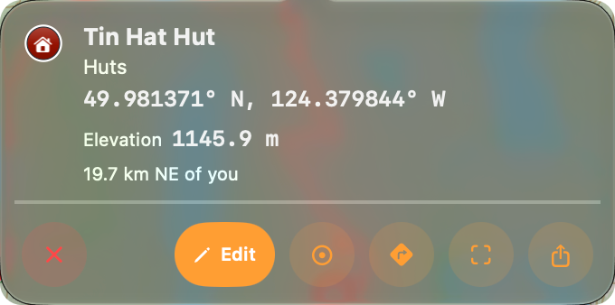
:::
::::

The outline remains on the map while the card is open, and a line's outline remains while its elevation profile is open. A basemap trail is highlighted as far as the map has loaded, then the whole feature is highlighted once it has been read.

- **Icon**: Your own feature shows the same icon as its row in the **Layers** tab. A place or a basemap feature shows a pin in a circle, and the place card shows a ring with a dot.
- **Name**: Tap the name to copy it.
- **Line under the name**: For your own feature, this line shows its folder path with the top folder first. For a basemap feature, it shows the kind, such as "Footpath, unpaved"; for a place, it shows the address, which you can tap to copy.
- **Coordinate**: The coordinate uses your **Coordinate Format** from [Units & Coordinates](/manual/settings/#units--coordinates), and you can tap it to copy it. For a line, it is the point on the line nearest your tap.
- **Cells**: The cells show the feature's figures, such as a line's **Length** or a recorded track's **Gain** and **Avg speed**. A polygon's **Area** excludes its holes. Tap a cell to copy it; [Calculation methods](/manual/measurement/#calculation-methods) explains how the figures are computed.
- **Distance from you**: For a point, a mark, a place or the place card, the last line shows the distance and true bearing from your last known position.

Your own features also show their description, limited to five lines, and you can tap it to copy the whole description. An imported HTML description appears as plain text without its links. **Photos (N)** shows thumbnails that open the [photo viewer](/manual/points-lines-polygons/#photos).

For your own features, the **Details** row shows the attribute count and opens an alphabetical list of attributes, where you can tap each value to copy it. The list leaves out keys TopoKit fills itself, including `distance`, any key starting with `track_` or `gps`, and a point's `elevation`.

### The card's buttons

The round buttons have no text on iPhone, where the names below are their VoiceOver labels; on Mac, these names are tooltips.

- The pill button provides an action for the selected feature:
  - **Edit** opens the editor for your own feature.
  - **Save** saves a basemap line or area in the project.
  - **Add Point** opens the [point editor](/manual/points-lines-polygons/#adding-a-point) at a mark, a place or a held spot. For a mark or a place, the name is filled in, along with the height for a peak.
- **Place**: Open the place card for the ground under a point, a mark or a place, with the original item listed under **Also here**.
- **Route here** (**Route to Here** on Mac): Start [**Add Route**](/manual/routes/#starting-from-a-point-or-a-place) with this spot as the destination.
- **Zoom to**: Frame your feature or the whole highlighted trail or park, or centre a mark or a place.
- **Elevation profile**: Open [the elevation profile](/manual/elevation/#the-elevation-profile) for any line, including a basemap trail. The profile shows the whole line; for a named trail, it opens only after the whole trail has been read.
- **Share**: On a point, a mark, a place or a spot, **Coordinates** shares the name and coordinate as text:mac[, and on Mac also copies them]. To share the feature as a file, choose one of the [file formats](/manual/import-and-export/#exporting-and-sharing). A mark, place or spot is shared as one point under the card's name, and **GPX** isn't offered for an area. For a basemap trail or park, the file formats become available once the whole shape has been read; until then, **Coordinates** is the only option.

## Saving a trail or a park

1. Tap the trail or ski run, or the printed name of the road, river or park.
2. Wait for **Save** to brighten.
3. Tap **Save**.

::::platforms
:::ios
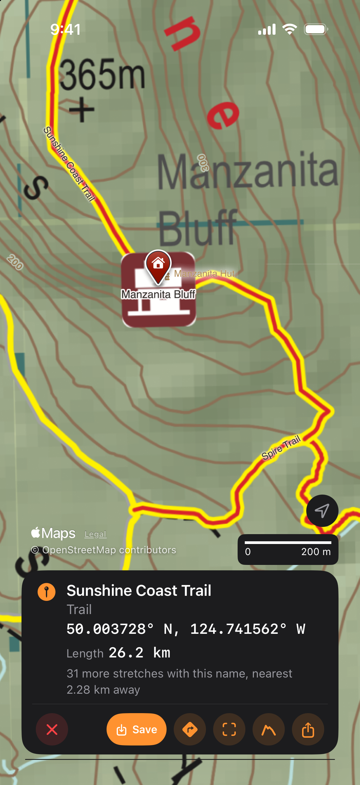
:::

:::mac

:::
::::

TopoKit saves the feature in **From the map**, a folder it creates at the top of the **Layers** tab the first time you save. The feature uses your **Default Style** for lines or polygons from [Features](/manual/settings/#features).

**Save** stays dimmed while TopoKit reads the whole feature from the basemap data on your device, using every basemap shown on the map.

For a named line, TopoKit reads the stretch you tapped and every stretch with the same name that joins it within 250 m. The card then shows **Length** and, when there is more than one stretch, **Stretches**. If other stretches with this name are left out, the card adds a line such as "2 more stretches with this name, nearest 3.20 km away". For a named area, TopoKit also reads any area with the same name that touches it.

For an unnamed way, or a named line the basemap data cannot find by name, TopoKit saves only the stretch highlighted on the map. **Save** stays dimmed if there is no highlighted stretch.

## Holding a spot and the place card

:::ios
On iPhone, hold the map still for half a second to open the place card for that spot. A ring with a dot marks the spot, and nothing is added to the project. You can also hold a pin or a trail to open the place card with the pin or trail under **Also here**, but a hold does nothing while a tool is running.
:::

:mac[On Mac, right-click bare ground and choose **Info**.]

::::platforms
:::ios
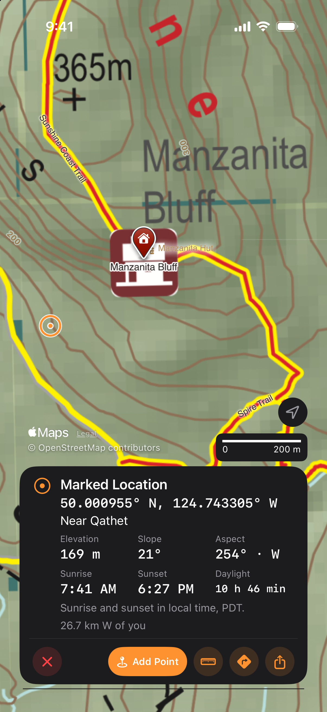
:::

:::mac
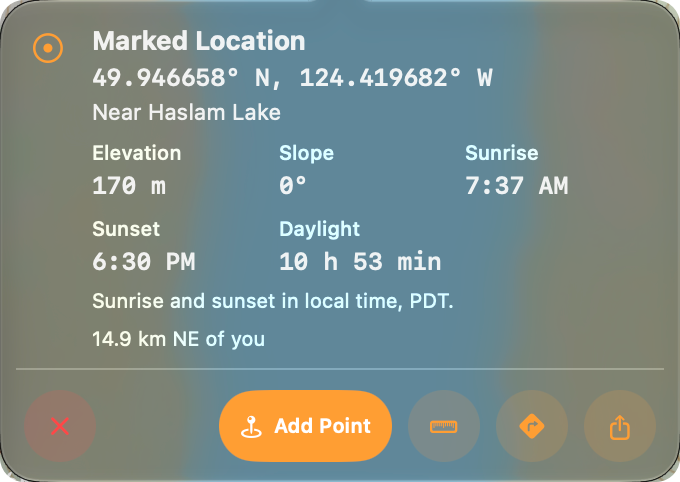
:::
::::

The "Near {place}" line under the coordinate appears only when you have a connection, because it uses Apple's place look-up.

The card shows **Elevation**, **Slope** and **Aspect** first when the elevation tile for the spot is on your device. Otherwise, it offers to [download that tile](/manual/elevation/#height-slope-and-aspect-at-a-spot).

The **Sunrise**, **Sunset** and **Daylight** values are for today, and each appears only when the sun rises or sets there that day.

**Start here** starts a line, a polygon or a route with the spot as its first point, or a circle with the spot as its centre. You need an open project to use **Start here**; without one, choosing a tool closes the card without starting it. To add a point at the spot, use **Add Point**, which opens the point editor with no name filled in.

:::mac
## Right-clicking the map

To open the map's shortcut menu, right-click or Control-click the map. On a cluster bubble, a right-click spreads or lists its points just as a click does, without opening a menu. No menu opens while a tool is running.

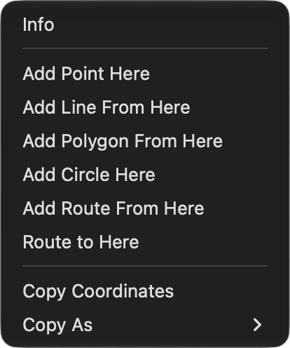

If no project is open, the menu contains only **Info**, **Copy Coordinates** and **Copy As**.

On bare ground, **Info** opens the place card and **Add Point Here** opens the point editor. **Add Line From Here**, **Add Polygon From Here** and **Add Route From Here** start their tools with the spot as the first point, while **Add Circle Here** starts a circle with the spot as its centre.

**Copy Coordinates** copies the spot in your **Coordinate Format**. To copy it in any of the four formats without changing the setting, choose **Copy As**.

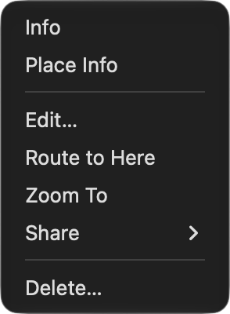

For a feature, a mark or a basemap line, the menu offers the same actions as its card. **Info** opens the card, and **Place Info** performs the **Place** action. For your own feature, **Delete…** asks you to confirm before deleting it, and you can [undo the deletion](/manual/interface/#undo-and-redo).
:::

## Search

:mac[On Mac, the search bar is at the top of the map, and **Edit → Search** (`Cmd-F`) places the cursor in it.] :ios[On iPhone, the search bar is at the top of the **Layers** tab.] You can search with or without a project open.

Search results appear in up to four sections, in this order: **Coordinate**, **Layers**, **Basemaps** and **Places**. Selecting a row frames the result, opens its card as a tap would and clears the search. A raster's card shows its name, while a folder or tile layer has no single spot and opens no card. A place is framed using the extent Apple provides, with a lake framed whole and no place framed closer than about 1 km.

### What each section finds

| Section | What it searches | Order and limit |
|---|---|---|
| **Coordinate** | You can enter a coordinate in any of the four formats, even offline. The single row, **Go to coordinate**, opens the place card. | This section is always first. |
| **Layers** | This section searches anywhere in the names of folders, features, rasters and tile layers, ignoring case and accents. It also searches the parent folder's name, attribute keys and values, a point's coordinate and a tile layer's URL. | Names that start with the search text appear first, with up to 100 rows. |
| **Basemaps** | You can search offline for names printed by the basemaps shown on the map, using data on your device. Enter at least two letters or digits, so `19` finds Highway 19. Every typed word must start a word in the name, so `tin h` finds Tin Hat Mountain. | This section shows up to 20 rows. |
| **Places** | This section shows Apple's suggestions for addresses, points of interest and natural features when you have a connection, favouring the part of the world the map shows. | This section shows up to eight rows. |

::::platforms
:::ios
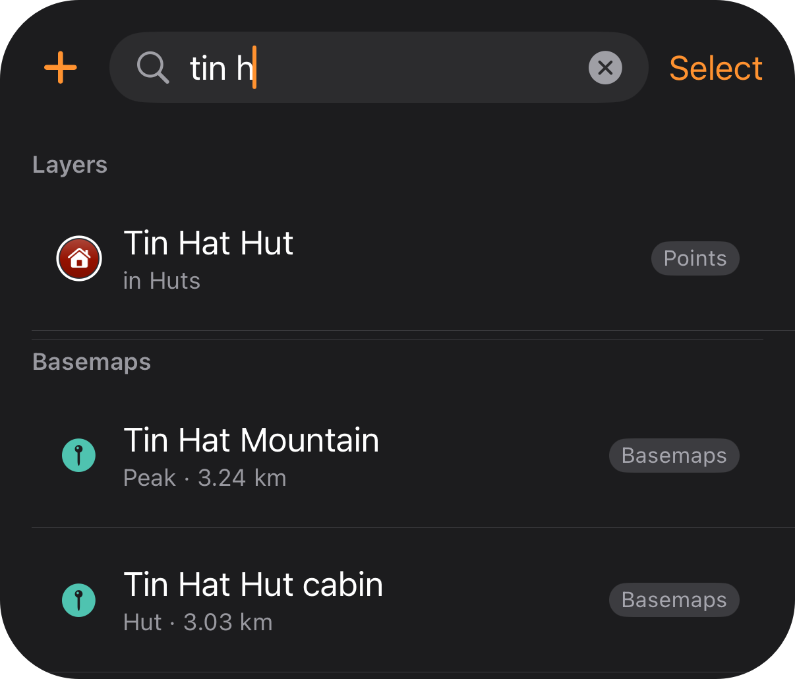
:::

:::mac
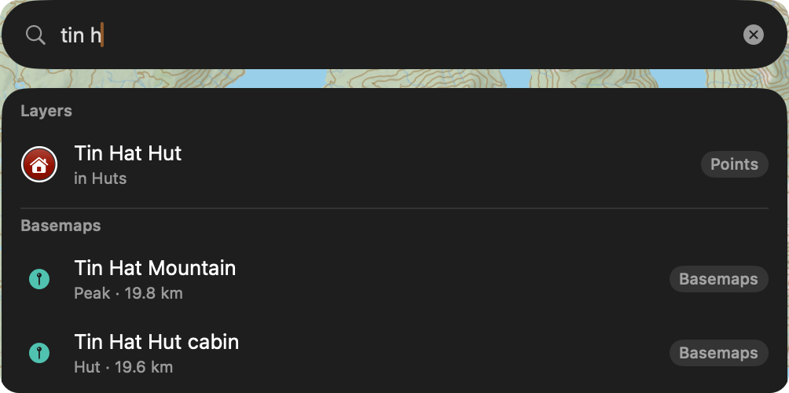
:::
::::

To list every layer of a kind under **Layers** instead of matching names, enter an exact category word, such as `points`, `lines`, `area`, `rasters`, `tiles` or `folders`. Enter `vectors` to list points, lines and polygons together.

### Coordinate formats

| Format | Example | What it reads |
|---|---|---|
| DD | `49.976361, -124.149780` | Separate the values with a comma, a semicolon or a space. You can put an optional hemisphere letter before or after each number; if the first value is labelled E or W, it is read as longitude first. |
| DMS | `49°58'35"N 124°08'59"W` | Include a hemisphere letter for both values, a degree mark `°` or `d` and a minute mark `'`, `′` or `m`. The seconds mark `"`, `″` or `s` is optional, but capital `D`, `M`, `S` and bare numbers are not read. |
| DDM | `49°58.5817'N 124°08.9868'W` | Include a degree mark and a hemisphere letter; the minute mark is optional. |
| UTM | `10U 417559 5536636` | Use zones 1–60, a six-digit easting and a northing of five to eight digits. `N` and `S` indicate the hemisphere, so a position in latitude band S (32° to 40° N) takes `N`. Any other letter indicates a band: `C` to `M` is south, and `P` to `X` is north. |

All formats use a point for decimals. A comma always separates latitude from longitude, so `49,5 8,2` gives no coordinate row and `48,2` is read as latitude 48, longitude 2.

TopoKit writes UTM using the plain 6° zone without the Norway and Svalbard exceptions, and the hemisphere letter: `10N 417559E 5536636N`. You can paste every coordinate TopoKit writes back into search, in any of the four formats, and TopoKit will read it.

## FAQ

**Why did the card close when I zoomed out?**
A peak's, hut's or town's card closes when its mark is no longer printed at that zoom. A park's or trail's card stays open because its outline is still on the map.
