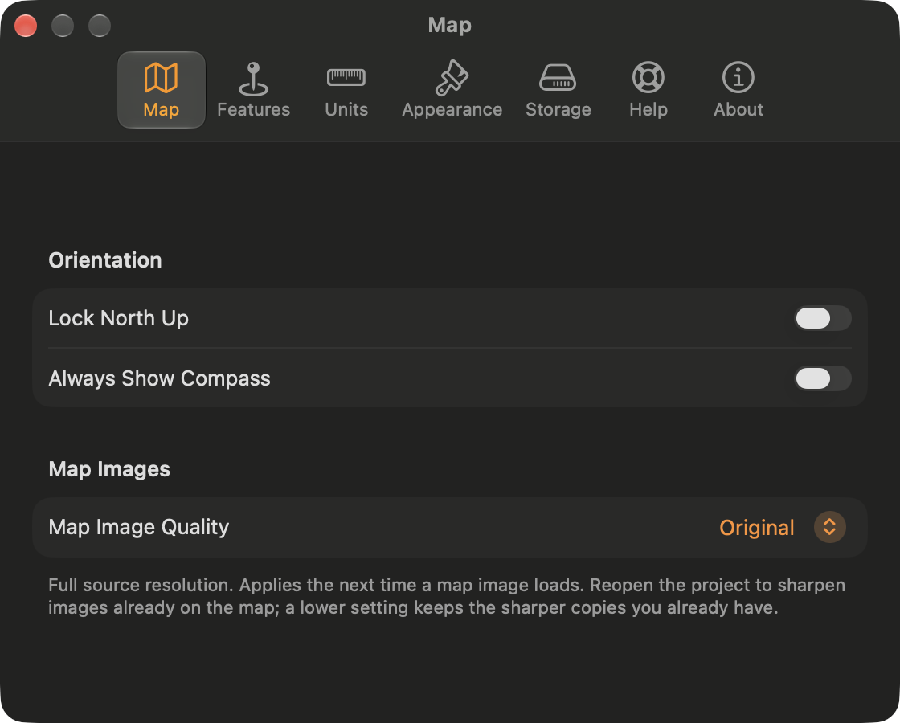
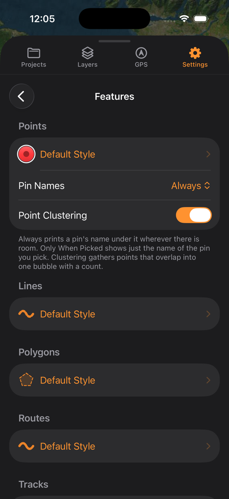
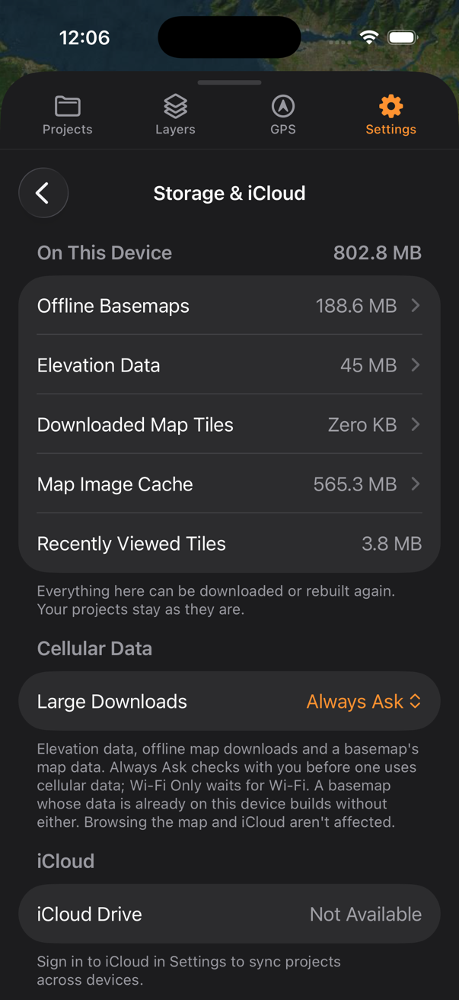

Your settings are saved on your device rather than in a project or your iCloud account, so each device starts with its own values. Styles that Settings rows have already applied to features stay with those features wherever you open the project.

:ios[On iPhone, Settings is a tab.] :mac[On Mac, Settings is a tab in the panel, and **TopoKit → Settings…** (`Cmd-,`) opens the same pages in a window of their own.]

:::mac
## The Mac Settings window

Each page has a toolbar button with a shorter name: **Map**, **Features**, **Units**, **Appearance**, **Storage**, **Help** and **About**. **Your TopoKit**, **Restore Purchases** and **Redeem Code** appear at the top of the **About** tab rather than under a separate **Your TopoKit** button. The window opens on **Map** the first time, then on the tab you last used.

:::

## Your TopoKit

The first row shows your TopoKit status beneath its title. On this page, you can restore a purchase or redeem a code. [The Your TopoKit page](/manual/your-topokit/#the-your-topokit-page) explains both.

## Map

Turn on **Lock North Up** to stop the map rotating, and **Always Show Compass** to keep the [compass](/manual/interface/#the-map) on screen while north is up.

- :ios[**Keep Screen On** controls when your iPhone screen stays on, with **Off** as the default. Choose **Always** to prevent the screen from locking while TopoKit is in front; when you switch to another app, the screen locks as usual. **While Recording** keeps the screen on only while a [track is recording or paused](/manual/gps-and-track-recording/#background-recording-and-recovery), including during auto-pause.]
- **Map Image Quality** sets the maximum length, in pixels, of a raster's longest side during [reprojection](/manual/raster-overlays/#reprojection-quality). The default is **High (8192px)**, and **Original** sets no cap. Except for a GeoPDF placed by four or more control points, a raster that has already been reprojected keeps its existing quality until you use **Clear Map Image Cache** to remake it at the current setting.

## Features

To choose the style for new features, change **Default Style** under **Points**, **Lines** or **Polygons** using the [feature style sheets](/manual/points-lines-polygons/#styling-a-feature). Each feature receives the default style when you create it, so changing the default leaves existing features as they are. Drawn lines and polygons start with an orange, dashed style.

- **Pin Names** controls which [point names appear beneath their pins](/manual/points-lines-polygons/#points-on-the-map). With **Always** selected, names are omitted where pins are crowded, but the selected pin's name appears under either setting, however crowded the map is.
- **Point Clustering** combines [overlapping pins into one bubble with a count](/manual/points-lines-polygons/#points-on-the-map) and is on by default.
- **Default Style** under **Routes** sets the [drawing style](/manual/routes/#how-the-route-is-drawn) used by :ui[Add Route] and the starting style in its save sheet, separately from the **Lines** default. The style is applied when you save the route, so later changes to the default leave saved routes as they are.
- :ios[**Default Style** under **Tracks** sets the line style used when you [save a recorded track](/manual/gps-and-track-recording/#saving-a-track) on iPhone. Turn on **Randomize Colour** to replace the style's colour with one of twelve chosen at random for each saved track; width, pattern and opacity still come from **Default Style**.]
- **Vertex Style** under **Drawing** sets the appearance of the dots shown while you create and measure. This style is read each time you draw rather than saved into features, so changes appear at once. The dots, including the faint dots between them, use the colour of the line or polygon you are drawing unless you turn off **Inherit Colour from Feature** in the style sheet.
- **Lines** and **Polygons** under **Imported Files** set the styles applied to lines and polygons imported from a file, while imported points use **Default Style** under **Points**. These styles are applied at import, so changing them leaves earlier imports as they are.

## Units & Coordinates

- **Units** sets [Metric or Imperial units](/manual/measurement/#units), with the initial choice taken from your device's region when you first open TopoKit. It controls the scale bar, the figures on the elevation profile and the starting contour unit for new basemaps; basemaps you have already built keep their own unit. :ios[On iPhone, it also controls the speed, altitude and distance units on the GPS tab.] Changing **Units** resets **Distance** and **Area** under **Measuring Tools Start With** to the new system's defaults, while **Bearing** keeps its value.
- **Coordinate Format** sets how coordinates are displayed and copied in TopoKit. Whichever format you choose, coordinates are stored as WGS84 latitude and longitude, and the search bar accepts [every coordinate format](/manual/search-and-identify/#coordinate-formats).
- **Measuring Tools Start With** sets the **Distance** and **Area** units and the [**Bearing**](/manual/measurement/#bearing) used when you open a measuring tool. You can change them in the tool card for one measurement. :mac[On Mac, **Bearing** does not offer magnetic north, which requires a compass.]
- **Show Segment Lengths** labels each segment with its [length](/manual/measurement/#segment-lengths) while you draw or edit a line or polygon, and is on by default.

## Appearance

- **Theme** applies to TopoKit's panels and controls without changing exports.
- **Panel Style** is **Solid** by default, making panels opaque so controls keep the same contrast over any map. Choose **Blur** or **Glass** to let the map show through.
- **Solid Panel Background** appears when you choose **Blur** or **Glass**. :ios[On iPhone, it keeps the sheet opaque while the smaller controls stay translucent.] :mac[On Mac, it keeps the panel opaque while the smaller controls stay translucent.]
- :mac[**Panel Position** sets which side of the window the panel appears on in the [Mac layout](/manual/interface/#mac-layout), with the left side as the default.]

:::ios
## Toolbar & Haptics

This page is on iPhone only.

- **Show Toolbar** shows or hides the [tool sidebar](/manual/interface/#the-tool-sidebar), and turning it off also hides the three settings rows below it. **Basemaps** and the Apple Maps switch are available only in the sidebar, so you cannot reach them with **Show Toolbar** off. You can still [hold a spot on the map to open its place card](/manual/search-and-identify/#holding-a-spot-and-the-place-card), with :ui[Add Point] as its pill and :ui[Add Line], :ui[Add Polygon], :ui[Add Circle] and :ui[Add Route] in its **Start here** menu. To open **Add Data**, use :ui[plus]{icon=plus} in the **Layers** tab.
- **Position** sets which side the sidebar appears on, with the right side as the default. When **Swipe to Dismiss** is on, you can hide the sidebar by swiping sideways towards that edge.
- **Icon Size** sets the width of each button to 36, 44 or 52 points, and the sidebar resizes to fit. **Medium** is the default; **Small** leaves the most space for the map, and **Large** is easiest to tap with gloves.
- **Haptic Feedback** controls every vibration in TopoKit, including those outside the sidebar, and is on by default.
:::

:::ios
## GPS & Recording

This page is on iPhone only. To change the appearance of recorded tracks, use the settings under [Features](#features).

- **Recording Profile** sets how far you must move and how accurate a fix must be before it is included in a recording. **Balanced** is the default, and you can find the values for each profile in [Recording profiles](/manual/gps-and-track-recording/#recording-profiles).
- **Auto-Pause When Stationary** [pauses a recording automatically](/manual/gps-and-track-recording/#auto-pause) once the reported speed stays below 0.5 m/s for 30 seconds, and is off by default.
:::

## Storage & iCloud

Under **On This Device**:mac[, or **On This Mac** on a Mac,] you can view five stores and their combined size beside the heading. None of the data in these stores is part of a project, and the total excludes photos, which are saved in the project folder.

- **Offline Basemaps** contains [basemaps built on this device and their working data](/manual/basemaps/#storage). Use **Delete Offline Basemaps** to remove only this device's copies; the basemap layers stay in your projects and appear as not on this device until you rebuild them.
- **Elevation Data** contains elevation tiles downloaded for lookups and profiles. Use **Manage Tiles** to view their sizes and delete them one at a time, or **Clear Elevation Data** to delete them all. A deleted tile downloads again the next time a lookup, profile or basemap needs it, so rebuilding a basemap afterwards requires a connection. Basemaps you have already built keep their map, as described in [Disk space](/manual/elevation/#disk-space).
- **Downloaded Map Tiles** contains tiles downloaded for offline use in tile layers. Use **Clear Downloaded Map Tiles** to [remove downloaded tiles](/manual/tile-layers/#removing-downloaded-tiles) from every tile layer in every project, including deleted layers. This also clears **Recently Viewed Tiles** and deletes the map tiles of every basemap built on this device, even though their size is counted under **Offline Basemaps**. Tile layers stay in your projects, but you need to download their tiles again. Basemaps also stay in your projects, and TopoKit [recreates their map tiles from elevation data](/manual/basemaps/#storage) when you next open the project.
- **Map Image Cache** contains [reprojected copies of your rasters](/manual/raster-overlays/#caching). Use **Clear Map Image Cache** to reproject each raster at the current **Map Image Quality** the next time it loads; this can take a while for large rasters.
- **Recently Viewed Tiles** contains map tiles downloaded as you browse, which are kept so the map does not need to fetch them again.

The remaining settings control downloads, iCloud and photos.

- :ios[**Large Downloads**, under **Cellular Data**, controls whether your iPhone downloads elevation data, offline maps and a basemap's map data over cellular data or a personal hotspot. The default is **Always Ask**, and [Downloads over cellular data](/manual/tile-layers/#downloads-over-cellular-data) explains the question and its answers.]
- **iCloud** shows how much iCloud space your projects and map images use when iCloud Drive is connected. It also shows the projects folder's path, which you can select and copy. Without a connection to iCloud Drive, **iCloud Drive** reads **Not Available** and the group prompts you to sign in to iCloud for [iCloud sync](/manual/projects-and-files/#icloud-sync).
- **Keep All Projects Offline** appears when iCloud Drive is connected. Turn it on to keep a copy of every project in iCloud on this device, or turn it off to remove those copies. You can read about what each copy includes in [Offline pinning](/manual/projects-and-files/#offline-pinning).
- **Photo Size**, under **Photos**, sets the length of a saved photo's longest side, with **Medium (2048px)** as the default. The setting applies when you [add a photo](/manual/points-lines-polygons/#photos), so photos already in a project keep their size.

## Help & Feedback

To read this manual on the TopoKit website, choose **User Manual**. You can also use **Send Feedback** to start an email to the developer, or **Rate TopoKit** to open TopoKit's review page in the App Store. **Replay Introduction** runs the [first-launch introduction](/manual/getting-started/#the-first-launch) again from its first page. :mac[On Mac, these commands are also in the [**Help** menu](/manual/interface/#the-menu-bar), where the manual is named **TopoKit Help**; the menu also includes **What's New** and **Licenses**.]

Use the settings under **Troubleshooting** to view and send diagnostic information.

- **Debug Mode** shows a message as soon as TopoKit encounters an error and adds detailed entries to the log. Errors and warnings are recorded even when **Debug Mode** is off, which is the default. If more errors occur while a message is open, TopoKit updates the count in that message instead of opening separate messages; warnings are logged without a message. Choose **Send to Developer** in the message to open the same email as **Send Logs to Developer**, without being asked first.
- **View Logs** shows entries recorded since TopoKit launched, up to the latest 2,000. The saved log sent by **Send Logs to Developer** also includes earlier launches. It starts a new file at about 1 MB and keeps one earlier file, so the oldest entries are removed during a long session. **Clear** deletes both, and cannot be undone.
- **Send Logs to Developer** asks for confirmation before emailing the log to the developer, because it can include project names, file paths and coordinates from your work. The attached file begins with the app version and build, the system version, :ios[the iPhone model, ]the language and region, the device's memory and its free disk space. :ios[On iPhone, the share sheet opens instead if you have no mail account set up.] :mac[On Mac, the log opens in a new message in your mail app, or a sharing menu lets you choose where to send the file if no mail app is set up.]

After a crash, TopoKit asks whether to send the system's crash report the next time you open the app, whether or not **Debug Mode** is on. This question does not appear after a force quit, a restart or a flat battery, as these are not crashes. Choose **Send Report…** to open an email with the report's text in the body and the system's full report attached, so you can read it all before sending. The report includes the app and system versions, the device model and where the crash happened, but excludes your projects, your locations and the log. If you neither send nor decline a report, TopoKit asks again at the next launch. :ios[On iPhone, if the crash interrupted a recording, TopoKit asks about the crash report and the recovered track one at a time.]

## About TopoKit

Open **What's New** to read the release notes. An orange dot appears on this row and on the **About TopoKit** row in the Settings list when you have unread notes; closing the notes clears both dots. The page also shows the installed version and links to the **Privacy Policy** and **Terms of Use**. Open **Licenses** for credits for the code TopoKit uses and the sources of its elevation and basemap data, as described in [Credit and licences](/manual/basemaps/#credit-and-licences).

## FAQ

**Why does the Mac have fewer Settings pages?**
**GPS & Recording**, **Toolbar & Haptics** and the **Tracks** group of **Features** are available only on iPhone, as the Mac does not record tracks or provide haptic feedback. **Keep Screen On** and **Large Downloads** are also iPhone-only; the Mac downloads over any connection, including a phone's hotspot.
