A tile layer is a map streamed from a server. TopoKit fetches only the tiles for the area on screen.

::::platforms
:::ios
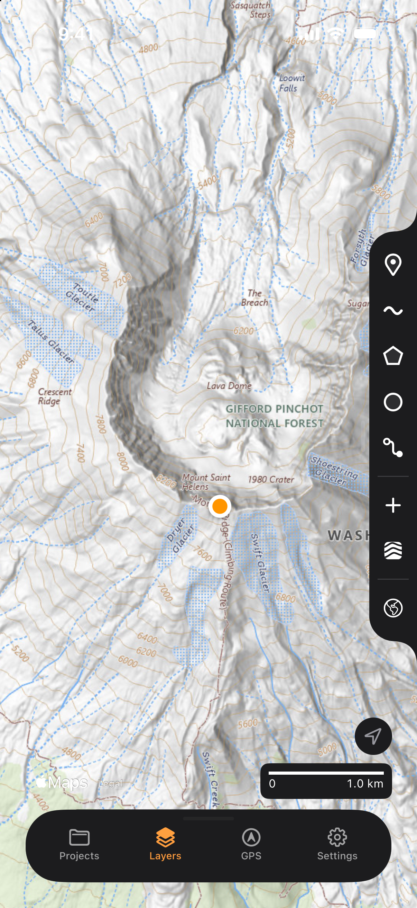
:::

:::mac
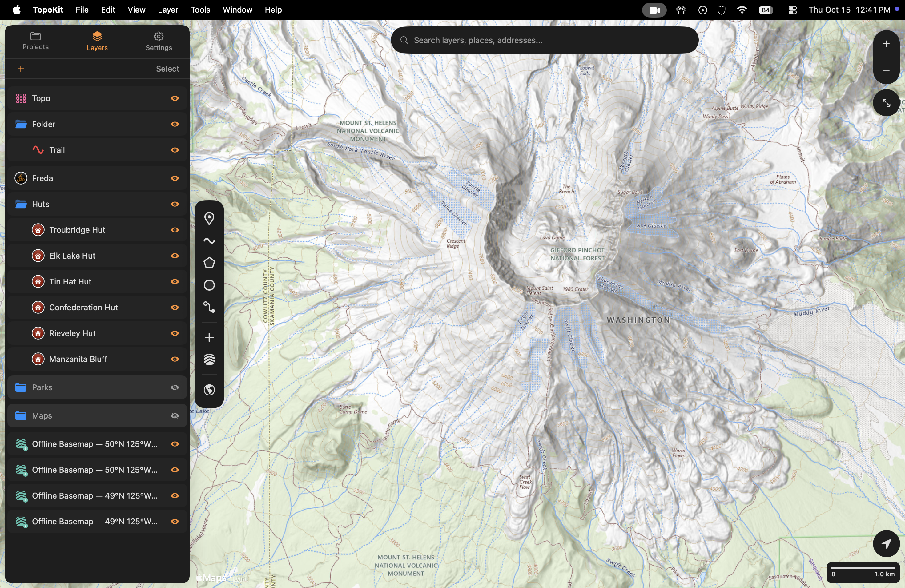
:::
::::

TopoKit ships no tile sources: you paste the address of a service you choose. For a topographic map without a source of your own, :ui[Basemaps] in the tool sidebar [builds one](/manual/basemaps/#building-a-basemap).

## Finding a tile source

The address decides which tab it goes in. An XYZ address contains `{z}`, `{x}` and `{y}`. A WMS address contains `service=WMS` or `request=GetCapabilities`. A WFS, WMTS, WCS or vector-tile address is neither, and does not work.

Test an address in a browser first, with real numbers in place of the placeholders. An error page or a login form means TopoKit cannot use it, because TopoKit sends no authentication.

## Adding a tile layer

:::mac
On Mac, choose **Add Tile Layer…** from :ui[Add Data]{icon=plus} in the [tool sidebar](/manual/interface/#the-tool-sidebar), from :ui[plus]{icon=plus} in the **Layers** tab, or from **Layer → Add Tile Layer…** in the menu bar.
:::

:::ios
On iPhone, tap :ui[Add Data]{icon=plus} in the [tool sidebar](/manual/interface/#the-tool-sidebar) or :ui[plus]{icon=plus} in the **Layers** tab, and choose **Add Tile Layer…**.

:::

::::platforms
:::ios
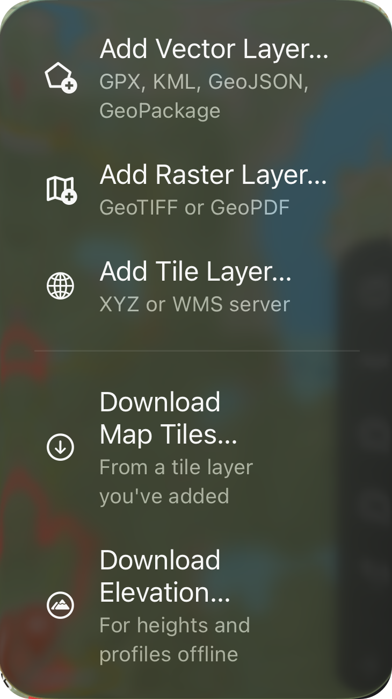
:::

:::mac
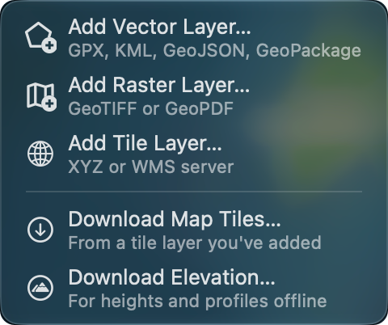
:::
::::

Adding a tile layer, editing one and downloading tiles are part of the full app, though tile layers and downloaded tiles already in a project keep drawing without it; see [What asks you to unlock](/manual/your-topokit/#what-asks-you-to-unlock).

The sheet shows no preview and accepts any text as a template, so a wrong address is added and draws nothing. The new layer goes to the top of the **Layers** tab, where it hides everything below it everywhere; drag it below your data ([Draw order](/manual/layer-tree/#draw-order)).

### Adding an XYZ tile layer

1. Type a **Layer Name**. Left blank, the layer is named XYZ Layer.
2. Paste the provider's address into **Tile URL Template** with its placeholders intact, in the order the provider documents. Some services use `{z}/{y}/{x}`.
3. Tap **Add**.

::::platforms
:::ios
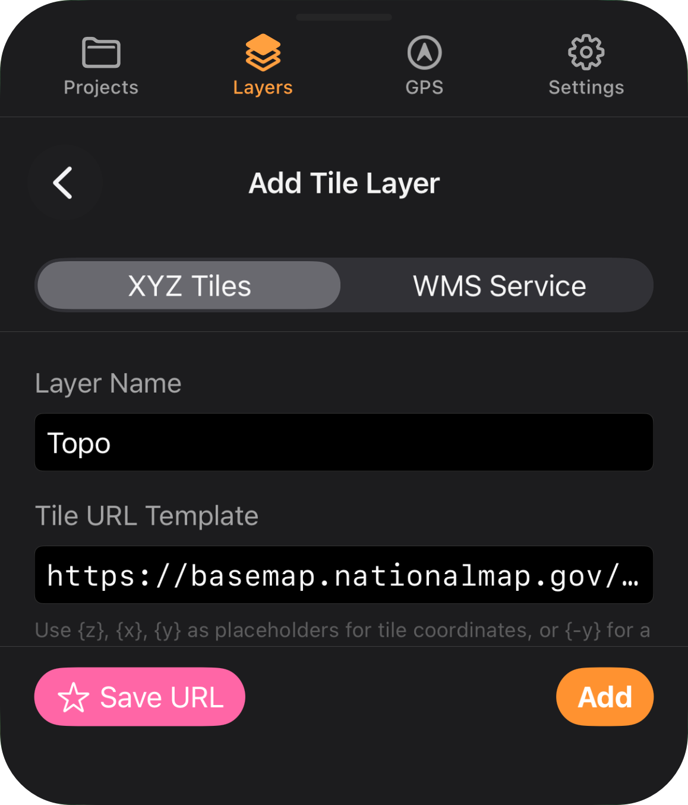
:::

:::mac

:::
::::

For a TMS server, which counts rows from the south, write `{-y}` in place of `{y}`; with `{y}`, its tiles come back from the wrong rows, with north and south swapped.

- **API keys**: put the key in the address as the provider documents it. TopoKit has no way to add a header, so a provider that wants its key in a header does not work.
- **Placeholders**: `{s}` always becomes `a`. `{r}` is not filled in and is sent as written, so remove it.
- **Tile size**: 256 × 256 pixels.
- **Zoom ceiling**: TopoKit assumes the server publishes up to z19 and scales up the last tile beyond that. A zoom below the ceiling that the server lacks comes back blank. A download that finds the server stops short of its **Max Zoom Level** lowers the ceiling to the deepest zoom it fetched, and a later download that fetches deeper raises it again.

### Adding a WMS layer

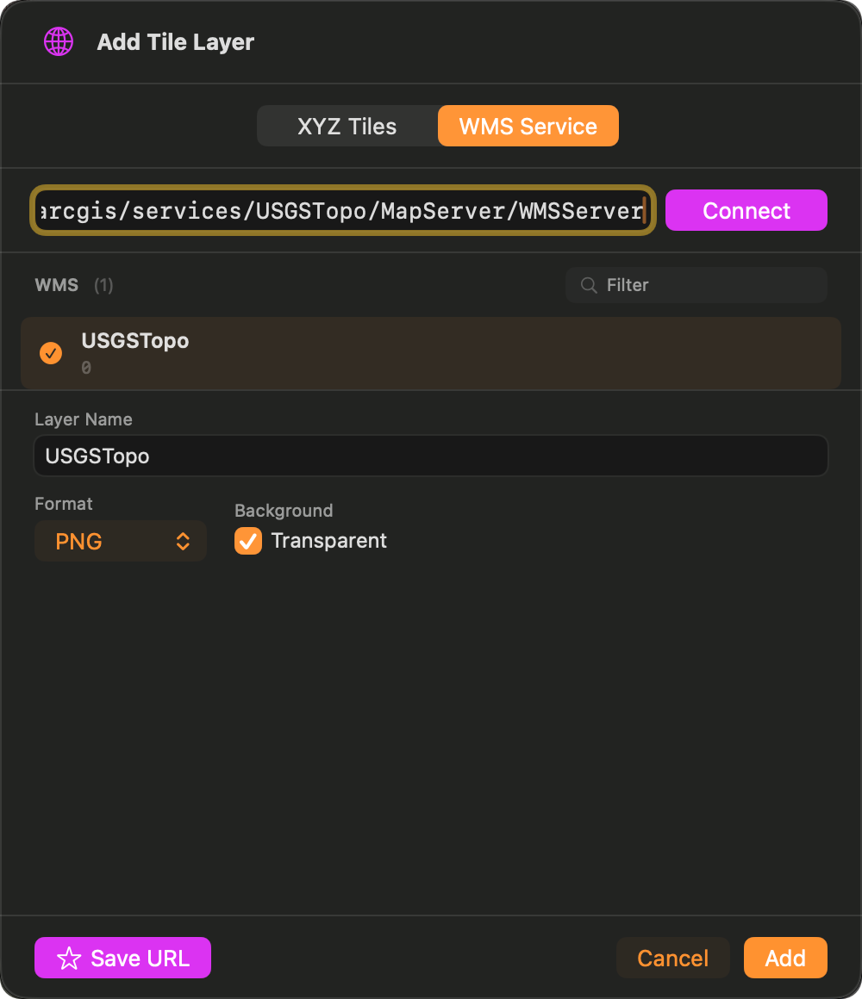

1. Select **WMS Service** and paste the service address. A bare endpoint gets the GetCapabilities request added; an address that already carries `SERVICE` and `REQUEST` is used as is.
2. Tap **Connect**. TopoKit reads WMS 1.1.1 and 1.3.0 capabilities, nested layers included. `WMS server error: HTTP 401` or `HTTP 403` under the field means the server wants a login.
3. Pick a layer. An orange triangle marks a layer that does not advertise Web Mercator.
4. Choose a **Format**. PNG keeps transparency, JPEG is smaller for opaque imagery, and PNG 8-bit is a smaller PNG for flat-colour maps.
5. Leave **Transparent** on for a map that should let the layers beneath show through. Turn it off for opaque imagery.
6. Tap **Add**.

- **Projection**: TopoKit always requests EPSG:3857.
- **Tile size**: 512 × 512 pixels, on the map and in downloads.
- **Style**: always the server's default.
- **Zoom ceiling**: as for XYZ, starting at z18.

### Saving a source for reuse

- **XYZ**: **Save URL** saves the name and template at the top of the **XYZ Tiles** tab. Tapping a saved template fills in the form without adding the layer; its context menu holds **Edit Name**.
- **WMS**: **Save URL** after **Connect** saves the service, and starring a layer row saves that layer with the sheet's current **Format** and **Transparent** settings. Tapping a starred layer under its saved service adds it without connecting. The context menu of a saved service or starred layer holds **Rename**.

Saved sources are kept on the device, not in the project, so every project on that device offers them and other devices do not.

## Managing tile layers

**Edit** in the row's :ui[Layer options]{icon=ellipsis} menu, or its right-click menu on Mac, opens the tile layer's editor. :mac[On Mac, **Layer → Edit Layer…** (`Cmd-I`) opens it too.] The editor changes the name and the opacity, nothing else.

:::mac
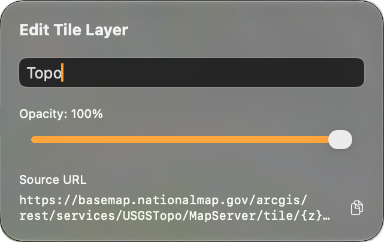
:::
 :ios[On iPhone, tap **Save** to keep a new name; leaving without saving keeps the opacity but not the name.] :mac[On Mac the editor is a popover that keeps the new name when it closes.]

::::platforms
:::ios
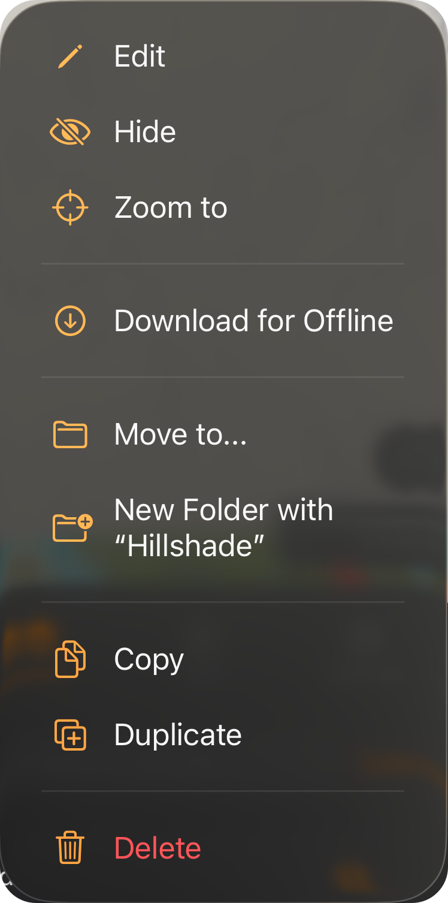
:::

:::mac
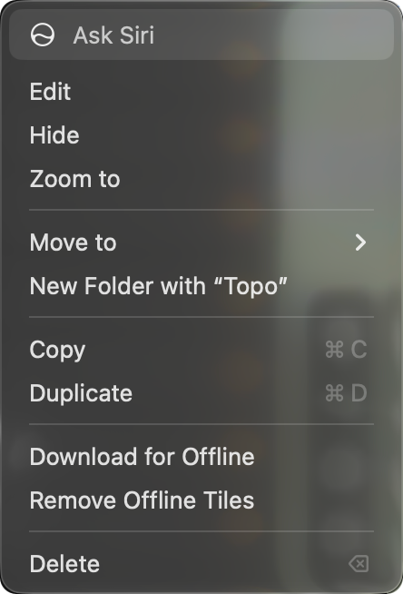
:::
::::

To change the address, delete the layer and add it again. Tap the address under **Source URL** to copy it first; for a WMS layer, the **Layer** row below it copies the machine name to find again with **Filter**.

A tile layer draws over Apple Maps, place names included, so Apple's names show only through the transparent parts of its tiles or through a layer below 100% opacity.

## Offline downloads

A download saves a layer's tiles to this device, so the layer draws without a connection. A layer can hold any number of downloads.

### Starting a download

**Download Map Tiles…** in the :ui[Add Data]{icon=plus} menu or the **Layers** tab's :ui[plus]{icon=plus} menu opens the download sheet. :mac[On Mac it is also in the **Layer** menu.] **Download for Offline** in a tile layer's :ui[Layer options]{icon=ellipsis} menu opens the same sheet with that layer selected. :mac[On Mac, **Layer → Download for Offline…** does the same for the selected layer.]

::::platforms
:::ios

:::

:::mac

:::
::::

1. **Tile Layer**: choose the layer. **Offline: …** layers and built basemaps are not offered.
2. **Region**: set the rectangle.
   - :mac[**Map View**: on Mac, the current map view.]
   - **Draw**: tap two opposite corners on the map, then **Done** on the tool card; its ✕ abandons the download. Draw turns a hidden layer on and leaves it on.
   - **Coordinates**: type a **Northwest Corner** and a **Southeast Corner**, in any [coordinate format](/manual/points-lines-polygons/#coordinate-entry-formats).
3. **Download Mode**: **All zoom levels** fetches every zoom from 0 to the max. **Max resolution only** fetches only the max zoom and builds the lower zooms from it on the device, clipped to the rectangle, so it downloads less; while it builds them, the bar reads "Building: {layer name}".
4. **Max Zoom Level**: from 1 to 20, starting at z16. Each level up quadruples the tile count.
5. Tap **Download**.

The **Tiles** estimate is exact. The **Storage** estimate counts every tile at 15 KB whatever the format, so it runs high for JPEG imagery. A warning appears once the estimate passes 500 MB; it never blocks the download.

### While it downloads

Several downloads run at once, each with its own bar.

- **Cancel**: ✕ then **Cancel Download** stops the download and drops its rectangle. If the layer has no finished download, its partial tiles are deleted; if it has one, they stay and a later download reuses them.
- **Retries**: a tile that fails on a dropped connection or a server error is tried up to three times. A tile the server refuses with a 4xx answer, such as 404 or 429, is not retried.
- **Retry Failed**: a download that ends with failed tiles reports them in **Download Complete**, where **Retry Failed** fetches only the missing tiles. One that fails outright shows **Download Failed**, with **Retry**.
- **Stopping**: downloads run only while their project is open. Tiles already on disk are kept, and the same download started again fetches only what is missing.

### Downloads over cellular data

:::ios
On iPhone, a tile download checks before it uses cellular data or a personal hotspot, following **Settings → Storage & iCloud → Large Downloads** ([Storage & iCloud](/manual/settings/#storage--icloud)).

**Always Ask**, the default, asks **Download Using Cellular Data?** once, however many downloads are waiting, and the answer holds until the iPhone is next on Wi-Fi: **Download** lets downloads use cellular data until then, and **Wait for Wi-Fi** holds them. **Always Allow** also changes the setting, so TopoKit stops asking.

The check repeats as a download runs, so one started on Wi-Fi does not carry on over cellular data unasked. A held download's bar reads "{layer name}: Waiting for Wi-Fi…", and the download carries on by itself once the iPhone is on Wi-Fi. Browsing the map and iCloud sync are not affected.
:::

:::mac
The Mac has no cellular setting and downloads over any connection, a personal hotspot included.
:::

### Using offline tiles

A finished download adds an **Offline: {layer name}** layer at the top of the source layer's folder. The next is **Offline: {layer name} (2)**, and so on; downloads never merge. Each reads only the downloaded tiles inside its own rectangle. Past the downloaded max zoom it scales up its sharpest tile.

:::ios
<video src="/media/tile-layers-using-offline-tiles-iphone.mp4" autoplay loop muted playsinline aria-label="Downloading tiles on iPhone: Download Map Tiles… from the Add Data menu, the Topo layer, Draw with two corners tapped round Mount St. Helens and Done, the sheet with the Max Zoom Level dragged to z14 and the cards reading 23 tiles, Download, the Offline: Topo row appearing above Topo, and then Topo's eye tapped so only the downloaded rectangle draws over Apple's imagery of the volcano"></video>
:::

:::mac
<video src="/media/tile-layers-using-offline-tiles.mp4" autoplay loop muted playsinline aria-label="Downloading tiles on a Mac: Download Map Tiles… chosen from the Add Data menu, the sheet with the Topo layer and Map View over Mount St. Helens, the zoom set to 14 and the cards reading 111 tiles, Download, the Download Complete alert, the Offline: Topo row appearing above Topo, the map zoomed out twice, and then the Topo row's eye clicked so the streamed layer goes and the downloaded rectangle stands alone over Apple's imagery"></video>
:::

::::platforms
:::ios
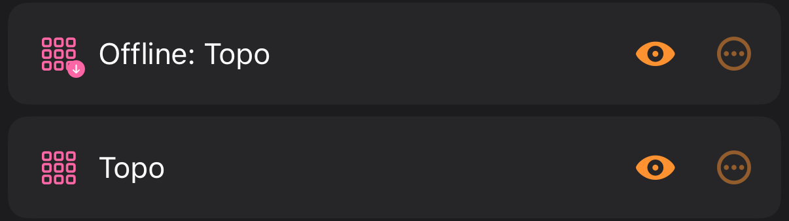
:::

:::mac
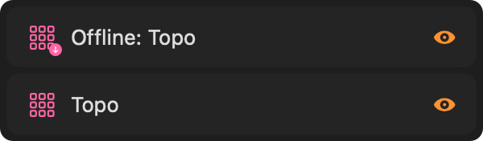
:::
::::

Downloaded tiles never sync. The project carries each download's rectangle and zoom range, so on another device the **Offline: …** layer is there without tiles. The **Layers** tab offers them in an **Offline tiles available** banner, and the layer's :ui[Layer options]{icon=ellipsis} menu has **Download for This Device**; either fetches the same rectangle and zooms again on that device. Built basemaps follow their own rule ([Other projects and other devices](/manual/basemaps/#other-projects-and-other-devices)).

### Removing downloaded tiles

The system never purges downloaded tiles. A layer's downloads share one store, so overlapping downloads keep one copy of the tiles they share, and the total shows in **Settings → Storage & iCloud → Downloaded Map Tiles**.

| Action | What it removes | What stays |
|---|---|---|
| **Remove Offline Tiles** in the source layer's :ui[Layer options]{icon=ellipsis} menu | Every downloaded tile of that layer, after **Remove Offline Tiles?** | The layer, which streams from the server again |
| **Clear Downloaded Map Tiles** in [Storage & iCloud](/manual/settings/#storage--icloud) | Every downloaded tile on this device | Every layer |
| Deleting the layer | The layer, and any download it is running | Its downloaded tiles, which its **Offline: …** layers keep drawing |

**Remove Offline Tiles** appears once the layer has a finished download, never on an **Offline: …** layer, and removes all of the layer's downloads at once; to keep a smaller area, remove them and download that area again. :mac[On Mac it is also **Layer → Remove Offline Tiles…**.]

## FAQ

**Why did my download stop, or finish with failed tiles?**
Tiles fail past the zoom the server publishes, and a server that throttles bulk requests refuses some; retry, or download a smaller area at a time.

**Why does my WMS layer connect but draw nothing?**
A server that answers with an error picture has it drawn like any other tile.

**Why does Download Map Tiles… say "Add a tile layer first."?**
It downloads only XYZ and WMS layers added to the project. Apple Maps cannot be downloaded, and a built basemap is already on the device.
