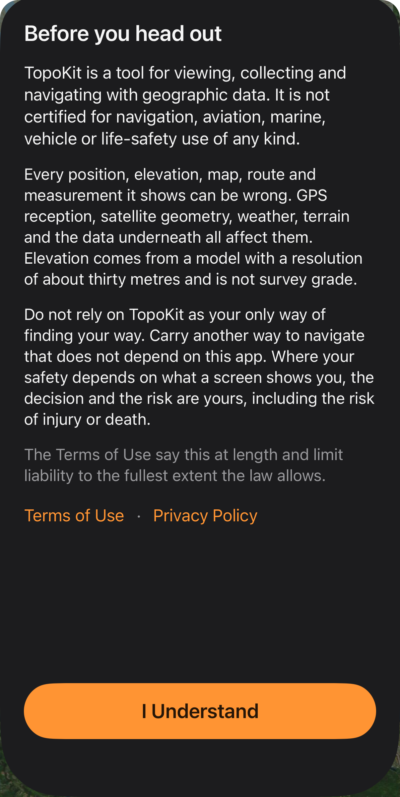
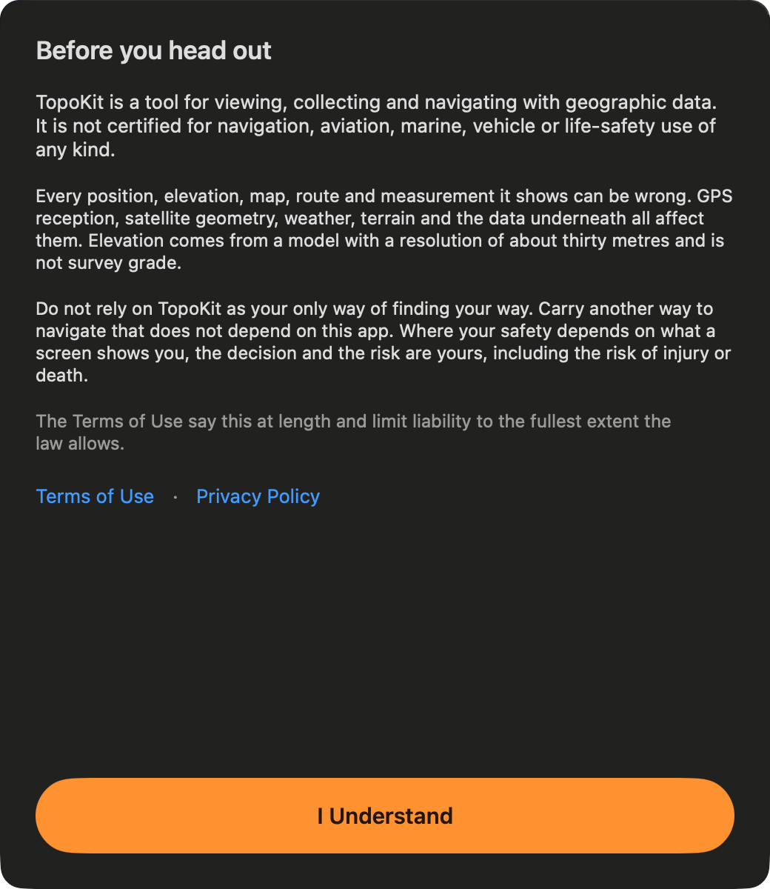

To create and edit in TopoKit, unlock the full app with **Monthly**, which includes a free first month, or **Unlock Forever**. You can download TopoKit without purchasing either plan.

## What you can do without unlocking

Without unlocking, you can open, view and export all your work, and open any project, including a `.mapproject` file someone sends you. You can show, hide, move, copy and delete layers, rename a folder, and use search and the card that opens when you tap or hold.

You can also share your work, use Settings and sync with iCloud. :ios[On iPhone, you can view the GPS tab's readouts.]

Nothing is dimmed or marked with a badge, and choosing a control that needs the full app opens the **Unlock TopoKit** sheet in place of its tool. When you open an editor that needs the full app, it shows the sheet's content in place of its own.

## What asks you to unlock

TopoKit asks you to unlock when you do any of the following:

- Create a project from the Projects tab or, on Mac, choose **File → New Project…**.
- Start :ui[Add Point]{icon=add-point}, :ui[Add Line]{icon=add-line}, :ui[Add Polygon]{icon=add-polygon} or :ui[Add Circle]{icon=add-circle} by any method, or choose **Add Point** or **Save** on a card.
- Choose **Edit Vertices on Map**, open a feature's, raster's, tile layer's or basemap's editor, or open a folder's style sheets.
- Start a route with :ui[Add Route], **Route here** on a card (**Route to Here** on Mac and in :ui[Layer options]{icon=ellipsis}), or any other method.
- Add a file with **Add Vector Layer…** or **Add Raster Layer…**, which ask you to unlock after you pick the file.
- Open a file in TopoKit from another app. :mac[On Mac, you're also asked to unlock when you drag a file in.]
- Choose **Add Tile Layer…**, **Download Map Tiles…** or **Download for This Device**.
- Choose **Download Elevation…**, download terrain from a card, or choose **Elevation Profile**.
- Pick an area in **Basemaps** or choose **Build on This Device**.
- Choose **Record Track** on the GPS tab on iPhone.

The profile shown while you draw a line or a route does not ask you to unlock again, because the tool asked when it started.

## The Unlock TopoKit sheet

Under its title, the sheet names the action that requires the full app, with a line such as "Routes are part of the full app."

:mac[On Mac, you can open the sheet at any time by choosing **Unlock TopoKit…** from the [**TopoKit** menu](/manual/interface/#the-menu-bar). During the free month or while you have Monthly, the sheet offers only **Unlock Forever**.]

## Monthly and Forever

Both plans unlock TopoKit on every iPhone and Mac signed into the same Apple Account. With **Unlock Forever**, you pay once; with **Monthly**, you get the first month free when the App Store confirms that your account is still eligible. The plan cards show the App Store's prices in your account's currency, and you can also find the prices on [the TopoKit website](/).

To cancel Monthly or the free month, choose **Manage Subscription** on the [Your TopoKit page](#the-your-topokit-page) to open Apple's subscription settings.

During the free month or while you have Monthly, the page offers only **Unlock Forever**. Buying it does not cancel Monthly, so if Monthly is still set to renew, TopoKit shows the renewal date immediately after the purchase and provides **Manage Subscription** so you can cancel it.

## If you already own TopoKit

If you bought TopoKit when it was a paid download, or get it before 1 January, you own all of it on every iPhone and Mac signed into that Apple Account without buying or restoring anything. TopoKit confirms this using the App Store's record of when your Apple Account first got the app.

## The Your TopoKit page

To check what you own, open **Settings → Your TopoKit**, the first row in Settings. Your current state appears below the row's name, and the page shows the plan cards unless you own TopoKit outright. During the free month or while you have Monthly, the page also includes **Manage Subscription**. For help with a purchase, choose **Purchase Help** to open TopoKit's support page.

:mac[On Mac, you'll find **Your TopoKit**, **Restore Purchases** and **Redeem Code** at the top of the [Settings window's **About** tab](/manual/settings/#the-mac-settings-window), rather than in a Your TopoKit tab.]

| The row reads | What it means |
|---|---|
| Checking… | Everything is unlocked while TopoKit waits for an answer from the App Store, because it hasn't received an answer yet and has none saved. |
| Free trial · Ends *date* | You are in your free month, and in its last three days the row counts down to "Ends today". Monthly starts after the free month unless you cancelled. |
| Monthly · Ends *date* | TopoKit stays unlocked until the date shown, and Monthly renewal is turned off. |
| Monthly · Payment problem | Apple is retrying the payment because it could not take it, and TopoKit stays unlocked until the date shown on the page. |

## Restore Purchases and Redeem Code

TopoKit checks what you own with the App Store each time you open it or return to it, so purchases made on another device appear without using either control.

- Choose **Restore Purchases** to sync your Apple Account's purchases with the App Store, which may ask you to sign in.
- Choose **Redeem Code** to open Apple's code sheet; TopoKit checks what you own again when the sheet closes.

:mac[On Mac, **Restore Purchases** is also in the **TopoKit** menu.]

## Reminders and payment problems

In the last three days of the free month, a banner reads "Free period ends *date*." Choose **Unlock Forever** in the banner to open the sheet, which offers only Forever.

When Apple cannot take a Monthly payment, the banner reads "Payment problem." Choose **Update in Settings** to open Apple's subscription settings, which you can also open with **Manage Subscription**.

TopoKit stays unlocked through Apple's grace period, but locks if Apple still hasn't received payment when that period ends. The sheet's first button then becomes **Manage Subscription**, and TopoKit unlocks again as soon as the payment goes through.

If you close the banner, it stays hidden until you next open TopoKit.

## Without a connection

TopoKit saves the App Store's last answer and starts from it each time you open the app, so it opens in the right state even without a signal. Losing your connection never locks TopoKit.

When a renewal date passes while you're offline, the row continues to read "Monthly · Renews *date*" for three days, then changes to "Monthly · Checking renewal". The page then asks you to connect once to confirm your subscription.

When TopoKit can't reach the App Store, the sheet and the page replace the plans with "Prices aren't available. TopoKit can't reach the App Store right now." and **Try Again**. You can find out what else works without a connection in [Before you go offline](/manual/offline/).

## When a plan ends

When a plan ends, work already in progress finishes and saves, because TopoKit checks only when an action starts or an editor opens. This applies to a track recording, an open editor, a shape you've already begun, an import that's already reading, and a basemap build, including the areas queued after it. TopoKit never checks while that work is running, but the next action that needs the full app opens the sheet with the reason the plan ended in place of the usual action message.

## Purchases that wait

With Ask to Buy, TopoKit unlocks as soon as the purchase is approved, even if you've closed the sheet. While you wait, the row reads "Not unlocked · Waiting for approval", and every action that needs the full app shows that message with **OK**. TopoKit keeps waiting if the request is declined, because it never receives notice of a declined request. To end the wait and see the plans again, choose **Restore Purchases**.

## The safety notice

The **Before you head out** notice explains that TopoKit is not certified for navigation or life-safety use and that anything it shows can be wrong. It also says that its elevation is not survey grade and that you should carry another way to navigate.

::::platforms
:::ios

:::

:::mac

:::
::::

The notice appears once on each device, after the introduction if you're new to TopoKit, or on the first launch of 1.2 if you finished the introduction in an earlier version. To close it, you must choose **I Understand**. Using [**Replay Introduction**](/manual/getting-started/#the-first-launch) does not show the notice again, and a later version of TopoKit shows it again only if the notice's words change.

## FAQ

**Can I cancel the free month without paying?**
Cancel with **Manage Subscription** at least 24 hours before the free month ends, and Monthly never starts.

**The sheet says "Purchases are turned off on this device." Why?**
Parental controls or whoever manages the device has blocked in-app purchases, so TopoKit shows no plans until those restrictions change.
